# 数学：人工智能所需的数学基础

<!-- PDF 第 1 页 -->

# 人工智能

跟开发 APP 和后台服务器相比，人工智能需要大量的数学知识

## 需要哪些数学知识？？？

- 微积分

- 线性代数

- 概率论

- 最优化

关于书籍，特别说明一下，除非你是数学知识遗忘的特别厉害了，或者是本科的时候没有学过相关数学知识，否则不建议大家抱着书去学习，会浪费大家大量的精力和时间

## 微积分

- 导数与求导公式

- 一阶导数与函数的单调性

- 一元函数极值判定法则

- 高阶导数

- 二阶导数与函数的凹凸性

- 一元导数泰勒展开


先说微积分/高等数学。在机器学习中，微积分主要用到了微分部分，作用是求函数

<!-- PDF 第 2 页 -->

的极值，就是很多机器学习库中的求解器（solver）所实现的功能。在机器学习里会用到微积分中的以下知识点：

- 导数和偏导数的定义与计算方法

- 梯度向量的定义

- 极值定理，可导函数在极值点处导数或梯度必须为0

- 雅克比矩阵，这是向量到向量映射函数的偏导数构成的矩阵，在求导推导中会用到

- Hessian 矩阵，这是2 阶导数对多元函数的推广，与函数的极值有密切的联系

- 凸函数的定义与判断方法

- 泰勒展开公式

- 拉格朗日乘数法，用于求解带等式约束的极值问题

其中最核心的是记住多元函数的泰勒展开公式，根据它我们可以推导出机器学习中常用的梯度下降法，牛顿法，拟牛顿法等一系列最优化方法，泰勒公式：

微积分和线性代数，微积分中会用到大量线性代数的知识，线性代数中也会用到微积分的知识

## 线性代数

- 向量及其运算
- 矩阵及其运算
- 张量
- 行列式
- 二次型
- 特征值与特征向量

```
张量就是 TensorFlow 里的 Tensor，是谷歌这个框架里的基础概念。向量是一维张量，矩阵是二维张量，张量本身还可以是更高维的；把一组数横向摆放就是行向量，纵向摆放就是列向量，多个向量组合到一起，就能形成矩阵。
```

<!-- PDF 第 3 页 -->


相比之下，线性代数用的更多。在机器学习的几乎所有地方都有使用，具体用到的知识点有：

- 向量和它的各种运算，包括加法，减法，数乘，转置(transpose)，内积( Inner Product 点积： Dot Product  一般我们会调用.dot()函数)
- 向量和矩阵的范数，L1 范数和L2 范数
- 矩阵和它的各种运算，包括加法，减法，乘法，数乘
- 逆矩阵的定义与性质
- 行列式的定义与计算方法
- 二次型的定义
- 矩阵的正定性
- 矩阵的特征值与特征向量
- 矩阵的奇异值分解
- 线性方程组的数值解法，尤其是共轭梯度法

机器学习算法处理的数据一般都是向量、矩阵或者张量。经典的机器学习算法输入的数据都是特征向量，深度学习算法在处理图像时输入的2 维的矩阵或者3 维的张量。掌握这些知识会使你游刃有余。

- 多元函数微分学

- 高阶偏导数

- 雅克比矩阵

- Hessian 矩阵

- 多元函数泰勒展开

- 多元函数极值判定法则

<!-- PDF 第 4 页 -->

### 回到线性代数

- 奇异值分解SVD

- 常用的矩阵和向量求导公式

## 概率论

- 随机事件与概率
- 条件概率和贝叶斯公式
- 随机变量
- 随机变量的期望和方差
- 常用概率分布（正太分布、均匀分布、伯努利二项分布）
- 随机向量（联合概率密度函数等）
- 协方差与协方差矩阵
- 最大似然估计


如果把机器学习所处理的样本数据看作随机变量/向量，我们就可以用概率论的观点对问题进行建模，这代表了机器学习中很大一类方法。在机器学习里用到的概率论知识点有:

- 随机事件的概念，概率的定义与计算方法

- 随机变量与概率分布，尤其是连续型随机变量的概率密度函数和分布函数

- 条件概率与贝叶斯公式

- 常用的概率分布，包括正态分布，伯努利二项分布，均匀分布

- 随机变量的均值与方差，协方差

<!-- PDF 第 5 页 -->

- 随机变量的独立性

- 最大似然估计

## 最优化

最后要说的是最优化，因为几乎所有机器学习算法归根到底都是在求解最优化问题。

求解最优化问题的指导思想是在极值点出函数的导数/梯度必须为0。因此你必须理解梯度下降法，牛顿法这两种常用的算法，它们的迭代公式都可以从泰勒展开公式中得到。如果能知道坐标下降法、拟牛顿法就更好了。

凸优化是机器学习中经常会提及的一个概念，这是一类特殊的优化问题，它的优化变量的可行域是凸集，目标函数是凸函数。凸优化最好的性质是它的所有局部最优解就是全局最优解，因此求解时不会陷入局部最优解。如果一个问题被证明为是凸优化问题，基本上已经宣告此问题得到了解决。在机器学习中，线性回归、岭回归、支持向量机、logistic 回归等很多算法求解的都是凸优化问题。

拉格朗日对偶为带等式和不等式约束条件的优化问题构造拉格朗日函数，将其变为原问题，这两个问题是等价的。通过这一步变换，将带约束条件的问题转换成不带约束条件的问题。通过变换原始优化变量和拉格朗日乘子的优化次序，进一步将原问题转换为对偶问题，如果满足某种条件，原问题和对偶问题是等价的。这种方法的意义在于可以将一个不易于求解的问题转换成更容易求解的问题。在支持向量机中有拉格朗日对偶的应用。

KKT 条件是拉格朗日乘数法对带不等式约束问题的推广，它给出了带等式和不等式约束的优化问题在极值点处所必须满足的条件。在支持向量机中也有它的应用。如果你没有学过最优化方法这门课也不用担心，这些方法根据微积分和线性代数的基础知识可以很容易推导出来。如果需要系统的学习这方面的知识，可以阅读《凸优化》，《非线性规划》两本经典教材。

| 算法或理论 | 用到的数学知识点 |
|---|---|
| 贝叶斯分类器 | 随机变量、贝叶斯公式、随机变量独立性、正态分布、最大似然估计 |
| 决策树 | 概率、熵、Gini 系数 |
| KNN 算法 | 距离函数 |

<!-- PDF 第 7 页 -->

| 算法或理论 | 用到的数学知识点 |
|---|---|
| 主成分分析 | 协方差矩阵、散布矩阵、拉格朗日乘数法、特征值与特征向量 |
| 流形学习 | 流形、最优化、测地线、测地距离、图、特征值与特征向量 |
| 线性判别分析 | 散度矩阵、逆矩阵、拉格朗日乘数法、特征值与特征向量 |
| 支持向量机 | 点到平面的距离、Slater 条件、强对偶、拉格朗日对偶、KKT 条件、凸优化、核函数、Mercer 条件 |
| Logistic | 概率、随机变量、最大似然估计、梯度下降法、凸优化、牛顿法 |
| 随机森林 | 抽样、方差 |
| AdaBoost 算法 | 概率、随机变量、最大似然估计、梯度下降法、凸优化、牛顿法 |
| 隐马尔可夫模型 | 概率、离散型随机变量、条件概率、随机变量独立性、拉格朗日乘数法、最大似然估计 |
| 条件随机场 | 条件概率、数学期望、最大似然估计 |
| 高斯混合模型 | 正态分布、最大似然估计、Jensen 不等式 |
| 人工神经网络 | 梯度下降法、链式法则 |
| 卷积神经网络 | 梯度下降法、链式法则 |
| 循环神经网络 | 梯度下降法、链式法则 |
| 生成对抗网络 | 梯度下降法、链式法则、极值定理、Kullback–Leibler 散度、Jensen–Shannon 散度、测地距离、条件分布、互信息 |
| K-means 算法 | 距离函数 |
| 贝叶斯网络 | 条件概率、贝叶斯公式、图 |
| VC 维 | Hoeffding 不等式 |

出现频率最高的是优化方法，拉格朗日乘数法，梯度下降法，牛顿法，凸优化

第二类概率论知识，随机变量，贝叶斯公式，随机变量独立性，正太分布，最大似然估计

第三类线性代数知识，几乎所有都会涉及到向量、矩阵、张量的计算，包括特征值和特征向量，很多算法都会最终变成求解特征值和特征向量问题。

微积分的知识比如链式法则。

支持向量机会用到Mercer 条件、核函数，涉及到泛函分析和识别函数的范畴。

再比如说人工神经网络的证明，万能逼近定理会用到泛函分析和识别函数的内容，用来证明这样一个函数可以来逼近任何形式的函数。

离散数学的知识比如图论、树在机器学习里面也会用到，但是用的都是比较简单的。

所以说我们只有掌握好微积分、线性代数、概率论还有一些优化的算法，我们就能看懂所有的机器学习算法了。像刚才说的一些相对高深的微分几何、泛函分析和识别函数，它们主要用在一些基础理论证明上面，说白了就是证明一些算法的合理性，你即使看不懂这些证明，它也不影响你理解这些算法的推导、思想和使用。

## 微积分

### 导数的定义

$$
f'(x_0)=\lim_{\Delta x\to 0}\frac{f(x_0+\Delta x)-f(x_0)}{\Delta x}
$$

导数：这是微积分里面最核心的概念，当函数的自变量Δx 趋近于0 的时候，如果存在式子里面的值，那么函数可导

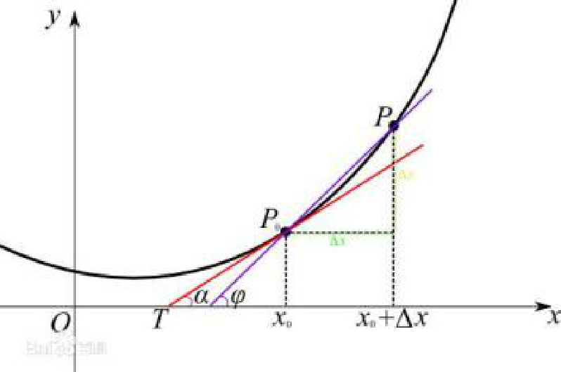

极限limit 认为是高等数学和初等数学的分界线

### 左导数与右导数、可导函数

趋近于0 有两个方向，从左边趋向于0 是左导数，反之是右导数下面的绝对值函数的左导数和右导数不相同，一个-1 一个+1，0 位置不可导

$$
f(x)=|x|
$$

<!-- PDF 第 9 页 -->

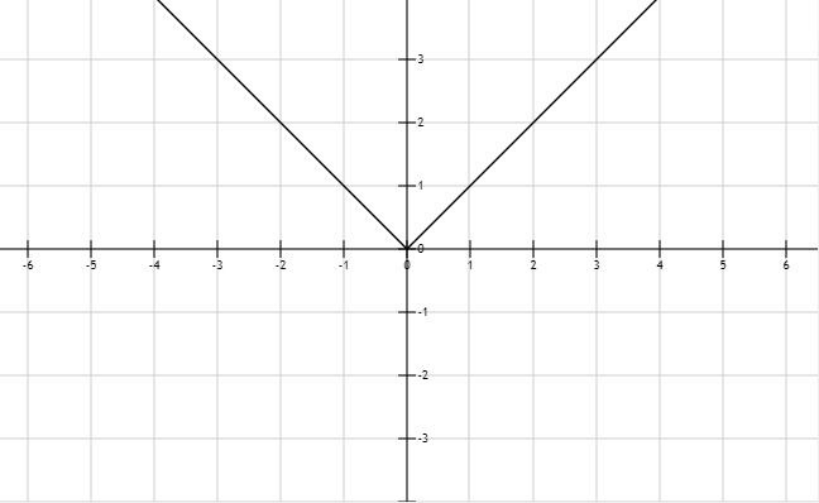

### Relu 函数

```
神经网络中一种经典的激活函数（Activation Function）
```


$$
\max(0,x)
$$

$$
f(x)=\begin{cases}x,&x\ge 0,\\0,&x<0.\end{cases}
$$

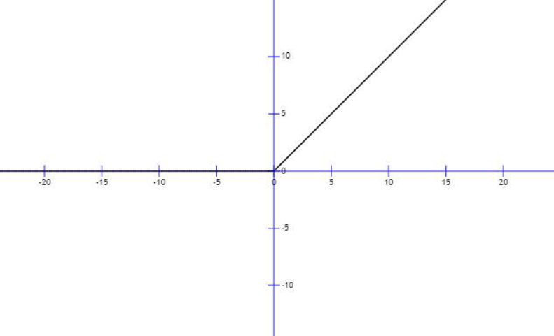


### 求导公式

- 1.基本函数

- 2.四则运算

- 3.复合函数

- 根据三种公式组合就可以求出任何公式的导数值

### 基本函数

幂函数

$$
\left(x^a\right)'=ax^{a-1}
$$

指数函数

以a 为底的指数函数

对数函数（以科学计数e为底的对数函数一般都可以简写成lnx 或者 logx ）
$$
\begin{aligned}(e^x)'&=e^x,\\(a^x)'&=a^x\ln a,\\(\ln x)'&=\frac1x.\end{aligned}
$$

以任意为底的对数函数

$$
\left(\log_a x\right)'=\left(\frac{\ln x}{\ln a}\right)'=\frac{1}{x\ln a}
$$

导数的公式都可以根据下面的式子推导出来

<!-- PDF 第 11 页 -->

定义

$$
\begin{aligned}\lim_{n\to+\infty}\left(1+\frac1n\right)^n&=e,\\\lim_{x\to0}\frac{\sin x}{x}&=1.\end{aligned}
$$

三角函数的导数不要管，我们很少会用到它，而且三角函数很讨厌，是周期性函数，而我们的机器学习中很多时候要求是单调的函数，单调增也好，单调减也好，最好不要周期性函数

### 四则运算法则

导数加减乘除

$$
\begin{aligned}(f(x)+g(x))'&=f'(x)+g'(x),\\(f(x)g(x))'&=f'(x)g(x)+f(x)g'(x),\\\left(\frac{f(x)}{g(x)}\right)'&=\frac{f'(x)g(x)-f(x)g'(x)}{g^2(x)}.\end{aligned}
$$

### 复合函数求导法则

$$
\bigl(f(g(x))\bigr)'=f'(g(x))g'(x)
$$

>重点：看到了这个式子又想起来了之前学习的 f`(-x)是啥意思？
>
>这个东西我们应该和[f(-x)]`​联系起来。前者是是先求导后带入，类似
>$$
>\left.f'(t)\right|_{t=-x}  
>$$
>导函数和函数一样也是一套规则，即针对特定的输入有特定的输出，这里就是以-x作为输入
>
>后者则是复合函数求导，即函数整体相对于x的变化率：
>$$
>\left[f(-x)\right]'=\frac{\mathrm{d}f(-x)}{\mathrm{d}x}=f'(-x)(-1)
>$$
>
>>小例子：
>>$$
>>已知：y=f(x)=e^x 求f'(\theta x) ，其中\theta是常数
>>$$
>>
>>解：
>>$$
>>f'(\theta x)=\left.e^x\right|_{x=\theta x}=e^{\theta x}
>>$$

### 导数的用途

1. 求极值，往往设导数为0，这里函数的导函数形式肯定得求（说白了：求函数极值时，我们往往先找出导函数等于零的点，再进一步判断这些点是否为极值点，并求出相应的极值。）

2. 神经网络里面激活函数会用到，其实还是求导数为0 的情况，只不过是复合函数形式

### 例子

$$
f(x)=\log\left(1+x^2+e^{2x}\right)
$$


$$
\begin{aligned}
f'(x)
&=\frac{1}{1+x^2+e^{2x}}\cdot\left(1+x^2+e^{2x}\right)'\\
&=\frac{0+2x+e^{2x}\cdot(2x)'}{1+x^2+e^{2x}}\\
&=\frac{2x+2e^{2x}}{1+x^2+e^{2x}}\\
&=\frac{2\left(x+e^{2x}\right)}{1+x^2+e^{2x}}
\end{aligned}
$$
Sigmoid 激活函数为：

$$
\sigma(x)=\frac{1}{1+e^{-x}}
$$

求导过程如下：

$$
\begin{aligned}
\sigma'(x)
&=\left(\frac{1}{1+e^{-x}}\right)'\\
&=-\frac{1}{(1+e^{-x})^2}\cdot(-e^{-x})\\
&=\frac{e^{-x}}{(1+e^{-x})^2}\\
&=\frac{1+e^{-x}-1}{(1+e^{-x})^2}\\
&=\frac{1+e^{-x}}{(1+e^{-x})^2}-\frac{1}{(1+e^{-x})^2}\\
&=\frac{1}{1+e^{-x}}-\left(\frac{1}{1+e^{-x}}\right)^2\\
&=\sigma(x)-\sigma^2(x)\\
&=\sigma(x)[1-\sigma(x)]
\end{aligned}
$$
tanh 称为双曲正切函数，也是一种激活函数，常用于 RNN（循环神经网络）。它的求导结果也很有意思：导数等于 1 减去原函数的平方。

$$
f(x)=\tanh x=\frac{e^x-e^{-x}}{e^x+e^{-x}}
$$

求导过程如下：

$$
\begin{aligned}
f'(x)
&=\left[(e^x-e^{-x})\cdot\frac{1}{e^x+e^{-x}}\right]'\\
&=(e^x-e^{-x})'\cdot\frac{1}{e^x+e^{-x}}
+(e^x-e^{-x})\cdot\left(\frac{1}{e^x+e^{-x}}\right)'\\
&=\frac{e^x+e^{-x}}{e^x+e^{-x}}
+(e^x-e^{-x})\cdot\left[-\frac{1}{(e^x+e^{-x})^2}\right]\cdot(e^x+e^{-x})'\\
&=1-\frac{e^x-e^{-x}}{(e^x+e^{-x})^2}\cdot(e^x-e^{-x})\\
&=1-\frac{(e^x-e^{-x})^2}{(e^x+e^{-x})^2}\\
&=1-\left(\frac{e^x-e^{-x}}{e^x+e^{-x}}\right)^2\\
&=1-[f(x)]^2\\
&=1-\tanh^2 x
\end{aligned}
$$


### 高阶导数

前面学的是一阶导数，对导数再次求导就是高阶导数，二阶和二阶以上的导数统称为高

阶导数。

$$
f'(x),\quad (f'(x))',\quad (5x^4)'=20x^3,\quad (5x^4)''=(20x^3)'=60x^2,\quad f^{(n)}(x)
$$

### 导数与函数单调性的关系

$$
f'(x)>0\Rightarrow f\text{ 单调递增},\qquad f'(x)<0\Rightarrow f\text{ 单调递减}
$$

函数的导数大于0，函数是单调增的。函数的导数小于0，函数是单调减的。

$$
f'(x)=2x
$$

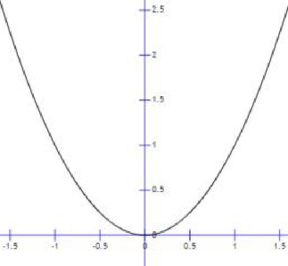

上图函数的导数是2X，那么就是x<0 的时候函数单调减，x>0 的时候函数单调增。

### 极值定理

导数为我们寻找极值提供依据，对于可导函数而言，因为在极值位置必然有函数的导数等于0。

$$
f'(x)=0
$$

极值处函数的导数等于0，这是必要条件，但不是充分条件，因为极值处的导数必然等于0，但是导数等于0 处不代表一定是极值。比如X 的三次方：

<!-- PDF 第 13 页 -->

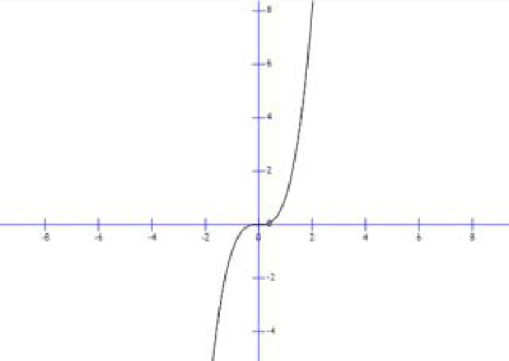

### 导数与函数凹凸性的关系

>这里采用机器学习和凸优化中的定义：
>
>| 函数   | 图像形状         | 名称              | 二阶导数      |
>| ------ | ---------------- | ----------------- | ------------- |
>| $x^2$  | $\cup$，开口向上 | 凸函数（convex）  | $f''(x)=2>0$  |
>| $-x^2$ | $\cap$，开口向下 | 凹函数（concave） | $f''(x)=-2<0$ |
>
>**凸函数的判断标准：图像上任意两点之间的线段，都位于对应曲线的上方或与其重合。**
>
>“向下凸”这个说法容易造成误解，直接记住凸函数的典型形状是 $\cup$ 即可。部分高数教材对“凹、凸”的中文叫法恰好相反，要以当前采用的定义为准。

函数的二阶导数是和函数的凹凸性是有关系的，凹凸性怎么定义的？先来做简单的回顾，更多的会在最优化方法里面给大家讲，这里先记住凸函数是向下凸的，反之就是凹函数，是否是凸函数可以通过二阶导数，如果二阶导数是大于0 就是凸函数，

$$
f''(x)>0
$$

拿X 的平方举例子，它的二阶导数是2，大于0 所以是凸函数。

$$
f'(x)=0
$$

称之为驻点，驻点是函数增减性的交替点，一侧增一侧减或一侧减一侧增

$$
f''(x)=0
$$

称之为拐点，拐点是凹凸性的，一侧凹一侧凸或一侧凸一侧凹拿X 的三次方举例子，一阶导是3X 的平方，二阶导是6X，这样当X 小于0 就是凹函数，X 大于0 就是凸函数。

### 一元函数泰勒展开

$$
\begin{aligned}f(x)&=\frac{f(x_0)}{0!}+\frac{f'(x_0)}{1!}(x-x_0)+\frac{f''(x_0)}{2!}(x-x_0)^2+\cdots\\&\quad+\frac{f^{(n)}(x_0)}{n!}(x-x_0)^n+R_n(x).\end{aligned}
$$

$$
f(x)=f(x_k)+(x-x_k)f'(x_k)+\frac12(x-x_k)^2f''(x_k)+o^n
$$

我们通过讲一元函数泰勒展开，把前面讲的导数给串起来，关于多元函数泰勒展开咱们

后面讲。

泰勒展开是通过多项式函数来近似一个可导函数f(x)，在x=x0 处进行泰勒展开，如果

函数f(x)是n 阶可导的。常数项+一阶项+二阶项一直加到n 的阶乘 分之一乘以n 阶导数。

泰勒展开在以前我们学高等数学的时候是非常有用的，它可以用来研究函数某些性质完成很多任务，在机器学习里面，它用来求函数的极值用的，很多时候函数f(x)可能会非常复杂，我们去用泰勒展开做一个近似，梯度下降法怎么做的呢？是做一个近似，只保留泰勒展开一阶项，还有牛顿法，牛顿法是保留泰勒展开二阶项，忽略二阶以上的项，用二次函数来进行函数f(x)的近似和求解。

>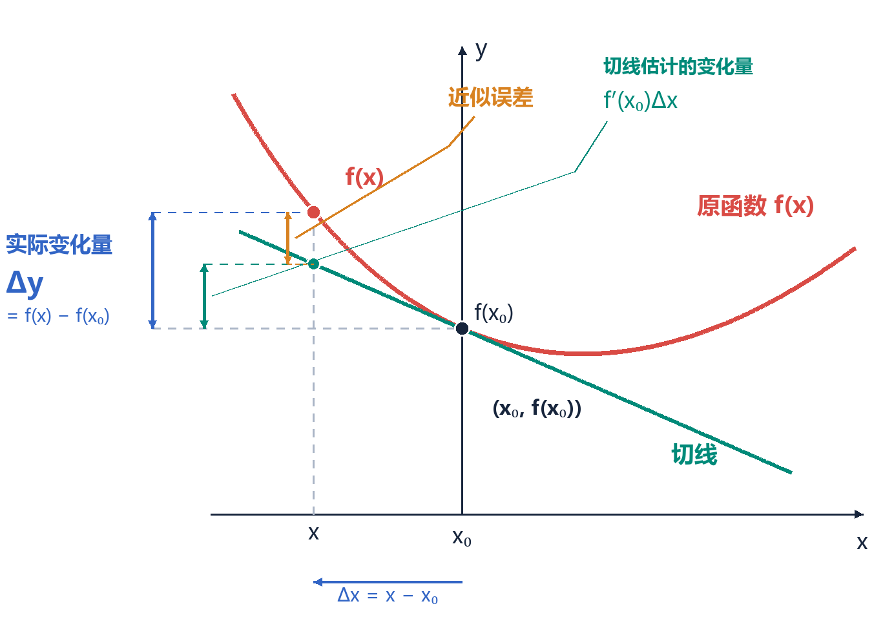
>
>老师这里是从**“利用 $x_0$ 处的信息，估算附近某点 $x$ 处的函数值”**这个角度理解泰勒展开的。
>
>令 $\Delta x=x-x_0$，函数值的实际变化量为：
>
>$$
>\Delta y=f(x)-f(x_0)
>$$
>
>如果用原函数在 $x_0$ 处的切线来近似这一小段曲线，就可以用“斜率乘以横向变化量”估算函数值的变化：
>
>$$
>\Delta y\approx f'(x_0)\Delta x
>$$
>
>因此，图中圈出、框出的部分可以理解为：
>
>$$
>\underbrace{f(x)}_{\text{要估算的函数值}}
>\approx
>\underbrace{f(x_0)}_{\text{起点处的函数值}}
>+
>\underbrace{f'(x_0)(x-x_0)}_{\text{用切线估算的变化量}}
>$$
>
>这里用一条直线来近似曲线，所以通常要求 $|\Delta x|$ 足够小。离 $x_0$ 较远时，切线就可能明显偏离原曲线，近似效果也会变差。在适当的光滑条件下，继续加入二阶项、三阶项，直到 $n$ 阶项，可以进一步修正局部近似。
>
>**我之前的理解是从“构造多项式”出发的：**找一个多项式，让它在 $x_0$ 处的函数值、一阶导数、二阶导数，直到 $n$ 阶导数，都分别与原函数相等，从而近似模拟原函数在 $x_0$ 附近的变化。需要注意，这些相等关系发生在 $x_0$ 这个点；在附近其他位置，多项式与原函数通常仍然只是近似相等。
>
>这两个角度是相通的：**老师强调从起点值出发，通过估算变化量得到附近的函数值；我之前的理解强调通过匹配各阶导数，让多项式与原函数的局部形状尽量一致。**
>
>保留到 $n$ 阶，就是最高保留到 $(x-x_0)^n$ 项。具体保留到几阶，要结合所需精度来选择

## 线性代数

### 向量与其运算

向量是线性代数里面最基本的概念，它其实就是一维数组，由N 个数构成的，

$$
X=(X_1, X_2,\ldots,X_n)
$$

向量的几何意义就是空间中的点，

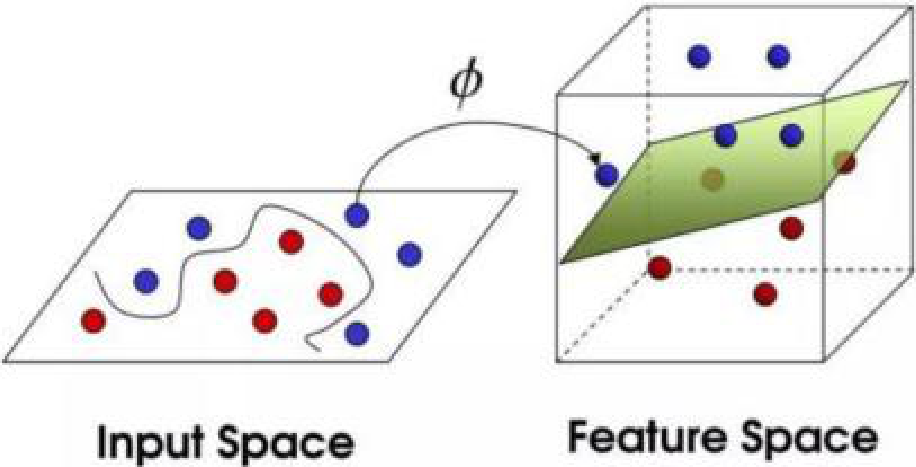

物理意义可以表示速度或者力这样的矢量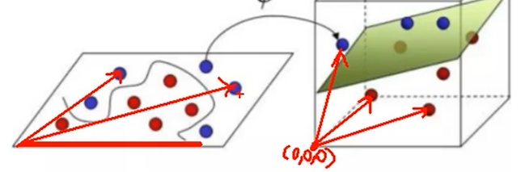


向量的分量我们称之为维度，n 维向量集合的全体就构成了n 维欧式空间，Rn

```
向量在几何上可以理解为空间中的点。例如，可以用经度和纬度两个分量来表示一个点。但同一经纬度下，可能存在高度不同的位置，仅靠经度和纬度就无法区分它们。此时可以进行升维，增加“高度”这一维，用经度、纬度、高度三个分量构成一个三维向量来表示该点。这样就能区分原来在二维表示中重合的位置，更完整地描述这些点，也有助于机器学习中后续的聚类等操作。这就是升维的一种直观理解。
```

>假设有 $M$ 条数据，每条数据用一个向量表示，每个向量包含 $N$ 个分量，也就是用 $N$ 个特征来描述这条数据。把这些数据按行排列，就得到一个 $M\times N$ 的矩阵：$M$ 表示数据条数，$N$ 表示每条数据的特征数，也就是每个向量的维数。从几何角度看，向量可以表示空间中的点：两个分量对应二维空间中的点，三个分量对应三维空间中的点，$N$ 个分量就对应 $N$ 维空间中的点。这样就能从数据和几何两个角度理解“维度”。

### 行向量和列向量

行向量是按行把向量排开，列向量是按列把向量排开

$$
X=\begin{pmatrix}X_1\\X_2\\\vdots\\X_n\end{pmatrix},\qquad X^T=(X_1\ X_2\ \cdots\ X_n)
$$

在数学中我们更多的把数据写成列向量，在编程语言中更多的把数据存成行向量

<!-- PDF 第 15 页 -->

### 向量的运算加法，数乘，减法，内积，转置

光上面定义向量是没有用的，肯定还要定义向量的一些运算，它有加减乘除一些运算，下面我们一一列举：

### 向量X+Y

等于它 们的分量分别相加，显然两个向量的长度得是相等的，减法我们在这里不列举，很容易举一反三

$$
\begin{pmatrix}1\\2\\3\end{pmatrix}+\begin{pmatrix}4\\5\\6\end{pmatrix}=\begin{pmatrix}5\\7\\9\end{pmatrix}
$$

  


### 数乘运算

它是一个数和这个向量每个分量相乘

$$
2\begin{pmatrix}1\\2\\3\end{pmatrix}=\begin{pmatrix}2\\4\\6\end{pmatrix}
$$

应用：梯度下降中的参数更新：
$$
\boldsymbol{w}^{t+1}=\boldsymbol{w}^{t}-\alpha\boldsymbol{g}
$$

其中，$\boldsymbol{w}$ 是模型参数向量，$\boldsymbol{g}$ 是梯度向量，图中都用包含 $n$ 个分量的列向量表示；$\alpha$ 是学习率，是一个标量，取 $0.1$。$\alpha\boldsymbol{g}$ 就是把梯度向量的每个分量都乘以 $\alpha$，再与原参数向量逐分量相减，从而将参数从第 $t$ 次迭代更新到第 $t+1$ 次迭代。

### 转置

把列向量变成行向量，把行向量变成列向量

$$
\begin{pmatrix}1\\2\\3\end{pmatrix}^{T}=(1\ 2\ 3)
$$

$$
(1\ 2\ 3)^T=\begin{pmatrix}1\\2\\3\end{pmatrix}
$$

向量的转置和内积可以用于线性回归中的预测计算。将一个样本的 $n$ 个特征组成输入向量 $\boldsymbol x$，将对应的 $n$ 个权重组成参数向量 $\boldsymbol w$。当二者都是列向量时，将 $\boldsymbol w$ 转置后与 $\boldsymbol x$ 相乘，就得到各个特征的加权和：$\boldsymbol w^T\boldsymbol x=w_1x_1+w_2x_2+\cdots+w_nx_n$。这个结果就是预测值 $\hat y$。这里的输入和参数都是向量，而输出是一个数。

### 运算法则

$$
A+B+C=A+(B+C)
$$

$$
K(X+Y)=KX+KY
$$

### 向量的内积（又叫点乘）

两个列向量，$$
X^{T}Y
$$，等于对应位置相乘再相加

两个向量的内  积的本质是变成一个标量

$$
(1\ 2\ 3)\begin{pmatrix}1\\1\\2\end{pmatrix}=1\times1+2\times1+3\times2=9
$$

### 向量的范数

范数的公式是向量每个分量绝对值P 次方再用幂函数计算P 分之一，这里P 肯定是整数1，2，3...到正无穷都是可以的。向量的范数就是把向量变成一个标量，范数的表示就是两个竖线来表示，然后右下角写上P

$$
\|x\|_p=\left(\sum_{i=1}^{n}|x_i|^p\right)^{1/p}
$$

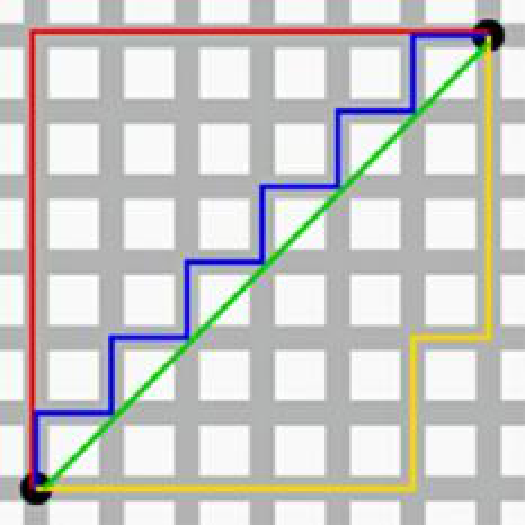

1 范数是绝对值加和，1 范数写成L1（1范数说白了就是P=1)【L1范数的几何意义：向量终点到原点的曼哈顿距离，就是图中红色线的长度。】
$$
\|x\|_1=\sum_{i=1}^{n}|x_i|
$$

2 范数是平方加和开根号，其实代表的是向量的长度，高中时候学的向量的模，2 范数写成L2【L2范数的几何意义：向量终点到原点的 曼哈顿距离，就是图中绿色线的长度】
$$
\|x\|_2=\sqrt{\sum_{i=1}^{n}x_i^2}
$$

范数在后面是非常有用的，在后面讲正则项的时候会用到

>L1 范数和 L2 范数在机器学习中常用于构造 **L1 正则项和 L2 正则项**。这里的 $\boldsymbol w$ 是模型需要学习的参数向量，其范数分别为：
>
>$$
>\|\boldsymbol w\|_1=\sum_{i=1}^{n}|w_i|
>$$
>
>$$
>\|\boldsymbol w\|_2=\sqrt{\sum_{i=1}^{n}w_i^2}
>$$
>
>其中，**L2 正则项通常使用 L2 范数的平方**，即 $\|\boldsymbol w\|_2^2=\sum_{i=1}^{n}w_i^2$。
>
>在拟合数据的同时，让参数向量 $\boldsymbol w$ 的 L1、L2 范数尽可能小，使它在高维空间中更接近零向量，从而有助于防止过拟合，提高模型的泛化能力和容错能力。

### 特殊的向量

- 0 向量

- 就是分量全为0 的向量

$$
(0\ 0\ \cdots\ 0)
$$

- 单位向量
- 就是L2 范数/模/长度为1 的向量

>**稀疏向量（Sparse Vector）**：大部分分量为零。存储时，通常记录向量的**总长度、非零元素的索引和对应的值**，其余位置默认为零，从而节省存储空间。
>
>**稠密向量（Dense Vector）**：大部分分量非零。存储时，按照顺序把所有分量一个一个保存下来，包括其中的零。
>
>**独热向量（One-hot Vector）**是只有一个分量为 $1$、其余分量都为 $0$ 的向量。它在机器学习中可以用来表示离散的类别，这种表示方式叫作**独热编码（One-hot Encoding）**。
>
>例如，按“晴天、雨天、阴天”的顺序，每个位置对应一种天气：
>
>- 晴天（Sunny）→ $(1,0,0)$
>- 雨天（Rainy）→ $(0,1,0)$
>- 阴天（Cloudy）→ $(0,0,1)$
>
>有几个类别，向量就有几个分量，当前类别对应的位置为 $1$。类别较多时，向量中绝大多数分量都是 $0$，因此独热向量也是一种**稀疏向量**。

### 矩阵与其运算

$$
A=\begin{bmatrix}a_{11}&\cdots&a_{1n}\\\vdots&\ddots&\vdots\\a_{m1}&\cdots&a_{mn}\end{bmatrix}
$$

矩阵就是二维数组，上面是一个m 乘n 的矩阵，它有m 行，n 列，每行每列上面都有一个元素，每个元素都有行标i 和列标j，aij

### 方阵，对称矩阵，单位矩阵，对角线

下面介绍几种特殊的矩阵，如果m 等于n，那就称为方阵

$$
\begin{pmatrix}1&0&0\\0&2&0\\0&0&3\end{pmatrix}
$$

对称矩阵定义是aij 等于aji 那么就是对称矩阵，同时肯定是个方阵


单位矩阵主对角线都是1，其它位置是0，这称之为单位阵，单位矩阵写为 I，一定是方阵，在矩阵运算中等同于数字里面的1 

$$
I_n=\begin{pmatrix}1&0&\cdots&0\\0&1&\cdots&0\\\vdots&\vdots&\ddots&\vdots\\0&0&\cdots&1\end{pmatrix}
$$

对角阵，就是主对角线非0，其它位置是0

$$
\Lambda=\begin{pmatrix}\lambda_1&0&\cdots&0\\0&\lambda_2&\cdots&0\\\vdots&\vdots&\ddots&\vdots\\0&0&\cdots&\lambda_n\end{pmatrix}
$$

<!-- PDF 第 18 页 -->

### 矩阵的运算加法，数乘，减法，转置

矩阵的加减矩阵的加法就是矩阵的对应位置相加，减法也是一样就是对应位置相减

以及矩阵的数乘也是很好理解
$$
\begin{aligned}\begin{pmatrix}1&2&3\\0&0&0\end{pmatrix}+\begin{pmatrix}4&5&6\\0&0&0\end{pmatrix}&=\begin{pmatrix}5&7&9\\0&0&0\end{pmatrix},\\5\begin{pmatrix}1&2&3\\0&0&0\end{pmatrix}&=\begin{pmatrix}5&10&15\\0&0&0\end{pmatrix}.\end{aligned}
$$


矩阵还有一种非常特殊的操作：转置

转置的操作和向量是一样的，就是把aij 变成aji，把行和列互换一下

$$
\begin{pmatrix}1&2&3\\4&5&6\end{pmatrix}^{T}=\begin{pmatrix}1&4\\2&5\\3&6\end{pmatrix}
$$

>## NumPy 的 reshape 与转置
>
>### 1. 先理解 shape 和轴
>
>`shape` 表示数组每个轴的长度，轴的编号从 `0` 开始。
>
>```python
>import numpy as np
>
>v = np.array([1, 2, 3])
>v.shape                  # (3,)，一维数组，有3个元素
>
>a = np.array([[0, 1, 2],
>              [3, 4, 5]])
>a.shape                  # (2, 3)，二维数组，2行3列
>```
>
>二维数组的轴 `0` 对应行，轴 `1` 对应列。**一维数组只有一个轴，没有区分行向量、列向量。**
>
>### 2. reshape 用于调整形状
>
>`reshape` 可以处理一维、二维及更高维数组，前后元素总数必须一致。
>
>调整成二维时，两个参数分别指定行数、列数。`-1` 表示根据元素总数自动计算这个位置的大小，每次最多使用一个 `-1`。
>
>```python
>v.reshape(1, -1)          # 1行，列数自动计算
># [[1, 2, 3]]
>
>v.reshape(-1, 1)          # 1列，行数自动计算
># [[1],
>#  [2],
>#  [3]]
>```
>
>这两种结果都是二维数组，形状分别为 `(1, 3)` 和 `(3, 1)`。
>
>### 3. 二维矩阵转置用 .T 或 transpose
>
>转置把行和列交换，原来位于 `[i, j]` 的元素，变到 `[j, i]` 的位置。
>
>```python
>a.T
># [[0, 3],
>#  [1, 4],
>#  [2, 5]]
>
>a.T.shape                # (3, 2)
>a.transpose(1, 0)        # 与 a.T 相同
>```
>
>`transpose(1, 0)` 中的数字是**原数组的轴编号**，表示把原来轴 `0、1` 的顺序调整成 `1、0`。
>
>`.T` 是属性，直接写 `a.T`。`transpose` 是方法，需要加括号。
>
>**矩阵转置用 `.T` 或 `transpose`。`reshape` 用于重新组织形状，元素的排列结果有区别。**
>
>```python
>a.reshape(3, 2)
># [[0, 1],
>#  [2, 3],
>#  [4, 5]]
>```
>
>这里默认按原数组逐行读取元素，再按新形状逐行填入。虽然结果也是3行2列，元素的位置与转置结果不同。
>
>### 4. 为什么一维数组的 .T 看起来没作用
>
>```python
>v.shape                  # (3,)
>v.T.shape                # (3,)
>```
>
>一维数组只有一个轴，转置后仍是同样的一维数组。想明确表示行向量或列向量，可以先用 `reshape` 变成二维。
>
>```python
>row = v.reshape(1, -1)   # 二维行向量，形状 (1, 3)
>column = row.T           # 转置成列向量，形状 (3, 1)
>
># 也可以直接得到列向量
>column = v.reshape(-1, 1)
>```
>
>### 5. 多维转置具体怎么转
>
>```python
>temp = np.arange(24).reshape(2, 3, 4)
>```
>
>`np.arange(24)` 生成0到23。这里的形状 `(2, 3, 4)` 可以理解为**2组，每组3行，每行4个元素**。
>
>| 原轴编号 | shape 中对应的值 | 在这个例子中的含义 |
>| -------- | ---------------- | ------------------ |
>| 0        | 2                | 组数               |
>| 1        | 3                | 每组的行数         |
>| 2        | 4                | 每行的列数         |
>
>现在执行：
>
>```python
>b = temp.transpose(1, 0, 2)
>```
>
>**原来的轴顺序是 `0、1、2`，现在按 `1、0、2` 重新排列。理解时分成下面两步。**
>
>#### 第一步，看 shape 怎么变
>
>按 `1、0、2` 的顺序，取出原 shape 中对应位置的值。
>
>```python
>temp.shape               # (2, 3, 4)
>b.shape                  # (3, 2, 4)
>```
>
>也就是把原来的组数和每组行数交换，列数保持原样。
>
>- 原来每组有3行 → 现在有3组。
>- 原来有2组 → 现在每组有2行。
>- 原来每行有4列 → 现在仍然有4列。
>
>#### 第二步，看每个元素的位置怎么变
>
>**每个元素的坐标也按照同样的轴顺序重新排列，原来的 `[i, j, k]` 变成 `[j, i, k]。`**
>
>| 原来的坐标 | 转置后的坐标 |
>| ---------- | ------------ |
>| 组号 `i`   | 行号 `i`     |
>| 行号 `j`   | 组号 `j`     |
>| 列号 `k`   | 列号 `k`     |
>
>例如，数字9原来在：
>
>```python
>temp[0, 2, 1]            # 第0组、第2行、第1列，值为9
>```
>
>转置后，组号和行号交换：
>
>```python
>b[2, 0, 1]               # 第2组、第0行、第1列，值仍为9
>```
>
>**所有元素都按这条规则重新安排位置，就得到整个转置结果。**
>
>从整行来看，就是把原来两组中“行号相同的那一行”放进同一个新组。
>
>```python
># 原来的 temp
># [[[ 0,  1,  2,  3],
>#   [ 4,  5,  6,  7],
>#   [ 8,  9, 10, 11]],
>#
>#  [[12, 13, 14, 15],
>#   [16, 17, 18, 19],
>#   [20, 21, 22, 23]]]
>
># 转置后的 b
># [[[ 0,  1,  2,  3],     # 原第0组的第0行
>#   [12, 13, 14, 15]],    # 原第1组的第0行
>#
>#  [[ 4,  5,  6,  7],     # 原第0组的第1行
>#   [16, 17, 18, 19]],    # 原第1组的第1行
>#
>#  [[ 8,  9, 10, 11],     # 原第0组的第2行
>#   [20, 21, 22, 23]]]    # 原第1组的第2行
>```
>
>### 6. .T 和自定义 transpose 的关系
>
>**`.T` 和不传参数的 `transpose()` 都会把所有轴的顺序反过来。** `transpose(...)` 则可以指定轴的排列顺序，每个轴编号都要出现一次。
>
>对于形状为 `(2, 3, 4)` 的 `temp`：
>
>| 写法                           | 新轴采用的原轴顺序 | 结果形状    | 原元素 `[i, j, k]` 的新位置 |
>| ------------------------------ | ------------------ | ----------- | --------------------------- |
>| `temp.transpose(1, 0, 2)`      | 1、0、2            | `(3, 2, 4)` | `[j, i, k]`                 |
>| `temp.transpose(0, 2, 1)`      | 0、2、1            | `(2, 4, 3)` | `[i, k, j]`                 |
>| `temp.T` 或 `temp.transpose()` | 2、1、0            | `(4, 3, 2)` | `[k, j, i]`                 |
>
>其中 `transpose(0, 2, 1)` 保持组号的位置，交换每组的行、列。
>
>**复习时记住，reshape 指定新形状，transpose 指定轴顺序。转置时，shape 中各轴的长度和每个元素的坐标都按指定顺序重新排列。**
>
>用 `b = a.T`、`b = a.reshape(...)` 等写法接住返回结果，方便继续使用。
>
>```
>这里说的“反过来”具体指把整个顺序倒着读：
>- 0、1 倒着读 → 1、0
>- 0、1、2 倒着读 → 2、1、0
>```


矩阵的乘法：矩阵的乘法和一般的乘法是不太一样的

它是把第一个矩阵的每一行，和第二个矩阵的每一列拿过来做内积得到结果

$$
\begin{pmatrix}1&2&3\\0&0&0\end{pmatrix}\begin{pmatrix}1&0\\1&0\\1&0\end{pmatrix}=\begin{pmatrix}6&0\\0&0\end{pmatrix},\quad (m\times n)(n\times k)=m\times k
$$

满足分配律，结合律，和交换律

$$
A+B+C=A+(B+C)
$$

加法肯定是满足，重点看乘法

首先乘法是满足结合律的
$$
(AB)C=A(BC)
$$

满足分配律的，这里是左分配律，和右分配律

$$
(A+B)C=AC+BC
$$

$$
A(B+C)=AB+AC
$$

特别强调的是矩阵是不满足交换律的，不一定相等，甚至AB 的尺寸和BA 的尺寸是不同的

$$
AB\ne BA
$$

还有一个特殊的转置的公式

$$
(AB)^T=B^T A^T
$$

<!-- PDF 第 19 页 -->

### 逆矩阵

矩阵有AB，但是没有A/B 这么一说，只有逆矩阵，逆矩阵怎么定义的？假设有个矩阵A，注意它一定是方阵，乘以矩阵B 等于 I（单位矩阵）

$$
AB=I
$$

或者

$$
BA=I
$$

I 为单位矩阵，那么我们称这里的B 为A 的右逆矩阵或者左逆矩阵。【说白了对于方阵我们才能求他的逆】

有个很重要的结论就是，如果这样的B 存在的话，它的左逆和右逆一定相等，统称为A 的-1

矩阵求逆有什么用呢？它可以帮助我们解线性方程组，。把方程组写成 $AZ=B$，其中 $A$ 是系数矩阵（这里是方阵），$Z$ 是未知量组成的向量，$B$ 是常数项组成的向量。

当 $A$ 可逆时，在等式两边同时**左乘** $A^{-1}$：

$$
A^{-1}AZ=A^{-1}B
$$

因为 $A^{-1}A=I$，而单位矩阵 $I$ 乘以 $Z$ 仍然是 $Z$，所以得到：

$$
Z=A^{-1}B
$$

这样就求出了方程组中的未知量。

面我们看一下公式：
$$
(AB)^{-1}=B^{-1}A^{-1}
$$

$$
(A^{-1})^{-1}=A
$$

$$
(A^T)^{-1}=(A^{-1})^T
$$

### 行列式

行列式其实在机器学习中用的并不多，一个矩阵必须是方阵，才能计算它的行列式。行列式是把矩阵变成一个标量

$$
\begin{vmatrix}
a_{11} & a_{12}\\
a_{21} & a_{22}
\end{vmatrix}
=a_{11}a_{22}-a_{12}a_{21}
$$

$$
\begin{aligned}
\begin{vmatrix}
a_{11} & a_{12} & a_{13}\\
a_{21} & a_{22} & a_{23}\\
a_{31} & a_{32} & a_{33}
\end{vmatrix}
&=a_{11}a_{22}a_{33}+a_{12}a_{23}a_{31}+a_{13}a_{21}a_{32}\\
&\quad-a_{13}a_{22}a_{31}-a_{12}a_{21}a_{33}-a_{11}a_{23}a_{32}
\end{aligned}
$$

前面讲的是行列式的计算方式，下面我们看下行列式的性质，当然这都是方阵而言的

$$
|AB|=|A||B|
$$

$$
|A^{-1}|=|A|^{-1}
$$

$$
|\alpha A|=\alpha^n|A|
$$

数乘α，相当于α的n 次方乘以A 的行列式，因为刚才我们看计算方式的时候，相当于每一列都乘上了α

$$
\begin{aligned}
|\alpha A|
&=
\begin{vmatrix}
\alpha a_{11} & \alpha a_{12} & \alpha a_{13}\\
\alpha a_{21} & \alpha a_{22} & \alpha a_{23}\\
\alpha a_{31} & \alpha a_{32} & \alpha a_{33}
\end{vmatrix}\\
&=(\alpha a_{11})(\alpha a_{22})(\alpha a_{33})
+(\alpha a_{12})(\alpha a_{23})(\alpha a_{31})
+(\alpha a_{13})(\alpha a_{21})(\alpha a_{32})\\
&\quad-(\alpha a_{13})(\alpha a_{22})(\alpha a_{31})
-(\alpha a_{12})(\alpha a_{21})(\alpha a_{33})
-(\alpha a_{11})(\alpha a_{23})(\alpha a_{32})\\
&=\alpha^3|A|
\end{aligned}
$$

这里是三阶方阵，每一项都含有三个 $\alpha$，所以可以提取出 $\alpha^3$。对于一般的 $n$ 阶方阵：

$$
|\alpha A|=\alpha^n|A|
$$

## 多元函数的微分学


### 偏导数

$$
\frac{\partial f}{\partial x_i}=\lim_{\Delta x_i\to0}\frac{f(x_1,\ldots,x_i+\Delta x_i,\ldots,x_n)-f(x_1,\ldots,x_i,\ldots,x_n)}{\Delta x_i}
$$

偏导数，可以看作是导数的推广，对于多元函数来说，我们把其它的自变量固定不动，看成是常量，我们对其中的某一个变量求导数的话，那就是偏导数了。

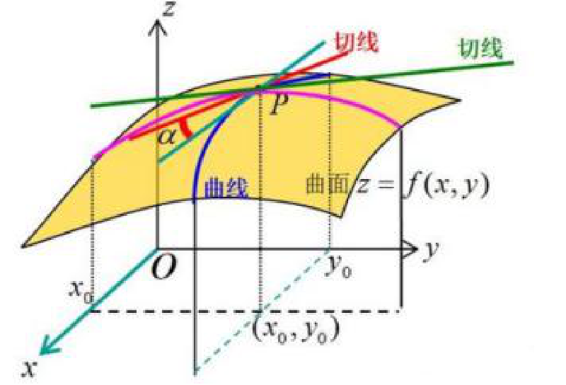

几何意义上面来说就是在某个方向上对原函数来切一下，再去求导，就是偏导数

$$
\begin{aligned}f(x,y)&=x^2+xy-y^2,\\\frac{\partial f}{\partial x}&=2x+y,\\\frac{\partial f}{\partial y}&=x-2y.\end{aligned}
$$

### 高阶偏导数

有高阶导数的话，同样我们有高阶偏导数，它的情况比高阶导数要复杂一些，因为它的求导变量有多个，比如说

$$
\frac{\partial^2 f}{\partial x\,\partial y}
$$

它对x,y 求高阶偏导数的话，就是先对x 求偏导，再对y 求偏导，其实跟一元函数的高阶导数是一样的，依次对每个变量反复求导呗，我们还是以上面的公式为例

$$
f(x,y)=x^2+xy-y^2
$$

对x 求偏导，然后再对x 求偏导就等于2 了

$$
\frac{\partial^2 f}{\partial x^2}=2,\quad\frac{\partial^2 f}{\partial x\partial y}=1,\quad\frac{\partial^2 f}{\partial y\partial x}=1,\quad\frac{\partial^2 f}{\partial y^2}=-2
$$

有个重要的结论，就是高阶导数和求导次序无关

$$
\frac{\partial^2 f}{\partial x\partial y}=\frac{\partial^2 f}{\partial y\partial x}
$$

### 梯度

机器学习中的梯度下降法，和牛顿法很多地方都会用到这个概念的

$$
\nabla f(x)=\left(\frac{\partial f}{\partial x_1},\frac{\partial f}{\partial x_2},\ldots,\frac{\partial f}{\partial x_n}\right)^T
$$

- 梯度可以看成是一元函数它的导数，对于多元函数的推广

- 对于多元函数如果它的自变量有N 个

$$
x_1\quad x_2\quad\cdots\quad x_n
$$

它的梯度是个向量，是由对X1 X2 等的偏导数构成的这样一个向量，称之为梯度梯度我们用倒三角这个符号来表示作用于f(x)得到这样一个向量，式子里面的T 表示往往我们把它转置一下，看成是列向量

### 雅可比矩阵

雅可比矩阵是由一阶偏导数构成的矩阵。它可以把多个偏导数统一组织起来，使多元复合函数的求导公式写得更加简洁，在人工神经网络的反向传播中经常会用到。

假设有一个函数，把 $n$ 维输入向量 $x$ 映射为 $k$ 维输出向量 $y$：

$$
y=f(x),\qquad x\in\mathbb{R}^{n},\quad y\in\mathbb{R}^{k}
$$

**可以把整个函数 $f$ 理解为由多个“小函数”组成，每个小函数负责计算一个输出分量。** 每个 $y_i$ 都可以是整个输入向量中各个分量的函数：
$$
\begin{cases}
y_1=f_1(x_1,\ldots,x_n)\\
y_2=f_2(x_1,\ldots,x_n)\\
\vdots\\
y_k=f_k(x_1,\ldots,x_n)
\end{cases}
$$

让每个 $y_i$ 分别对每个 $x_j$ 求偏导，再把这些偏导数排列起来，就得到雅可比矩阵。第一行是 $y_1$ 对 $x_1,\ldots,x_n$ 的偏导，第二行是 $y_2$ 对各个输入分量的偏导，依此类推：

$$
J_f(x)=
\begin{bmatrix}
\frac{\partial y_1}{\partial x_1}
&\frac{\partial y_1}{\partial x_2}
&\cdots
&\frac{\partial y_1}{\partial x_n}\\
\frac{\partial y_2}{\partial x_1}
&\frac{\partial y_2}{\partial x_2}
&\cdots
&\frac{\partial y_2}{\partial x_n}\\
\vdots&\vdots&\ddots&\vdots\\
\frac{\partial y_k}{\partial x_1}
&\frac{\partial y_k}{\partial x_2}
&\cdots
&\frac{\partial y_k}{\partial x_n}
\end{bmatrix}
$$

输入向量 $x$ 有 $n$ 个分量，输出向量 $y$ 有 $k$ 个分量，雅可比矩阵就是 $k\times n$ 的矩阵。如果某个输出不依赖某个输入，对应的偏导数就是 $0$。

例如：

$$
\begin{aligned}
y_1&=x_1^2+2x_1x_2+x_3,\\
y_2&=x_1-x_2^2+x_3^2,\\
x&=(x_1,x_2,x_3)^T.
\end{aligned}
$$

这里，三个输入分量 $x_1,x_2,x_3$ 经过两个小函数，得到两个输出分量 $y_1,y_2$，完成了从三维向量到二维向量的映射。

分别让 $y_1$、$y_2$ 对三个输入分量求偏导，就得到一个 $2\times3$ 的雅可比矩阵：

$$
J_f(x)=
\begin{bmatrix}
2x_1+2x_2&2x_1&1\\
1&-2x_2&2x_3
\end{bmatrix}
$$

第一行来自 $y_1$ 的三个偏导，第二行来自 $y_2$ 的三个偏导。矩阵中的每个元素，都描述了某个输入分量变化时，对应输出分量的局部变化率。

>**训练时，我们最终需要的是“损失函数对各个权重的偏导数” $\dfrac{\partial L}{\partial w_i}$。所有权重共同构成损失函数的自变量，把这些偏导数组成梯度，再沿负梯度方向调整所有权重。**
>
>讲义从“节点输出对输入求偏导”直接跳到“调整权重”，中间省略了损失函数和链式求导。下面沿着 **3 个输入节点 → 2 个中间节点 → 1 个输出**，把这些步骤串起来。
>
>---
>
>常见的全连接神经元可以写成：
>
>$$
>y_1=\phi(w_1x_1+w_2x_2+w_3x_3+b_1)
>$$
>
>其中，$w_1,w_2,w_3$ 是连接的权重，$b_1$ 是偏置，$\phi$ 是激活函数。
>
>**运算形式由我们设计网络时选定，权重和偏置通过训练调整。**
>
>例如，老师写的：
>
>$$
>y_1=x_1^2+2x_1x_2-x_3^2
>$$
>
>可以用于演示求导，但这个式子的系数已经固定。要说明网络中的权重怎样学习，就需要把权重明确写进函数。
>
>为了看清求导过程，下面使用一个简化网络：激活函数取恒等函数，并省略偏置。
>
>$$
>\begin{aligned}
>y_1&=w_1x_1+w_2x_2+w_3x_3\\
>y_2&=w_4x_1+w_5x_2+w_6x_3\\
>\hat y&=w_7y_1+w_8y_2
>\end{aligned}
>$$
>
>$y_1,y_2$ 是中间节点的输出，$\hat y$ 是最终预测。假设正确答案为 $t$，选用平方损失：
>
>$$
>L=\frac12(\hat y-t)^2
>$$
>
>**改变权重，会改变中间输出和最终预测，进而改变损失。**
>
>---
>
>对于一个给定的训练样本，先固定输入 $x_1,x_2,x_3$ 和正确答案 $t$。
>
>把 $y_1,y_2$ 代入最终预测：
>
>$$
>\hat y
>=
>w_7(w_1x_1+w_2x_2+w_3x_3)
>+
>w_8(w_4x_1+w_5x_2+w_6x_3)
>$$
>
>再代入损失函数：
>
>$$
>L=
>\frac12
>\left[
>w_7(w_1x_1+w_2x_2+w_3x_3)
>+
>w_8(w_4x_1+w_5x_2+w_6x_3)
>-t
>\right]^2
>$$
>
>**这就是一个以全部八个权重为自变量的八元函数：**
>
>$$
>\boxed{L=F(w_1,w_2,\ldots,w_8)}
>$$
>
>**在“作为损失函数的自变量”这件事上，前后各层的权重地位一样。** 第一层的权重虽然要经过中间节点才能影响损失，但仍然是这个多元函数的自变量。
>
>这和熟悉的：
>
>$$
>z=f(x,y)
>$$
>
>是同一个思路。两个自变量时，在二维坐标平面里寻找使函数减小的方向；八个自变量时，就在八维权重空间里做同样的事情。
>
>训练开始时，每个权重都有一个初始值，通常通过随机初始化得到。所有权重的当前值共同确定一个点：
>
>$$
>\boldsymbol w=(w_1,w_2,\ldots,w_8)^T
>$$
>
>**权重已经有具体数值，不妨碍把它们作为变量求导。** 就像求 $f(x,y)$ 在 $(1,2)$ 处的梯度：先求偏导，再代入这个点的坐标。
>
>---
>
>**所有权重可以分别取值，但沿某个权重方向的斜率，可能与其他权重的值有关。**
>
>例如：
>
>$$
>f(u,v)=uv
>$$
>
>$u,v$ 可以分别取值，但：
>
>$$
>\frac{\partial f}{\partial u}=v
>$$
>
>求偏导时，把 $v$ 当作常数，求出的结果仍然可以含有 $v$。代入 $v$ 的当前值，就得到当前点沿 $u$ 方向的斜率。
>
>网络中的权重也是一样。$w_1$ 和 $w_7$ 可以分别设置，$w_1$ 的取值不需要通过 $w_7$ 计算出来；但沿 $w_1$ 方向的斜率，可以受到 $w_7$ 的影响。
>
>在这个网络中，$w_1$ 通过下面这条关系影响损失：
>
>$$
>w_1\longrightarrow y_1\longrightarrow\hat y\longrightarrow L
>$$
>
>按照链式法则：
>
>$$
>\frac{\partial L}{\partial w_1}
>=
>\frac{\partial L}{\partial\hat y}
>\frac{\partial\hat y}{\partial y_1}
>\frac{\partial y_1}{\partial w_1}
>$$
>
>三个因子分别是：
>
>$$
>\frac{\partial L}{\partial\hat y}=\hat y-t,
>\qquad
>\frac{\partial\hat y}{\partial y_1}=w_7,
>\qquad
>\frac{\partial y_1}{\partial w_1}=x_1
>$$
>
>所以：
>
>$$
>\boxed{
>\frac{\partial L}{\partial w_1}
>=
>(\hat y-t)w_7x_1
>}
>$$
>
>把所有权重和输入的当前值代入，就得到当前点沿 $w_1$ 方向的斜率。
>
>**可以把 $y_1,y_2$ 全部代入后直接求偏导，也可以保留中间节点，使用复合函数的链式法则求导，两种方法的结果相同。** 反向传播利用这些复合关系计算偏导，并复用中间结果。
>
>---
>
>损失对所有权重的梯度为：
>
>$$
>\nabla_{\boldsymbol w}L
>=
>\begin{bmatrix}
>\dfrac{\partial L}{\partial w_1}\\
>\dfrac{\partial L}{\partial w_2}\\
>\vdots\\
>\dfrac{\partial L}{\partial w_8}
>\end{bmatrix}
>$$
>
>**每个偏导描述沿一个权重坐标方向的变化，整个梯度则描述所有权重按什么比例一起改变，能让损失在当前位置增加最快。**
>
>训练希望损失减小，因此沿负梯度方向走一小步：
>
>$$
>\boxed{
>\boldsymbol w^{\text{新}}
>=
>\boldsymbol w^{\text{旧}}
>-\eta\nabla_{\boldsymbol w}L
>}
>$$
>
>拆成各个分量，就是：
>
>$$
>\begin{aligned}
>w_1^{\text{新}}
>&=w_1^{\text{旧}}-\eta\frac{\partial L}{\partial w_1}\\
>w_2^{\text{新}}
>&=w_2^{\text{旧}}-\eta\frac{\partial L}{\partial w_2}\\
>&\ \vdots\\
>w_8^{\text{新}}
>&=w_8^{\text{旧}}-\eta\frac{\partial L}{\partial w_8}
>\end{aligned}
>$$
>
>其中，$\eta>0$ 是学习率，控制这一步走多大。
>
>**逐个看，是每个权重减去自己的偏导乘以学习率；合起来看，就是整个权重向量沿负梯度方向移动。**
>
>梯度不为零时，沿负梯度方向走足够小的一步，可以让损失减小。每次更新后，在新位置重新计算梯度，再进行下一次更新。
>
>注意区分“谁对谁的梯度”：
>
>| 梯度                        | 改变什么              | 描述什么                |
>| --------------------------- | --------------------- | ----------------------- |
>| $\nabla_{\boldsymbol x}y_1$ | 输入 $x_1,x_2,x_3$    | $y_1$ 增加最快的方向    |
>| $\nabla_{\boldsymbol w}L$   | 权重 $w_1,\ldots,w_8$ | 损失 $L$ 增加最快的方向 |
>
>**训练要使用的是损失对权重的梯度。**
>
>---
>
>通常一轮参数更新包含下面几个步骤：
>
>1. **前向传播**：用当前所有权重和输入，算出 $y_1,y_2,\hat y$，再得到损失 $L$。
>2. **反向传播**：通过链式法则，算出损失对所有权重的偏导。
>3. **更新权重**：根据这些偏导，把所有层的权重各调整一点。
>4. **进入下一轮**：用更新后的权重重新计算预测、损失和梯度。
>
>**这一轮的所有偏导，都基于这一轮更新前的权重计算。** 第一轮代入初始值，之后每一轮代入当时的当前值。
>
>反向传播“从后往前”，指的是沿复合关系计算导数的顺序。并不需要先把最后一层调整到损失降不动，再去调整前一层。
>
>---
>
>**雅可比矩阵就是把某一层的各个输出对各个输入的偏导数整理成矩阵。**
>
>在这个简化网络中：
>
>$$
>J
>=
>\frac{\partial(y_1,y_2)}
>{\partial(x_1,x_2,x_3)}
>=
>\begin{bmatrix}
>\dfrac{\partial y_1}{\partial x_1}
>&
>\dfrac{\partial y_1}{\partial x_2}
>&
>\dfrac{\partial y_1}{\partial x_3}
>\\
>\dfrac{\partial y_2}{\partial x_1}
>&
>\dfrac{\partial y_2}{\partial x_2}
>&
>\dfrac{\partial y_2}{\partial x_3}
>\end{bmatrix}
>=
>\begin{bmatrix}
>w_1&w_2&w_3\\
>w_4&w_5&w_6
>\end{bmatrix}
>$$
>
>这些局部偏导求出来后，后续反向传播、通过链式法则计算损失对前面权重的偏导时，可以直接复用。
>
>**下面是让GPT生成的图，可以好好看一下**
>
>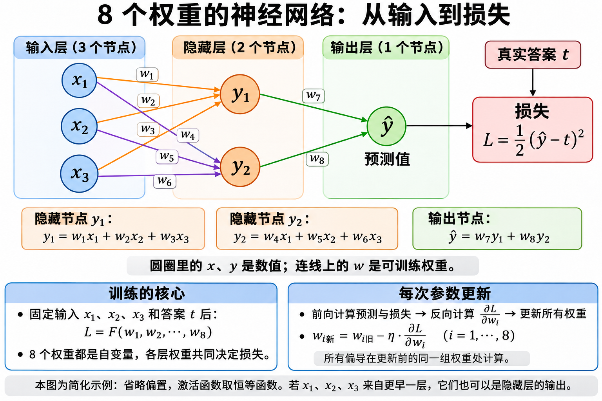


### Hessian 矩阵

它是对于一个多元函数来说的，它就相当于一元函数的二阶导数怎么定义的呢？有一个n 元函数，比方说X1，X2 一直到Xn

<!-- PDF 第 23 页 -->

$$
H_f(x)=\begin{bmatrix}\frac{\partial^2f}{\partial x_1^2}&\frac{\partial^2f}{\partial x_1\partial x_2}&\cdots&\frac{\partial^2f}{\partial x_1\partial x_n}\\\frac{\partial^2f}{\partial x_2\partial x_1}&\frac{\partial^2f}{\partial x_2^2}&\cdots&\frac{\partial^2f}{\partial x_2\partial x_n}\\\vdots&\vdots&\ddots&\vdots\\\frac{\partial^2f}{\partial x_n\partial x_1}&\frac{\partial^2f}{\partial x_n\partial x_2}&\cdots&\frac{\partial^2f}{\partial x_n^2}\end{bmatrix}
$$

它的hessian 矩阵是一个n*n 的矩阵，矩阵里面的元素是什么呢？它的所有的元素是二阶偏导数构成的，第一个元素是对X1 求二阶偏导数，第二个元素是对X1X2 求偏导数，因为咱们前面讲过，多元函数高阶偏导数和顺序无关，所以hessian 矩阵是对称矩阵

$$
f(x,y,z)=2x^2-xy+y^2-3z^2
$$

下面这个例子先看一下它的一阶偏导数

$$
\frac{\partial f}{\partial x}=4x-y,\quad\frac{\partial f}{\partial y}=-x+2y,\quad\frac{\partial f}{\partial z}=-6z
$$

然后把hessian 矩阵求出来

$$
H_f=\begin{pmatrix}4&-1&0\\-1&2&0\\0&0&-6\end{pmatrix}
$$

Hessian 矩阵和函数的凹凸性是有密切关系的，如果hessian 矩阵正定，可以说函数f(x)是凸函数，如果是负定，它就是凹函数，矩阵正定怎么定义的呢？

### 极值判别法则

对于一元函数，我们前面讲过，如果f(x)的一阶导数等于0 处有极值，当f(x)的二阶导数大于0时是极小值，当f(x)的二阶导数小于0 时是极大值，可以参考X 的平方这个函数


多元函数的极值判别法则

首先f(x)的一阶导数等于0，这点是驻点的话，那它就可能是极值点，它是极大值还是极小值或者不是极值怎么判定的？

看hessian 矩阵（就类似一元函数中的看二阶导数），在f(x)的一阶导数等于0 处，就是驻点处，

如果hessian 矩阵是正定的话，函数在该点有极小值

如果hessian 矩阵是负定的话，函数在该点有极大值

如果hessian 矩阵不定，还需要看更高阶的导数

对于任意向量 $X\neq 0$，都有 $X^TAX>0$，那就是正定矩阵；如果是 $\geq 0$ 的话，那就是半正定矩阵。（ **矩阵 A 固定以后，不管你拿哪个非零向量 X 代进去，算出来的数都大于零**。学习了后面的知识我们还会发现 $X^TAX$还是一个二次型 ）

怎么判断矩阵是正定的呢？就是拿这个式子去证明，但是这样不太容易，有时候我们会根据几个原则去判断：（一般我们使用的是第一点）

1. 矩阵的特征值全部大于 $0$（矩阵的特征值和特征向量我们会讲到）。
2. 矩阵的所有顺序主子式都大于 $0$（顺序主子式这个我们用得比较少）。
3. 矩阵合同于单位阵（也是用到比较少）。

 在机器学习中，通常先根据任务选定损失函数，再通过调整参数使损失尽可能小。**海森矩阵（Hessian）由函数的二阶偏导数组成，可以用来判断损失函数的凸性：对于二阶可微的损失函数，如果在整个凸定义域内，海森矩阵始终半正定，那么这个损失函数就是凸函数。** 对于可微的凸函数，任何局部极小值点都是全局最小值点，因此，只要找到梯度为零的点，就找到了全局最小值点，对应的参数就是全局最优解。

>下面就是对上一段话的解释【判断函数是否为凸函数和判断函数在该点是否取极值用的方法是很相似的】
>
>对于二阶连续可微的函数，在凸的定义域内，判断它是不是凸函数，可以看 **Hessian 矩阵是否处处半正定**，即在每个点，对任意非零列向量 $X$，都有：
>$$
>X^THX\geq 0
>$$
>
>如果要求严格大于零，即 $X^THX>0$，则称矩阵 $H$ **正定**。
>
>**$X^THX$ 就是用 Hessian 矩阵构造出的二次型。如果原函数本来就是纯二次函数，这个二次型恰好等于原函数的两倍。**
>
>例如：
>
>$$
>f(x,y)=x^2+3y^2
>$$
>
>它的 Hessian 矩阵为：
>
>$$
>H=
>\begin{pmatrix}
>2&0\\
>0&6
>\end{pmatrix}
>$$
>
>令 $X=(x,y)^T$，则：
>
>$$
>X^THX
>=
>\begin{pmatrix}x&y\end{pmatrix}
>\begin{pmatrix}2&0\\0&6\end{pmatrix}
>\begin{pmatrix}x\\y\end{pmatrix}
>=
>2x^2+6y^2
>=
>2f(x,y)
>$$
>
>所以，这种情况下，确实相当于**求出 Hessian 后，又通过二次型把原函数拼了回来，只是多了系数 $2$**。
>
>但如果原函数是：
>
>$$
>f(x,y)=x^2+3y^2+5x+7
>$$
>
>它的 Hessian 不变，构造出的二次型仍然是：
>
>$$
>X^THX=2x^2+6y^2
>$$
>
>因为一次项和常数项在求二阶导时已经消失，无法拼回来。
>
>**因此，对于二次函数，这样能拼回二次项的两倍；对于一般函数，不能靠这个二次型直接还原原函数。**

## 线性代数

### 二次型

二次型就是纯二次项构成的一个函数

因为二次函数（方程）的二次部分最重要，为了方便研究，我们把含有n 个变量的二次齐次函数：
$$
f(x_1,x_2,\ldots,x_n)=a_{11}x_1^2+a_{22}x_2^2+\cdots+a_{nn}x_n^2+2a_{12}x_1x_2+2a_{13}x_1x_3+\cdots+2a_{n-1,n}x_{n-1}x_n
$$

称为二次型。它就是一个数，它是怎么得到的呢？它就是一个向量和一个矩阵相乘的结果，X 是列向量，转置就是行向量

$$
X^T A X
$$

$$
(x_1\ \cdots\ x_n)\begin{bmatrix}a_{11}&\cdots&a_{1n}\\a_{21}&\cdots&a_{2n}\\\vdots&\ddots&\vdots\\a_{n1}&\cdots&a_{nn}\end{bmatrix}\begin{pmatrix}x_1\\\vdots\\x_n\end{pmatrix}
$$


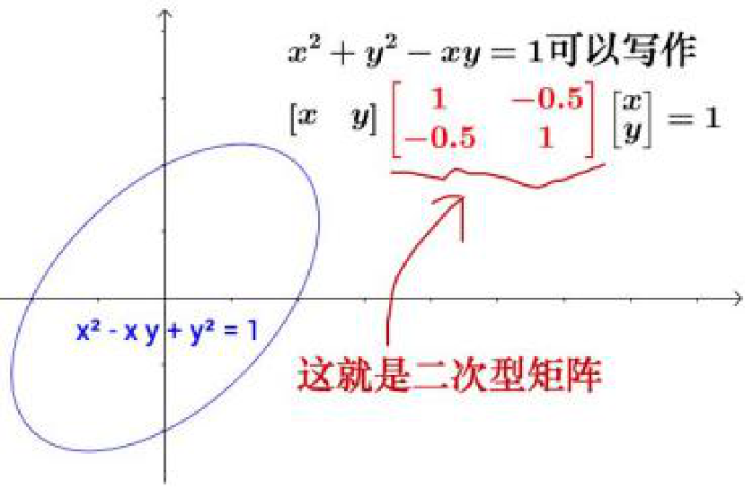


$$
简而言之ax^2+2bxy+cy^2可以写作==>>>\begin{pmatrix}x&y\end{pmatrix}\begin{pmatrix}a&b\\b&c\end{pmatrix}\begin{pmatrix}x\\y\end{pmatrix}
$$

$$
令X=\begin{pmatrix}x\\y\end{pmatrix},A=\begin{pmatrix}a&b\\b&c\end{pmatrix}, 因此该多项式可以写成X^TAX=1
$$

$$
\sum_{i=1}^{n}\sum_{j=1}^{n}a_{ij}x_i x_j
$$

有 $n$ 个变量时，矩阵 $A$ 是 $n\times n$ 的方阵，共有 $n^2$ 个元素 $a_{ij}$，这种形式在机器学习中会见到，比如是一次型的
$$
f(x;w)=w^Tx+b=w_1x_1+w_2x_2+\cdots+w_nx_n+b
$$

或者二次型的

$$
f(x;w)=x^TWx+b
$$

>**二次型就是：把输入的平方、输入之间两两相乘的结果，再分别加权相加。**
>
>这里 $x_1,x_2,\ldots$ 是输入，$w$ 或 $W$ 里面的元素是训练时要调整的权重。**这里说“一次、二次”，看的是输入 $x$ 的次数。**
>
>一次形式，用两个输入举例：
>
>$$
>f(x;w)=w_1x_1+w_2x_2+b
>$$
>
>就是给 $x_1,x_2$ 分别乘一个权重，然后相加。
>
>到了二次形式，加权的对象变成了：
>
>$$
>x_1^2,\qquad x_1x_2,\qquad x_2^2
>$$
>
>也就是**输入自己的平方，以及不同输入之间的乘积**。例如：
>
>$$
>f(x)=2x_1^2+6x_1x_2+4x_2^2+b
>$$
>
>这里 $2,6,4$ 就是各个二次项的系数，可以通过训练调整。
>
>---
>
>图中的：
>
>$$
>f(x;W)=x^TWx+b
>$$
>
>就是把这些二次项压缩成矩阵写法。比如令：
>
>$$
>x=\begin{bmatrix}x_1\\x_2\end{bmatrix},
>\qquad
>W=\begin{bmatrix}p&q\\q&r\end{bmatrix}
>$$
>
>展开就得到：
>
>$$
>\boxed{
>f(x;W)=px_1^2+2qx_1x_2+rx_2^2+b
>}
>$$
>
>**$W$ 里面存放二次项的权重，$b$ 仍然是偏置。**
>
>在机器学习中，这样就能表达更丰富的关系：
>
>- $x_1^2$：输入 $x_1$ 对结果的影响可以发生弯曲。
>- $x_1x_2$：表达两个输入共同作用的关系。例如，$x_1$ 对结果的影响，可以随着 $x_2$ 的取值而变化。
>
>**一次形式对原始输入加权；二次形式对输入的平方和两两乘积加权。**

例如该场景的数据分布是一次型的，那我们就可以选择 logistic regression、SVM 等分界面为一次型的模型；如果场景的数据分布是二次型的，我们可以选择 naive bayes（朴素贝叶斯回归）；如果场景的数据分布既不是一次型也不是二次型，那我们可以选择基于决策树的模型，例如 gbdt、random forest 等，或者 DNN，这些模型都高度非线性，表达能力极强，理论上可以拟合任意曲线。

>**特征工程，就是对原始数据的特征进行构造、变换或筛选，让它们更适合模型学习。**
>
>例如，原始输入是 $x_1,x_2$，可以根据需要构造出 $x_1^2$、$x_1x_2$、$x_2^2$ 等新特征。
>
>**每一项中由输入计算出来的部分，无论是平方、两个输入相乘，还是更复杂的输入组合，都可以整体记成一个新特征 $z_i$。** 只要这些 $z_i$ 不含待训练的权重，就能统一写成：
>$$
>f=w_1z_1+w_2z_2+w_3z_3+\cdots+b
>$$
>
>这样，即使模型仍采用“加权相加”的形式，也能表达原始输入与结果之间更复杂的关系。
>
>**特征工程负责构造模型使用的输入特征，训练负责学习这些特征对应的权重。** 构造好特征后，照常计算损失，通过反向传播求出损失对各个参数的偏导，再更新权重和偏置即可。

$$
\begin{aligned}对于二次型函数：f(x)&=x^TAx,通过正定矩阵的定义我们就可以有下面这些判断：\\f(x)&>0\ (x\ne0)\Rightarrow A\text{ 正定},\\f(x)&\ge0\ (x\ne0)\Rightarrow A\text{ 半正定},\\f(x)&<0\ (x\ne0)\Rightarrow A\text{ 负定},\\f(x)&\le0\ (x\ne0)\Rightarrow A\text{ 半负定}.\end{aligned}
$$

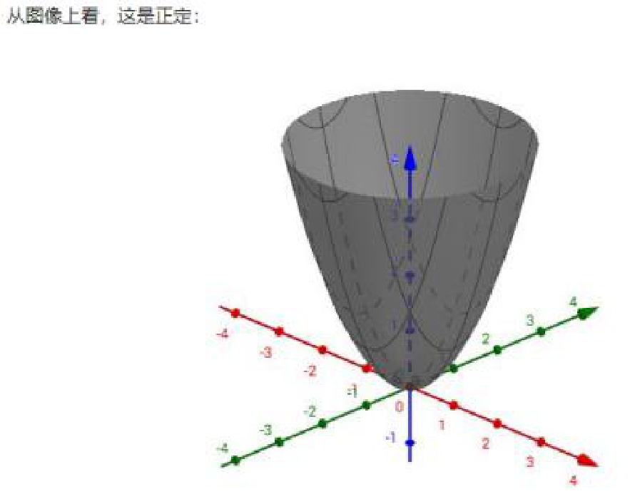

 

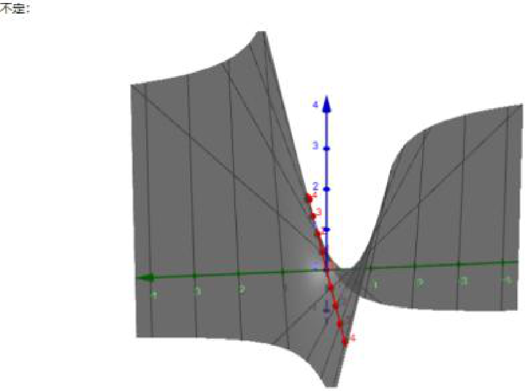

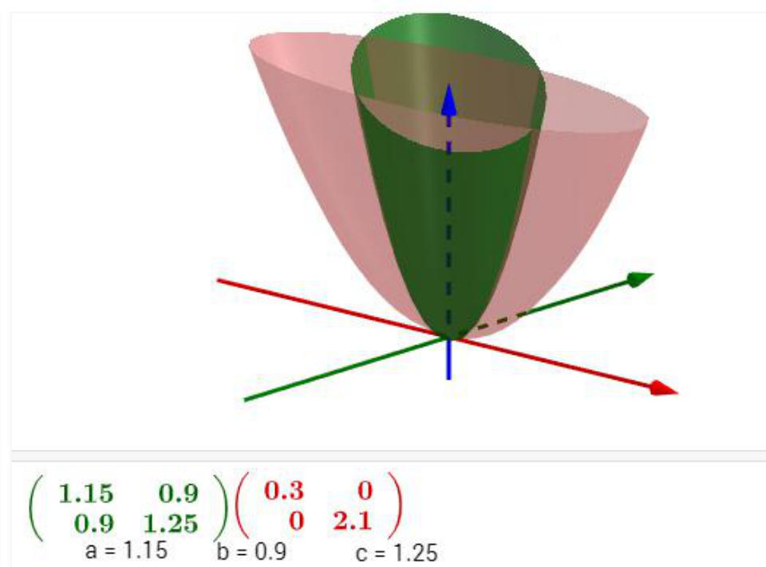

上面绿色部分就是Hassen矩阵，红色部分中的两个值都是特征值，我们发现特征值都大于0，说明凸函数，并且对照下面这个图来看，特征值越大，函数的凸性越明显。

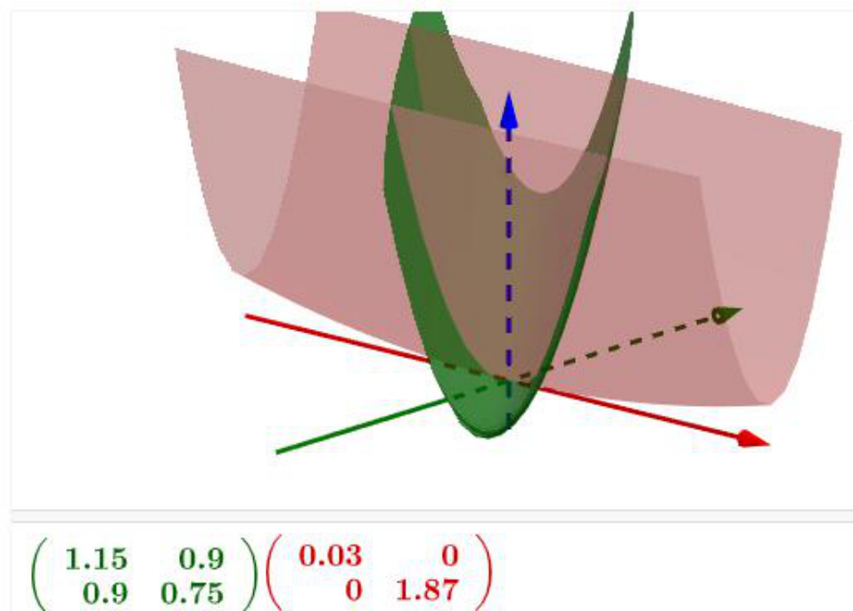

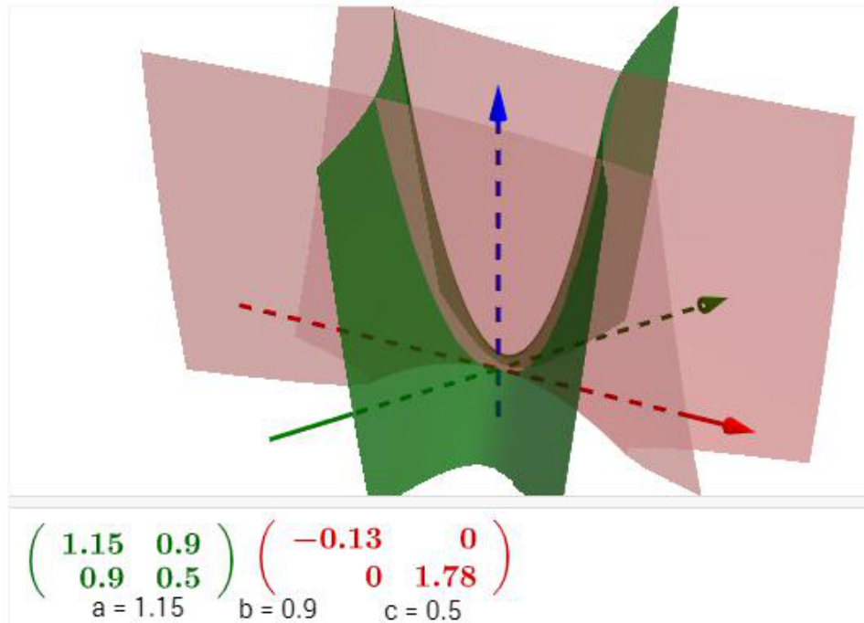

### 特征值和特征向量

我们已经知道，矩阵和向量的乘法就相当于对该向量做了一个线性变换。在这个变换中，大部分的向量都发生了偏移，脱离了原“轨道”。举个例子：

<!-- PDF 第 29 页 -->

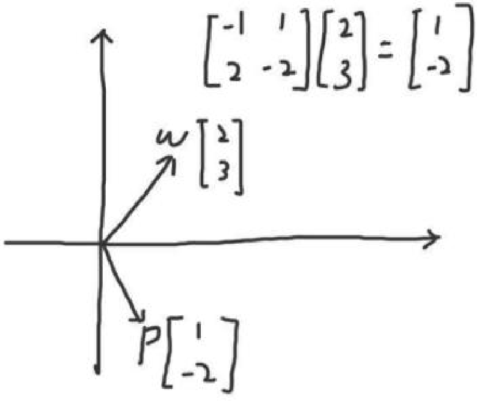

如上图所示，向量w（2,3）在矩阵[-1,1;2,-2]的作用下，线性变换为另一个向量p（1，-2）。p 和w 明显不在一条直线上，发生了偏移。那有没有一个矩阵，恰好使线性变换之后新向量p 和原来的向量w 在同一条直线上呢？我们再看一个例子：

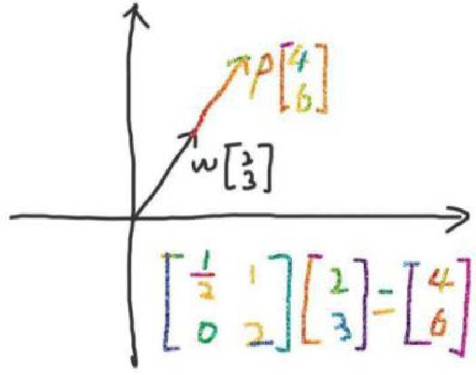

如上图，还是向量w（2,3），此时线性变换的矩阵变成了[1/2,1;0,2]，产生的新向量p（4,6）跟w 还在同一条直线上。

那么可以由此引出什么概念呢？

设A 是n 阶方阵，如果存在数λ和非零n 维列向量x，使得Ax=λx 成立，则称λ 是矩阵A 的一个特征值（characteristic value)或本征值（eigenvalue)。这时x被叫做特征向量或本征向量
$$
Ax=\lambda x
$$

式 $Ax=\lambda x$ 也可写成 $(A-\lambda I)x=0$。这是 $n$ 个未知数、$n$ 个方程的齐次线性方程组，它有非零解的充分必要条件是系数行列式：$$|A-\lambda I|=0$$。


<!-- PDF 第 30 页 -->

$$
\det(\lambda I-A)=\begin{vmatrix}\lambda-a_{11}&-a_{12}&\cdots&-a_{1n}\\-a_{21}&\lambda-a_{22}&\cdots&-a_{2n}\\\vdots&\vdots&\ddots&\vdots\\-a_{n1}&-a_{n2}&\cdots&\lambda-a_{nn}\end{vmatrix}=\lambda^n+a_1\lambda^{n-1}+a_2\lambda^{n-2}+\cdots+a_n
$$

展开之后是一个关于λ的一个n 次方程，直接可以通过方程的求根来算

$$
A=\begin{pmatrix}\frac12&1\\0&2\end{pmatrix}
$$

$$
\lambda^2-2.5\lambda+1=(\lambda-0.5)(\lambda-2)
$$

但是当n 的规模很大，就是矩阵的阶数大于等于5，这个是没法求的，因为我们数学里面有个重要的结论，5 次和5 次以上的代数方程它是没有求根公式的，所以这么做是非常困难的在工程上面我们去计算矩阵的特征值的话，一般是用QR 算法，‘


```text
A^(0) = A
for k = 1, 2, ...:
    Q^(k) R^(k) = A^(k-1)
    A^(k) = R^(k) Q^(k)
Recombine factors in reverse order
```

[QR 算法说明](http://madrury.github.io/jekyll/update/statistics/2017/10/04/qr-algorithm.html)

- 对于方程的求根，有个重要的定理叫做韦达定理

$$
ax^2+bx+c=0,\qquad x_{1,2}=\frac{-b\pm\sqrt{b^2-4ac}}{2a}
$$

就是初中时候学过，二次函数求根公式导出的韦达定理，

$$
x_1+x_2=-\frac ba,\qquad x_1x_2=\frac ca
$$

对于n 次方程同样有这样一个结论，trace 就是A 矩阵的主对角线的值加和等于所有特征值λ的和

<!-- PDF 第 31 页 -->

$$
\operatorname{tr}(A)=\sum_{i=1}^{n}a_{ii}=\lambda_1+\lambda_2+\cdots+\lambda_n=\sum_{i=1}^{n}\lambda_i
$$

所有特征值的乘积等于A 的行列式的

$$
\prod_{i=1}^{n}\lambda_i=\det(A)
$$

特征值和特征向量在机器学习中会被用到，像PCA 主成分分析，LDA 线性判别分析，以及其它算法里面都会用到它的理论和方法

### 特征值分解

特征值和特征向量的定义如下：

$$
Ax=\lambda x
$$

其中A 是一个n×n 的矩阵，x 是一个n 维向量，则我们说λ是矩阵A 的一个特征值，

而x 是矩阵A 的特征值λ所对应的特征向量。

求出特征值和特征向量有什么好处呢？就是我们可以将矩阵A 特征分解。如果我们求

出了矩阵A 的n 个特征值

$$
\lambda_1\le\lambda_2\le\cdots\le\lambda_n,\qquad (w_1\ w_2\ \cdots\ w_n)
$$

以及这n 个特征值所对应的特征向量

那么矩阵A 就可以用下式的特征分解表示：

$$
A=W\Sigma W^{-1}
$$

特征值分解怎么来的？我们以前在学线性代数的时候都学过我们怎么把一个矩阵变化成一个对角矩阵

定理 1：令 $M$ 为 $n\times n$ 矩阵，其特征值为 $\lambda_1,\lambda_2,\ldots,\lambda_n$，对应特征向量为 $V_1,V_2,\ldots,V_n$。以每个特征向量为列构成矩阵 $A=[V_1\ V_2\ \cdots\ V_n]$。矩阵 $A$ 可以将 $M$ 对角化：

$$
A^{-1}MA=\begin{pmatrix}\lambda_1&0&\cdots&0\\0&\lambda_2&\cdots&0\\\vdots&\vdots&\ddots&\vdots\\0&0&\cdots&\lambda_n\end{pmatrix}=\Lambda.
$$

反之，如果存在可逆矩阵 $A$，使 $A^{-1}MA$ 为对角矩阵，则 $A$ 的列向量是 $M$ 的特征向量，$A^{-1}MA$ 的主对角元素是 $M$ 的特征值。

<!-- PDF 第 32 页 -->

证明：由于矩阵 $A$ 的第 $j$ 列对应特征向量 $V_j$，因此 $MA$ 的第 $j$ 列等于 $MV_j$。又因为 $MV_j=\lambda_jV_j$，所以矩阵乘积可写为：

$$
MA=A\Lambda.
$$

由于特征向量线性无关，矩阵 $A$ 可逆，故：

$$
A^{-1}MA=\Lambda.
$$

通过一个正交变换做到的，$P^{-1}AP=\Lambda$是对角矩阵，它就是对角线的值是矩阵所有特征值构成的矩阵

$$
\Lambda=\begin{pmatrix}\lambda_1&0&\cdots&0\\0&\lambda_2&\cdots&0\\\vdots&\vdots&\ddots&\vdots\\0&0&\cdots&\lambda_n\end{pmatrix}
$$

P 是正交矩阵，正交矩阵的定义是P 的逆等于P 的转置

$$
P^{-1}=P^T
$$

正交矩阵的性质，是行和列相互之间是正交的，一个向量组(x1,x2,..,xn)，其中Xi 和Xj 内积是0 当i 不等于j 时，如果i=j，那么向量内积就是1，其实它就是我们几何里面垂直的概念的抽象，

$$
P\Lambda P^{-1}=A
$$

我们可以把一个矩阵拆分成，一个正交阵和⋀还有正交阵的逆的乘积的，这就是我们的特征值分解

### 多元函数的泰勒展开

一元函数的泰勒展开

$$
f(x)=\frac{f(x_0)}{0!}+\frac{f'(x_0)}{1!}(x-x_0)+\frac{f''(x_0)}{2!}(x-x_0)^2+\cdots+\frac{f^{(n)}(x_0)}{n!}(x-x_0)^n+R_n(x)
$$

$$
f(x)=f(x_k)+(x-x_k)f'(x_k)+\frac12(x-x_k)^2f''(x_k)+o^n
$$

<!-- PDF 第 33 页 -->

多元函数的泰勒展开f(xk)是标量，而且是个常数，一次项，不过注意(x-xk)是个向量，然后T 转置这里是把梯度和(x-xk)做内积，二次项的内积，是和hessian 矩阵做内积，

$$
f(x)=f(x_k)+\nabla f(x_k)^T(x-x_k)+\frac12(x-x_k)^T H(x_k)(x-x_k)+o^n
$$

多元函数泰勒展开是非常有用的，后面我们在推导梯度下降法，牛顿法，还有拟牛顿法的时候都是用的到的，所以同学们需要把它记住，同学们可以跟一元函数泰勒展开公式类比来记忆它

### 矩阵和向量的求导公式

$$
\nabla_x(w^T x)=w
$$

证明:

$$
\nabla_x(w^T x)=w\quad\Longrightarrow\quad \frac{\partial}{\partial x_i}\sum_{i=1}^{n}w_i x_i=w_i
$$

对Xi 求偏导得到的就是Wi，所以对x 求导就是w

$$
\nabla_x(x^T A x)=(A+A^T)x
$$

二阶导就是再一次对x 求导

$$
\nabla_x^2(x^T A x)=A+A^T
$$

$$
\begin{aligned}\beta^TV\beta&=(\beta_1\ \beta_2\ \beta_3)\begin{pmatrix}V_{11}&V_{12}&V_{13}\\V_{21}&V_{22}&V_{23}\\V_{31}&V_{32}&V_{33}\end{pmatrix}\begin{pmatrix}\beta_1\\\beta_2\\\beta_3\end{pmatrix}\\&=V_{11}\beta_1^2+V_{22}\beta_2^2+V_{33}\beta_3^2+(V_{12}+V_{21})\beta_1\beta_2\\&\quad +(V_{13}+V_{31})\beta_1\beta_3+(V_{23}+V_{32})\beta_2\beta_3.\end{aligned}
$$

<!-- PDF 第 34 页 -->

$$
\begin{aligned}\nabla_{\beta}(\beta^TV\beta)&=(V+V^T)\beta.\end{aligned}
$$

### 奇异值分解

微积分和线性代数最后一个知识点

$$
A=U\Sigma V^T
$$

这个比较抽象，前面我们知道一个矩阵可以进行分解，但这是对一个n 阶方阵而言的，但如果A 不是一个方阵这种分解（对角化）将是无效的

$$
A=P\Lambda P^{-1}
$$

有没有类似的分解呢？有，就是我们的奇异值分解，而且奇异值分解比较神奇，可以应用于任意形状矩阵，如果A是一个m*n 的矩阵，它一样可以分解成为三个矩阵的乘积，U V 和Σ，其中U V 都是正交矩阵，Σ是对角矩阵，注意这里Σ并不是一个方阵，而是m*n 的矩阵.SVD 也是对矩阵进行分解，但是和特征分解不同，SVD 并不要求要分解的矩阵为方阵。假设我们的矩阵A 是一个m×n 的矩阵，那么我们定义矩阵A 的SVD 为：A=U∑

U 是AAT 的矩阵，所以是m*m 的矩阵，AAT 正交化特征向量构成的矩阵，ATA是正交化特征向量所构成的矩阵，n*n 的矩阵。其中U 是一个m×m 的矩阵，Σ是一个m×n 的矩阵，除了主对角线上的元素以外全为0，主对角线上的每个元素都称为奇异值，V 是一个n×n 的矩阵。U 和V 都是酉矩阵，即满足

<!-- PDF 第 35 页 -->

$U^TU=I,\ V^TV=I$。下图可以很形象的看出上面SVD 的定义：

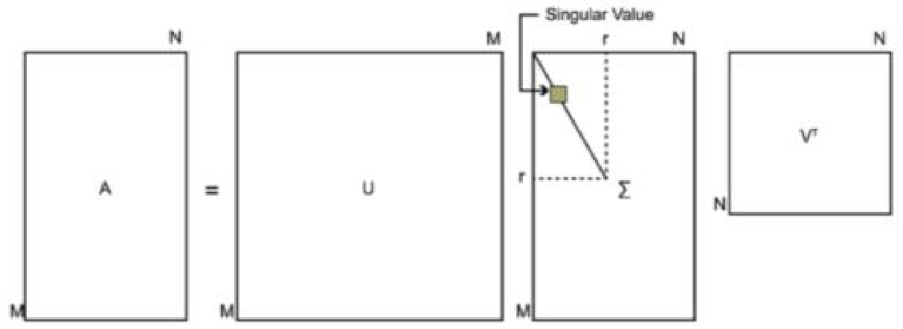

### 奇异值分解如何求解

那么我们如何求出SVD 分解后的U,Σ,V 这三个矩阵呢？

如果我们将A 的转置和A 做矩阵乘法，那么会得到n×n 的一个方阵ATA。既然ATA

是方阵，那么我们就可以进行特征分解，得到的特征值和特征向量满足：

$$
(A^T A)v_i=\lambda_i v_i
$$

这样我们就可以得到矩阵ATA的n 个特征值和对应的n 个特征向量v 了。将ATA的所

有特征向量张成一个n×n 的矩阵V，就是我们SVD 公式里面的V 矩阵了。一般我们将V中的每个特征向量叫做A 的右奇异向量。

如果我们将A 和A 的转置做矩阵乘法，那么会得到m×m 的一个方阵AAT。既然AAT

是方阵，那么我们就可以进行特征分解，得到的特征值和特征向量满足：(AAT)u =λ

这样我们就可以得到矩阵AAT 的m 个特征值和对应的m 个特征向量u 了。将AAT 的

所有特征向量张成一个m×m 的矩阵U，就是我们SVD 公式里面的U 矩阵了。一般我们将U 中的每个特征向量叫做A 的左奇异向量。

U 和V 都求出来了，现在就剩下奇异值矩阵Σ没有求出了。由于Σ除了对角线上是奇异

值其他位置都是0，那我们只需要求出每个奇异值σ就可以了。我们注意到:

$$
\begin{aligned}A&=U\Sigma V^T,\\AV&=U\Sigma,\\Av_i&=\sigma_i u_i,\\\sigma_i&=\frac{Av_i}{u_i}\quad\text{（原文记法）}.\end{aligned}
$$

这样我们可以求出我们的每个奇异值，进而求出奇异值矩阵Σ。上面还有一个问题没有讲，就是我们说ATA的特征向量组成的就是我们SVD 中的V

矩阵，而AAT 的特征向量组成的就是我们SVD 中的U 矩阵，这有什么根据吗？这个其实很容易证明，我们以V 矩阵的证明为例。

<!-- PDF 第 36 页 -->

上式证明使用了:UTU=I,∑T∑=∑2。可以看出ATA的特征向量组成的就是SVD 中

的V 矩阵。类似的方法可以得到AAT 的特征向量组成的就是SVD 中的U 矩阵。

进一步我们还可以看出我们的特征值矩阵等于奇异值矩阵的平方，也就是说特征值和奇

异值满足如下关系：=iλ

这样也就是说，我们可以不用i=Avi /ui来计算奇异值，也可以通过求出ATA的特征

值取平方根来求奇异值。

### 奇异值分解性质

上面我们对SVD 的定义和计算做了详细的描述，似乎看不出我们费这么大的力气做

SVD 有什么好处。那么SVD 有什么重要的性质值得我们注意呢？

对于奇异值,它跟我们特征分解中的特征值类似，在奇异值矩阵中也是按照从大到小排

列，而且奇异值的减少特别的快，在很多情况下，前10%甚至1%的奇异值的和就占了全部的奇异值之和的99%以上的比例。也就是说，我们也可以用最大的k 个的奇异值和对应的左右奇异向量来近似描述矩阵。也就是说：

Am×n=Um×m∑m×nVn×n Um×k∑k×kVkT×n。其中k 要比n 小很多，也就是一个大的矩阵

A 可以用三个小的矩阵Um×k,∑k×k,Vk ×Tn来表示。如下图所示，现在我们的矩阵A 只需要三个小矩阵就可以近似描述了。

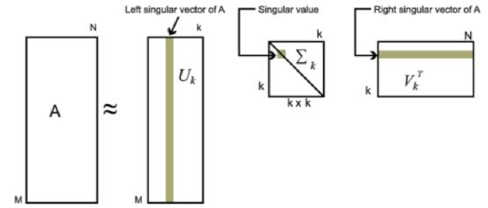

U 的每一列都是标准正交的（orthonormal），V 的转置都是每一行都是标准正交的，

Σ是呈对角线的（diagonal），只有对角线有值，而且一定都是非负的，意味着对角线一定有值，但是也有可能值是0，而且神奇的地方，如果左上角有值σ1，第二个左上角值是σ2，那么σ1 一定大于等于σ2，并且σ2 大于等于σ3，以此类推。

<!-- PDF 第 37 页 -->

所以Σ中有k 个非0 的值，依次从左上角往右下角方向排列，我们可以把Σ中等于0 的

行列去掉就保留k*k 个值，那么U 和V 中也分别只保留k 列和k 行，我们会发现一样乘回来可以得到A 仍然不变。

$$
\Sigma=\begin{pmatrix}\sigma_1&0&\cdots&0\\0&\sigma_2&\cdots&0\\\vdots&\vdots&\ddots&\vdots\\0&0&\cdots&\sigma_k\end{pmatrix}
$$

如果我们保留的小于k 个，那么乘回去的矩阵就不等于原来的A 了。如果去掉的是第k

个，那么乘回来的矩阵就是A+，是最接近A 的矩阵还比如可以求解对称矩阵的逆矩阵，可以用于降维算法中的特征分解，还可以用于推荐系统，以及自然语言里面的主题分析里面，会用到这个算法的

### SVD 用于数据压缩

奇异值分解在数值计算是非常有用的，首先可以做矩阵的压缩


```python
import numpy as np

arr = np.array([
    [0, 0, 0, 2, 2],
    [0, 0, 0, 3, 3],
    [0, 0, 0, 1, 1],
    [1, 1, 1, 0, 0],
    [2, 2, 2, 0, 0],
    [5, 5, 5, 0, 0],
    [1, 1, 1, 0, 0],
])
```

<!-- PDF 第 38 页 -->

```python
#### 1. 分解
u, sigma, v = np.linalg.svd(arr)

#### 2. 重构
new_arr = np.mat(u[:, 0:2]) * np.mat(np.diag(sigma[0:2])) * np.mat(v[0:2, :])
```

### SVD 用于PCA 降维

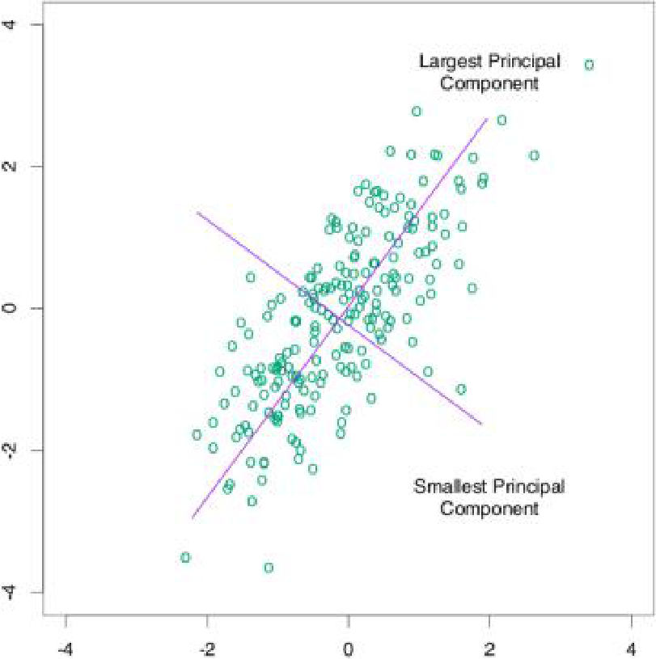

在中心化后，由于特征的均值变为0，所以数据的协方差矩阵C 可以用E(XXT)或者1 XX来表示，XT为矩阵的转置。这里X 每一行为一个特征。当然也可以表示为E(XTX)或者1 XTX，这时每一行为一个样本。

$$
\begin{aligned}\operatorname{cov}(X,Y)&=\frac{\sum_{i=1}^{n}(X_i-\bar X)(Y_i-\bar Y)}{n-1},\\\operatorname{var}(X)&=\frac{\sum_{i=1}^{n}(X_i-\bar X)^2}{n-1}.\end{aligned}
$$

SVD 分解得到的三个矩阵分别称为：左奇异向量，奇异值矩阵，右奇异向量。左奇异向量用于压缩行，右奇异向量压缩列。压缩方法均是取奇异值较大的左奇异向量或者右奇异向量与原数据C 相乘。

<!-- PDF 第 39 页 -->

### SVD 用于协调过滤

| 用户 | 鳗鱼饭 | 日式炸鸡排 | 寿司 | 烤牛肉 | 手撕猪肉 |
|---|---:|---:|---:|---:|---:|
| Jim | 2 | 0 | 0 | 4 | 4 |
| John | 5 | 5 | 5 | 3 | 3 |
| Sally | 2 | 4 | 2 | 1 | 2 |
| Tom | 1 | 1 | 1 | 5 | 5 |

可以直接计算Jim 与其余三个用户的相似度，然后选最相似的样本来为Jim 的两个空位打分。但是这样，如果一旦样本、特征过多，计算量就猛增。而事实上，我们不一定需要那么多特征，因此可以使用SVD 分解把样本映射到低维空间。（事实上，容易能从数据中看出来映射2 维空间，左边三个和右边两个明显不一样）

```python
food = np.mat([[2, 0, 0, 4, 4], [5, 5, 5, 3, 3], [2, 4, 2, 1, 2], [1, 1, 1, 5, 4]])
u, sigma, v = np.linalg.svd(food)
simple_food = np.mat(u[:, 0:2]) * np.mat(np.diag(sigma[0:2])) * np.mat(v[0:2, :])
```

### SVD 用于矩阵求逆

在矩阵求逆过程中，矩阵通过SVD 转换到正交空间，不同得奇异值和奇异值向量代表了系统矩阵中不同的线性无关（或独立）项。对矩阵进行SVD 分解，形式如下所示：

$$
[H]_{n\times v}=[U]_{n\times n}[\Sigma]_{n\times v}[V^T]_{v\times v}=\sum_{i=1}^{n}\{U_i\}_n\,\sigma_i\,\{V_i\}_v^T
$$

奇异值矩阵为：

$$
\Sigma=\begin{bmatrix}\sigma_1&0&\cdots&0\\0&\sigma_2&\cdots&0\\\vdots&\vdots&\ddots&\vdots\\0&0&\cdots&\sigma_n\end{bmatrix}
$$

当用SVD 方法进行求逆时，会使得求逆运算变得非常简单，这是因为通过SVD 求逆，只需要对奇异值求倒数即可，而正交阵B，有B-1=BT。因此，其求逆形式为：

$$
H^{-1}=V\Sigma^{-1}U^T,\qquad \Sigma^{-1}=\begin{bmatrix}\sigma_1^{-1}&0&\cdots&0\\0&\sigma_2^{-1}&\cdots&0\\\vdots&\vdots&\ddots&\vdots\\0&0&\cdots&\sigma_n^{-1}\end{bmatrix}
$$

奇异值矩阵为：

<!-- PDF 第 40 页 -->

$$
\Sigma^{-1}=\begin{bmatrix}\sigma_1^{-1}&0&\cdots&0\\0&\sigma_2^{-1}&\cdots&0\\\vdots&\vdots&\ddots&\vdots\\0&0&\cdots&\sigma_n^{-1}\end{bmatrix}
$$

从上面可以看出，SVD 求逆是原始奇异值的倒数，这就使得通过SVD 对矩阵求逆变得非常简单：奇异值求倒数，奇异矩阵转置。

## 概率论

### 为什么会涉及到概率论？

在机器学习和深度学习中是用的比较多的，为什么会涉及到概率论？因为X 以及如果是有监督机器学习的话，它的标签y，如果我们把它当作是随机变量的话，那我们就可以用概率论的观点对它进行建模，假设它服从某种概率分布，比如说人的身高它大体是服从正太分布的，像姚明身高非常高的非常少，像郭敬明一样矮也是非常少的，比如中国的男性平均身高1.75 左右，画出来就是我们学概率论和数理统计时候的一个正太分布这样一个东西

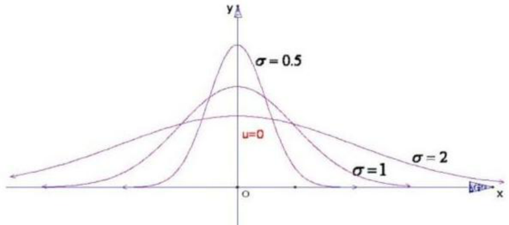

我们要是对数据进行分类的话，根据他的身高、体重等等，那我们就可以对他的身高进行建模来计算它服从某种分布，然后计算他的概率，这就是我们要学习概率论的原因

### 随机事件和随机事件概率

什么是随机事件呢？就是可能发生，也可能不发生的事件比如你抛硬币，它正面朝上，这就是一个随机事件，生孩子生男生女这也是一个随机事件如果一定发生的话，这种称为必然事件，比如说太阳明天会升起，这肯定是必然事件反正不可能发生的事件，我们称之为不可能事件，比如水往高处流，这就是不可能事件，因为水是往低处流的，否则它会违反自然规律的我们一般把随机事件用大写字母A B 这样来表示，每一个随机事件它关联有一个发生的概

<!-- PDF 第 41 页 -->

率，记作P(A)，像抛硬币它正面朝上的概率是0.5，反面朝上的概率也是0.5，0≤P(A)≤1如果等于1 那就是必然事件，如果等于0 那就是不可能事件以前学概率论的时候，老师交了我们各种计算概率的方法，比如抽各种颜色的球等等这样的问题，一般都是用排列组合来算的还有另外一种是那种连续的事件，比如在第一象限扔一个石头进去，它落在什么位置，这就是连续性的事件，那么落在一半的区域里面的概率就是1/2，这是通过面积来算的，这是另外一种套路

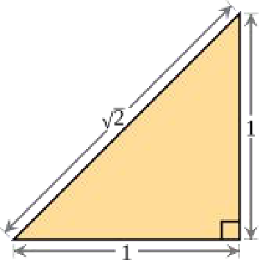

### 条件概率和贝叶斯公式

条件概率是针对于两个或更多个有相关关系/因果关系的随机事件而言的对于两个随机事件A 和B 而言，在A 发生的情况下B 发生的概率，那记住P(B|A)，AB 同时发生的概率除以A 发生的概率

$$
p(b\mid a)=\frac{p(a,b)}{p(a)}
$$

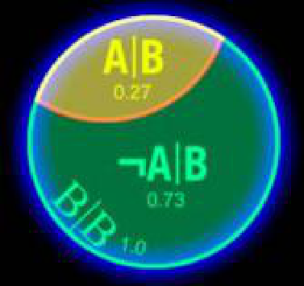

$$
p(a\mid b)=\frac{p(a,b)}{p(b)},\qquad p(a\mid b)=\frac{p(a)p(b\mid a)}{p(b)}
$$

贝叶斯公式

这里称a 为因，b 是果，我们称知道原因后结果发生的概率是先验概率，贝叶斯公式得到的结果是后验概率

$$
p(b)p(a\mid b)=p(a,b)=p(a)p(b\mid a)
$$

贝叶斯公式在整个机器学习和深度学习中是非常有用的，因为很多时候我们要用一种叫做

<!-- PDF 第 42 页 -->

最大化后验概率的思想MAP

### 随机事件的独立性

说白了就是两个事情是不相关的，b 在a 发生的条件下发生的概率是等于b 本身发生的概率

$$
p(b\mid a)=p(b),\qquad p(a,b)=p(a)p(b)
$$

我们可以给它推广到n 个事件相互独立的情况上面去，就是等于各自发生概率的乘积

$$
p(a_1,\ldots,a_n)=\prod_{i=1}^{n}p(a_i)
$$

### 随机变量

整个概率论的核心变量是什么呢？我们中学的时候就学习过变量了，它是取值可以变化的量，比如可以取0 到1 区间上所有的实数，或者取从1 到100 之间的整数随机变量是什么呢？就是变量取值都有一个概率第一种情况是离散型的随机变量，比如前面说的抛硬币正面朝上还是反面朝上，这是两个事件，我们可以把这两个事件编号，得到=0反

x：

=1正这就是随机变量，X 取值有两种情况，0 或1，取每种值的概率都是0.5，离散型的随机变量它的取值只可能是有限个可能，或者是无穷可列个，比如是从0 到+∞，但是一定是能用整数编号编出来另一种是连续型的随机变量，理解起来抽象一些，它的取值是无限不可列个，比如0 到1之间的所有的实数，首先它肯定是无限个，而它比无限可列个更高级，它不可列，比如其中的0.001 到0.002 之间它还是有无限个，不管怎么细分，a 和b 之间还是有无限个，这就是连续型的随机变量，比如说抛石子在0 到1 的矩形范围内，它可能落在区域内任何一个位置，那么石子落在的位置x,y 就是连续型随机变量，说白了就是它坐标取0 到1 之间任何一个值都是有可能的对于离散型随机变量，写成如下：

$$
P(X=x_i)=p_i,\qquad p_i\ge0
$$

<!-- PDF 第 43 页 -->

对于连续型随机变量我们是这么定义的，利用它的概率密度函数来定义

$$
f(x)\ge0,\qquad\int_{-\infty}^{+\infty}f(x)\,dx=1
$$

概率密度函数算出来的f(x)可以认为是近似等同于事件发生的概率P(x)，但是它还不是概率，但是他们之间是正相关的

$$
F(y)=P(X\le y)=\int_{-\infty}^{y}f(x)\,dx
$$

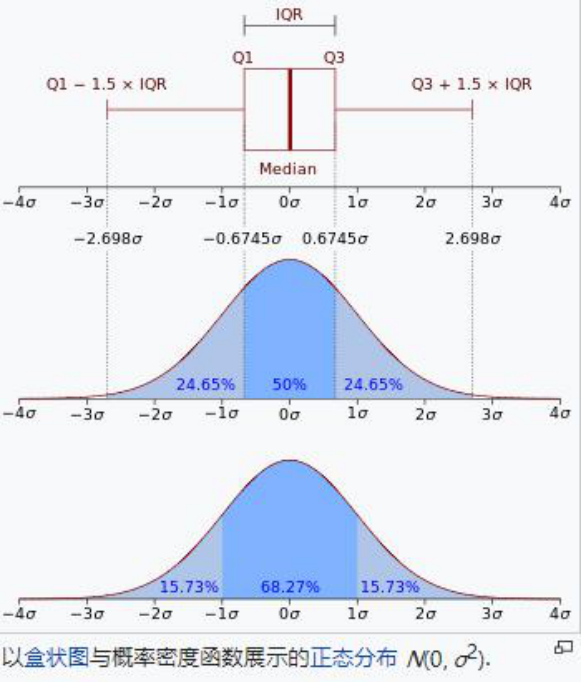

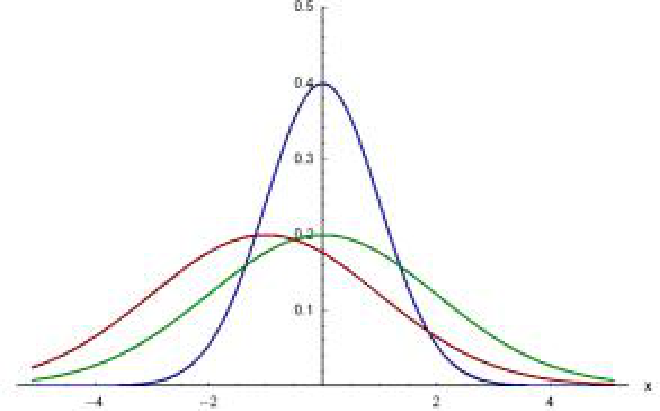

需要注意的是，连续性随机变量它取某个具体值的概率是0 的，p(x=xi但是它落在某个区间范围的概率是有值的，因为算的是面积，就好像前面提到的石子落到区域内的面积

$$
\int_{x_1}^{x_2}f(x)\,dx=F(x_2)-F(x_1)
$$

### 数学期望和方差

这个在学概率论的时候同学们都是学过的，这是核心概念之一什么是数学期望，从均值开始看起

$$
\frac1n\sum_{i=1}^{n}x_i\longrightarrow\sum_{i=1}^{n}p_i x_i
$$

这里的1/n 可以看作是每个Xi 的权重，或者叫概率，如果把它替换称概率P，就得到了我们的数学期望举个例子，比如说买彩票有0.2 的概率中500 万，0.3 的概率中1 万，0.5 的概率中0.1 万，那可能的收益不可能用500+1+0.1 来平均一下，肯定要考虑概率值

$$
500\times0.2+1\times0.3+0.1\times0.5
$$

说白了，数学期望就是概率意义的平均值，这是对于离散型的随机变量而言的

<!-- PDF 第 44 页 -->

对于连续型的随机变量，把它推广一下变成定积分，求一个广义积分就是数学期望

$$
E(X)=\sum_i x_i p(x_i),\qquad E(X)=\int_{-\infty}^{+\infty}x f(x)\,dx
$$

方差反应的数据的波动程度的，就是它和均值，我们的数学期望偏离程度的平均这里每个数据减去期望的平方，不平方的话正负抵消掉了，然后再乘以P 概率值

$$
\begin{aligned}D(X)&=\sum_i(x_i-E(X))^2p(x_i),\\D(X)&=\int_{-\infty}^{+\infty}(x-E(X))^2f(x)\,dx.\end{aligned}
$$

这里（x-E(x)）的平方等于如下利用数学期望的线性性质：

$$
\begin{aligned}E(aX+b)&=aE(X)+b,\\E[(X-\mu)^2]&=E(X^2)-2\mu E(X)+\mu^2,\quad \mu=E(X),\\\operatorname{Var}(X)&=E(X^2)-(E(X))^2.\end{aligned}
$$

这是求方差时非常常用的一个等式

### 常用随机变量服从的分布

正太分布

$$
f(x)=\frac{1}{\sqrt{2\pi}\sigma}\exp\left(-\frac{(x-\mu)^2}{2\sigma^2}\right)
$$

均匀分布

$$
f(x)=\begin{cases}\frac1{b-a},&a\le x\le b,\\0,&x<a\text{ 或 }x>b.\end{cases}
$$

二项分布

$$
P(X=1)=p,\qquad P(X=0)=1-p
$$

自然界和生活中很多事件都服从正太分布的，或者近似的服从正太分布的，比如人的身高和体重，大部分人都是平均值，小部分人比较胖，或比较瘦，比较高，或比较矮，还有考试成绩啊，人的收入啊这些都近似服从正太分布

<!-- PDF 第 45 页 -->


均匀分布，很好理解，a 和b 这个区间内取任意一个值的概率相等，rand()

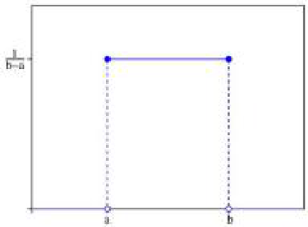

二项分布拿我们抛硬币的例子来说，比如x=0 是背面朝下的概率，x=1 是正面朝上的概率，那么它取值只有0 或1 两种情况，当然不用0 或1，你用-1 和+1 也是可以的。都是二项分布，取每个值都有一个概率值。在我们机器学习中，主要用的就是这几种概率分布。

### 随机向量

线性代数中，我们把标量x 推广到向量，就是它有多个分量。同样我们把单个随机变量可以推广到随机向量，就是它有多个分量，这样就有了随机向量的概念了，这是很自然的延申。离散型的随机向量向量X 取某一个具体的值为向量Xi，然后取每一个向量值的概率都大于等于0，所有的概率加起来要等于1，符合这两个约束条件就可以了

$$
P(X=1)=p,\qquad P(X=0)=1-p
$$

连续型的随机向量它是用0 和概率密度函数来描述的，n 重积分等于1，相当于体积等于1

$$
P(X=x_i)=p_i
$$

下面是二维的随机向量

<!-- PDF 第 46 页 -->

### 随机变量的独立性

两个随机变量如果相互独立的话，它们的联合概率密度函数等于它们的分别的概率密度函数

- 乘积

- 推广到多个随机变量相互独立

$$
f(x_1,\ldots,x_n)=f(x_1)f(x_2)\cdots f(x_n)\quad\text{（独立时）}
$$

这和随机事件的形式上是统一的，f 换成符合P 就可以了

### 协方差

协方差是对于方差的推广，对于两个随机变量，它们的协方差是反应它们两个之间的线性相关程度的，把x2 换成x1 那就是方差了，展开之后就是x1 和x2 的期望等于它们期望的乘积

$$
\operatorname{cov}(X_1,X_2)=E[(X_1-E(X_1))(X_2-E(X_2))]=E(X_1X_2)-E(X_1)E(X_2)
$$

对于n 维的向量X，它的协方差就构成了一个协方差矩阵，第一个是x1 和x1 的协方差，第一行第二个是x1 和x2 的协方差，第一行第n 个是x1 和xn 的协方差

$$
xx^T=\begin{bmatrix}x_1x_1&x_1x_2&\cdots&x_1x_n\\x_2x_1&x_2x_2&\cdots&x_2x_n\\\vdots&\vdots&\ddots&\vdots\\x_nx_1&x_nx_2&\cdots&x_nx_n\end{bmatrix}
$$

显然这是一个对称阵，这在我们机器学习里面会经常使用的

### 随机向量的常见分布

和随机变量一样，我们的随机向量也服从一些典型的分布，比如说正太分布和均匀分布，正太分布是对于一元的随机向量的一个推广

$$
f(x)=\frac{1}{(2\pi)^{n/2}|\Sigma|^{1/2}}\exp\left[-\frac12(x-\mu)^T\Sigma^{-1}(x-\mu)\right],\quad x\in\mathbb{R}^n
$$

Σ是协方差矩阵，然后不是绝对值，是行列式的开根号，μ是均值向量，然后Σ的逆矩阵这时我们再去理解一元的正太分布概率密度函数就好理解了，形式是一致的

$$
f(x)=\frac{1}{\sqrt{2\pi}\sigma}\exp\left(-\frac{(x-\mu)^2}{2\sigma^2}\right)
$$

以上就是多维的正太分布

<!-- PDF 第 47 页 -->

### 最大似然估计

它是解决估计一个概率密度函数中参数问题的比如有个向量X，θ是它的参数，比如正太分布中的μ和σ这都是需要估计的参数

$$
p(x;\theta)
$$

那我们怎么估计这组参数呢？肯定是根据一组样本来学习，假设我们有l 个样本它们是独立同分布的，也就是说它们服从同样一个概率分布，并且它们之间相互独立的，抽样出来的

$$
x_i,\qquad i=1,\ldots,l
$$

那么所有变量发生的概率就可以写成它们乘积的形式，因为它们之间是相互独立的嘛，这时L 是似然函数，这里x 一个个的已经取了具体样本的值了，然后θ是我们要估计的参数

$$
L(\theta)=\prod_{i=1}^{l}p(x_i;\theta)
$$

既然这组样本是已经抽样抽出来的，是已经发生的，我们肯定要把它发生的概率最大化，也就是说要最大化这样一个似然函数

$$
\max_{\theta}\prod_{i=1}^{l}p(x_i;\theta)
$$

前面我们说了，求解一个函数的极值，就是要求解它的导数，也就是梯度等于0

$$
\nabla L(\theta)=0
$$

而这样的乘积形式求导是不容易的，因为前面讲过公式

$$
(fg)'=f'g+fg'
$$

如果更多项展开是非常麻烦的，所以我们可以对函数取个对数，因为对数函数是单调增函数，所以求原函数的极值，也等于求它的对数形式的极值，所以我们两边取对数的话，就把连乘的形式转化为了连加的形式，因为连加的形式的导数，就是等于导数的连加

$$
\ln L(\theta)=\ln\prod_{i=1}^{l}p(x_i;\theta)=\sum_{i=1}^{l}\ln p(x_i;\theta)
$$

所以我们要解决的问题就是求这个函数的极大值，这个可以对θ求导让它等于0 得到，带log的是对数似然函数，这就是最大似然函数最基本的思想

$$
\max_{\theta}\sum_{i=1}^{l}\ln p(x_i;\theta)
$$

## 最优化

### 基本概念

最优化问题就是求f(x)的极大值或者极小值

<!-- PDF 第 48 页 -->

我们往往求极小值，在这里x 是优化变量，就是自变量，f(x)称为目标函数，可能还带有约束条件，有些优化问题既有等式约束，又有不等式约束

$$
\begin{aligned}\max\ f(x)&\Longleftrightarrow\min\bigl(-f(x)\bigr),\\g_i(x)&=0,\quad i=1,\ldots,m,\\h_j(x)&\le0,\quad j=1,\ldots,n.\end{aligned}
$$

满足这种约束条件，并且还在f(x)定义域之内的那些X 构成的集合叫可行域D

- 局部极小值

- 任何在X0 的邻域存在

$$
f(x)\ge f(x_0),\qquad \forall x\in\delta(x_0)
$$

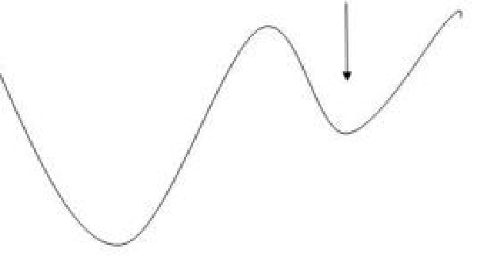

全局极小值

其实初中我们就学求极值的问题了，比如二次函数抛物线的顶点就是极大值或者极小

值，高中我们也会有求极值的题目，算一个非常复杂的函数的极值，借用初等数学一些的技巧来完成的。而真正的飞跃是发生在大学里面，微积分这门课为求解极值提供了一个统一的方法，就是找它导数等于0 的点，如果是多元函数的话，我们说它的梯度等于0，我们去解方程组就可以了，在机器学习里面我们遇到的几乎所有的函数都是可导的。光滑即可导

$$
f'(x)=0
$$

局部最小值（local minimum），通过大量实践发现在高维度的优化问题中，局部最

小值和全局最小值通常没有太大的区别，甚至在有些情况下比局部最小值有更好的归纳能力（泛化能力）。

### 为什么要迭代求解

前面咱们说了求极值就是导数或梯度等于0，找到疑似的极值，就是驻点f (x)=0驻点

有了微积分里面这样的手段，只要函数可导，我们求解不就行了？因为很多时候去求方程等于0 或方程组等于0 的根并不是那么容易，比如

$$
f(x,y)=x^3-2x^2+e^{xy}-y^3+10y^2+100\sin(xy)
$$

分别求对X 和Y 的偏导数

<!-- PDF 第 49 页 -->

$$
\begin{cases}3x^2-4x+ye^{xy}+100y\cos(xy)=0,\\xe^{xy}-3y^2+20y+x\cos(xy)=0.\end{cases}
$$

对于求下面的一些函数的方程叫做超越方程，别说超越方程了，对于5 次或以上的代数方程它都没有求根公式了，所以这个思路看上去很美，但是实际上是行不通的，我们得想其它的办法

$$
e^x,\qquad \ln x,\qquad \sin x,\qquad \arcsin x
$$

近似求解，我们先给个初始的值，看看它是不是极值点，当然得满足等式或者不等式约束，它如果不是，我们想办法再前进一步，只要我们得Xn 它越来越接近我们的极值点，那这个问题不就解决了嘛

$$
x_0\to x_1\to x_2\to\cdots\to x_n
$$

我们要构造一个序列，满足这样一个极限，当k 趋近于＋∞的时候，f(Xk)这点的梯度值极限趋近于0 的话，那我们就找到了函数的驻点

$$
\lim_{k\to+\infty}\nabla f(x_k)=0
$$

由此我们要解决的核心问题就变成了，怎么从当前一个点移动到下一个点上面去，也就是怎么从x 到k xk+1，迭代法是我们计算数学中经常采用的一种方法，它不单单可以求极值，还可以用来求方程组的解，包括线性方程，非线性方程，一个矩阵的特征值等等

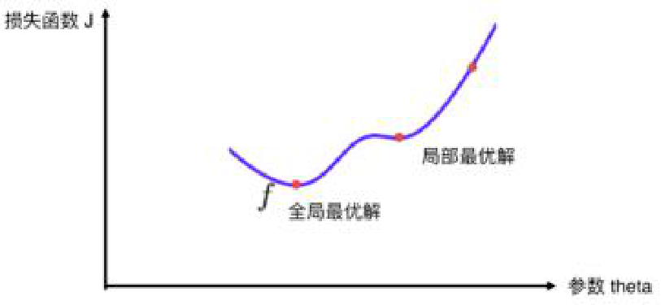

$$
\nabla f(X)=0
$$

### 梯度下降法

数值优化算法，是求近似解，而不是理论上面的精确解

$$
x_{k+1}=x_k-\eta\nabla f(x_k)
$$

下面我们来推导这个公式，需要用到多元函数的泰勒展开公式，最后加上一个高阶无穷小

$$
f(x)=f(x_0)+[\nabla f(x_0)]^T(x-x_0)+o(\|x-x_0\|)
$$

如果我们忽略高阶无穷小，也就是说x 它是属于x0 的δ邻域里面的话，那么等号就会变成约等于，那么我们把f(x0)放到等号左边

$$
\begin{aligned}f(x)-f(x_0)&\approx[\nabla f(x_0)]^T(x-x_0)\\&=\|\nabla f(x_0)\|\,\|x-x_0\|\cos\theta,\\x^Ty&=\|x\|\,\|y\|\cos\theta.\end{aligned}
$$

<!-- PDF 第 50 页 -->

这时要想下降的更快，就要让等式右边得到最小值，即当cosθ=-1，下降的幅度最大！单位向量代表的是方向，长度为1 的向量就是模为1 的向量称为单位向量。

$$
\|v\|=\sqrt{v_1^2+v_2^2+\cdots+v_n^2}
$$

向量乘以标量不会改变它的方向，只会改变它的幅值。这就是缩放向量的方法。所以一个向量可以表示为一个标量乘以一个单位向量。为了使得下降幅度最大，那么向量(x-x0)的方向和梯度的方向相反：

$$
v=-\frac{\nabla f(\theta_0)}{\|\nabla f(\theta_0)\|},\qquad \theta=\theta_0-\eta\frac{\nabla f(\theta_0)}{\|\nabla f(\theta_0)\|}
$$

分母是个标量，可以并入到η中，简化为：

$$
\theta=\theta_0-\eta\nabla f(\theta_0)
$$

需要注意的是，x 和x0 离的充分近，也就是在它的δ邻域里面，才能忽略掉泰勒展开里面的一次以上的项，否则就不能忽略它了，它就不是高阶无穷小了，约等于的条件就不成立了，所以η步长不能够太大，由此我们就得到了梯度下降法的公式。

$$
x=x_0,\qquad x_{k+1}=x_k-\eta\nabla f(x_k)
$$

- 实现细节问题

- 初始值的设定，随机或者设定满足约束条件的就OKAY

步长的设定，一个充分接近于0 的数就可以了，也可以动态的调整循环终止的判定，max_iteration，上一次减下一次的f(x)

### 牛顿法

$$
x_{k+1}=x_k-H_k^{-1}g_k
$$


这个方法是用伟大的物理学家和数学家命名的，莱布尼茨和牛顿都被普遍认为是独立的微积分发明者。牛顿最先将微积分应用到普通物理当中，而莱布尼茨创作了不少今天在微积分所使用的符号。牛顿利用了微积分的技巧，由万有引力及运动定律出发说明了他的宇宙体系，解决天体运动，流体旋转的表面，地球的扁率，摆线上重物的运动等问题。牛顿在解决数学

<!-- PDF 第 51 页 -->

物理问题时，使用了其独特的符号来进行计算，并提出了乘积法则、链式法则、高阶导数、泰勒级数。它是基于这样一个思想，我们不是要找梯度等于0 的点嘛，迭代x 让梯度值尽可能等于0

$$
\nabla f(X)=0,\qquad x_0\to x_1\to x_2\to\cdots\to x_n
$$

推导牛顿法的公式，多元函数的泰勒展开公式，这里我们把它展开成二次以上的项

$$
f(x)=f(x_0)+\nabla f(x_0)^T(x-x_0)+\frac12(x-x_0)^T H(x_0)(x-x_0)+o(\|x-x_0\|^2)
$$

同样当x 在x0 的δ邻域里面的话，我们可以把后面的高阶无穷小忽略掉，从而建立一个近似的等式，你现在不是要找梯度等于0 的x 嘛，我们现在用二次函数来代替原来的函数f(x)，在x0 处用一个抛物线来近似它，但是离x0 越远误差会越大，离x0 越近误差会越小

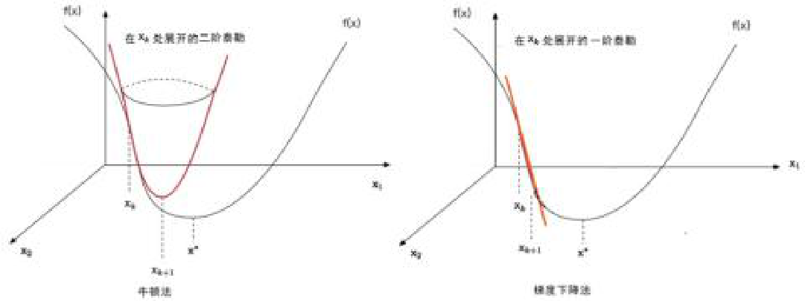

如果是二次函数的话，我们找它梯度等于0 的点是非常好找的，基于约等于的式子，两边同时求导，取梯度的话，就是下面

$$
\begin{aligned}f(x)&\approx f(x_0)+\nabla f(x_0)^T(x-x_0)\\&\quad+\frac12(x-x_0)^T H(x_0)(x-x_0).\end{aligned}
$$

因为，

$$
\nabla_x(w^T x)=w,\qquad \nabla_x(x^T A x)=(A+A^T)x
$$

所以，

$$
\nabla f(x)\approx\nabla f(x_0)+H(x_0)(x-x_0)=0
$$

下面就可以解一次方程，如果hessian 矩阵可逆，就可以两边乘上H 的逆矩阵

$$
g+H(x-x_0)=0\quad\Longrightarrow\quad x-x_0=-H^{-1}g
$$

前提是可逆的，同学们对比一下和梯度下降法的公式，注意一下H 和g 都是x=x0 点处取得的

$$
x_{k+1}=x_k-\eta g_k
$$

有同学肯定会说，那我们去求解方程组，那不是一次就可以求得梯度等于0 的点x 了嘛，但是因为我们忽略了后面的高阶无穷小，所以我们只是近似的找到了梯度等于0 的点，但是它并没有真正找到，所以我们下次要继续去用这个公式去迭代。

<!-- PDF 第 52 页 -->

$$
x_{k+1}=x_k-\eta H_k^{-1}g_k
$$

- 实现细节问题

- 初始值的设定，随机或者设定满足约束条件的就OKAY

步长的设定，η步长的设定和梯度下降法不同，不是迭代就一定使得f(x)下降，所以设置不好就有可能不收敛，求不到最优解的值，牛顿法一般会用line search 的技术，就是选择一些10-410-6等等，看看哪个步长使得f(xk+1)更小就反过来选择哪个作为步长

循环终止的判定，max_iteration，上一次减下一次的f(x)如果我们的x 是二次函数的话，牛顿法一步就可以收敛，前提是步长不做设置，等于1 的时候就可以了，这是因为如果原函数f(x)是二次函数的话，泰勒展开里面就不是约等于，而是直接等于在工程里面我们不是直接求解hessian 矩阵的逆矩阵，而是求一个方程组AX=b，可以用共轭梯度法梯度下降法只用到了一阶导数的信息，牛顿法既用到了一阶导数的信息，也用到了二阶导数的信息。

梯度下降法是用线性函数来代替目标函数，牛顿法是用二次函数来代替目标函数，所以说牛顿法的收敛速度是更快的。

但是牛顿法也有它的局限，hessian 矩阵不一定可逆，第二个即使存在，我们来解一个线性方程组，当hessian 矩阵规模很大，解线性方程组是非常耗时的，因此出现了一种改进的算法叫拟牛顿法

### 坐标下降法

分治法的思想

$$
\min f(x),\qquad x=(x_1,x_2,\ldots,x_n)
$$

它的思想是按住其它的不动，只优化其中一个比如x1，那就把多元函数求极值问题变成了一元函数求极值问题，这样优化的难度就小了很多，紧接着我们把其它的按住不动，再优化x，一直到2 x，完了之后再回来优化n x1，至于一个变量怎么解，可以用牛顿法或者公式来求解了，看具体问题的形式了SVM 中的SMO 算法就是把其中两个拿出来优化，其它的固定不动

- liblinear 库也大量的使用坐标下降法来求解的

- 直观的看就好比

<!-- PDF 第 53 页 -->

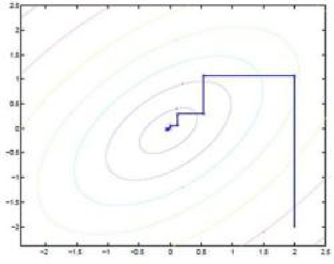

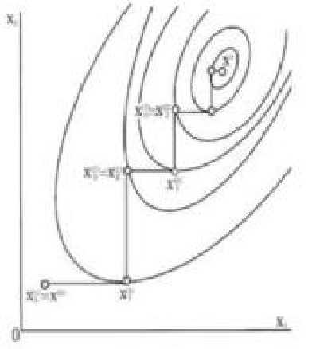

我们把所有的从x1 x 到2 x 优化一遍，就好比梯度下降迭代一次，这种方法它也有很大好处，n就是计算的工作量小很多

### 数值优化算法面临的问题

前面梯度下降法，还有牛顿法求极值的依据都是$\nabla f(x_k)=0$，而前面我们也说了函数在某一点的导数或梯度等于0 就是驻点，它只是函数取得极值的必要条件，不是充分条件，也就是说无法推导出

$$
\nabla f(x_k)=0\quad\Longrightarrow\quad x_k\text{ 为候选极值点}
$$

- 所有我们前面介绍的数值优化算法，都会面临两个问题

- 局部极值问题

这个问题好歹是个局部极值，只不过不是全局极值，理论上我们要求全局最优解的话，我们要把所有极小值找出来，你可能要不断的去设置不同的初始迭代点，反复的求解让它收敛到不同的局部最小值，然后来比较谁最小来找到一个全局最小值。

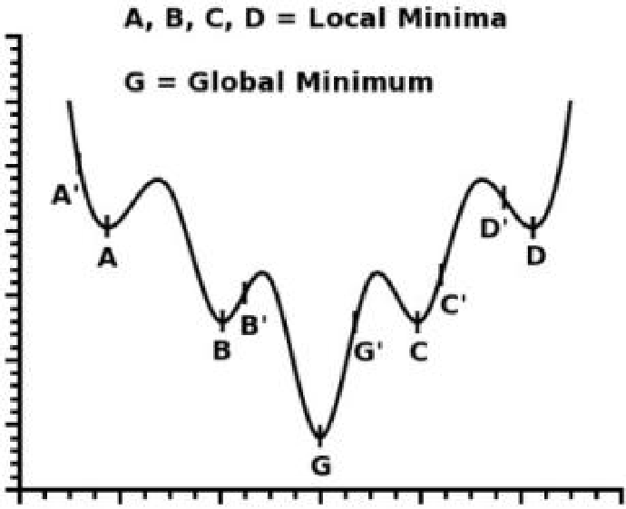

鞍点问题前面我们说过一元函数x 函数，在坐标为0 处它是驻点，但是它连局部最小值点都不是，3对应多元函数来说，我们称之为鞍点，严格定义是，在这一点它的hessian 矩阵是不定的，既不正定也不负定，这样它就即不是极小值的点也不是极大值的点。

<!-- PDF 第 54 页 -->

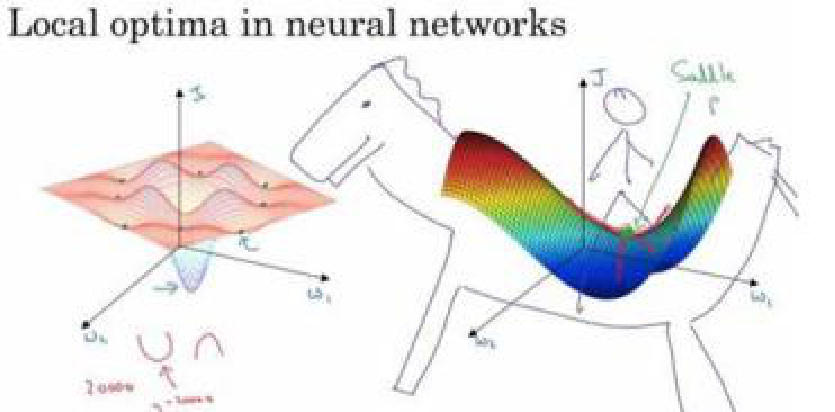

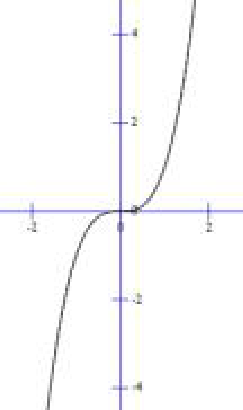

### 拉格朗日乘数法

高等数学和微积分的时候我相信大家都学过，用来求解等式约束下的极值问题的

$$
\min f(x),\qquad h_i(x)=0,\quad i=1,\ldots,k
$$

拉格朗日乘子函数，把对x 带约束条件的优化问题，转化为不带约束条件的优化问题

$$
L(x,\alpha)=f(x)+\sum_{i=1}^{k}\alpha_i h_i(x)
$$

下面两个式子是分布对x 和α求梯度，然后去解下面方程组就可以了

$$
\nabla_x f(x)+\sum_{i=1}^{k}\alpha_i\nabla_x h_i(x)=0,\qquad h_i(x)=0
$$

### 凸优化问题

前面我们说过数值优化面临两个问题，一个是局部极值问题，和鞍点问题，我们能不能避免这两个问题呢？只要我们对优化问题进行限定就可以，这类问题有两个限定条件

- 1，优化变量的可行域必须是凸集

- 2，优化函数必须是个凸函数

同时满足这两个限定条件的问题，叫做凸优化问题，从而才能说局部极小值就是全局极小值

### 凸集

凸集的定义：对于一个点的集合C，有x,y 它都是属于C 里面的两个点，它们两点的连线中任何一点也是属于集合C 的，

$$
\theta x+(1-\theta)y\in C
$$

<!-- PDF 第 55 页 -->

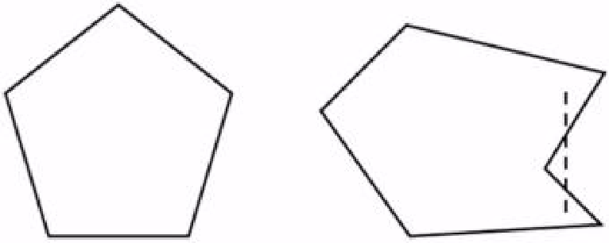

- 典型的凸集

- 欧式空间Rn

它的意义在于，很多时候可行域就是欧式空间，那肯定是凸集

仿射子空间x Rn:x 是n 维欧式空间里的向量，满足Ax=b 这个方程组的解，它构成的集合就是仿射子空间

$$
x,y\in C,\quad Ax=b,\quad A(\theta x+(1-\theta)y)=\theta Ax+(1-\theta)Ay=b
$$

它的意义在于，所有的等式约束构成的集合是凸集，很多时候等式约束就是这样的线性方程，所以一般我们不会构建处非线性的等式约束来。

多面体x Rn:

线性不等式的解

$$
\begin{aligned}x,y&\in C,\\A(\theta x+(1-\theta)y)&=\theta Ax+(1-\theta)Ay\\&\le\theta b+(1-\theta)b=b.\end{aligned}
$$

这样中间的点它还是不等式的解，所以说这样一个集合它还是凸集，它的现实意义在于，如果有一组线性不等式约束的话，那它构成的可行域也一定是凸集。凸集的交集也是凸集ICi如果有k 个集合C1 C ..2 C ,它们是凸集，那它们的交集也一定是凸集，它们的并集不是凸集，k会有凹的地方了

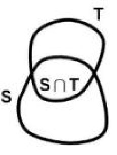

<!-- PDF 第 56 页 -->

### 凸函数

$$
f(\theta x+(1-\theta)y)<\theta f(x)+(1-\theta)f(y)
$$

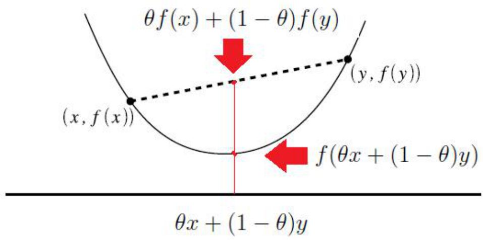

凸函数在函数上任意找两点它们的连续就是割线上的值比对应的f(x)的值要大证明函数是凸函数，第一种当然是利用上面定义去证明，也可以利用一阶导数信息，和二阶导数信息去证明。先说对于一元函数来说，怎么用一阶导数来判断是凸函数还是不是凸函数呢？f y≥f x +f x y−x) x 是切线和抛物线相交的点，y 是变化的多元函数f(y≥

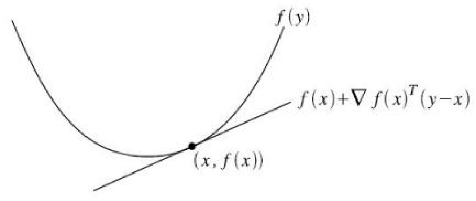

二阶判别法如果一元函数，那么f''(x)≥0就是凸函数，多元函数Hessian 矩阵是半正定的，它就是凸函数，>0 就是严格的凸函数，=0 就是有平的地方，就是有线性变化的地方比如ax+b 求二阶的时候就是=0.如果每个函数fi(x)都是凸函数，那么它们的非负线性组合f(x)=∑wi fi(x) if wi≥0也

是凸函数

### 凸优化的性质

凸优化的定义是目标函数是凸函数，可行域是个凸集，如果有这两个限定条件的话，局部最

<!-- PDF 第 57 页 -->

优解一定是全局最优解，下面证明对于凸优化问题，它的局部最优解一定是全局最优解：反证法，假设有一点x 是局部最小值，但不是全局最小值，那样就存在另外一个点y 是全局最小值位置，这时f(y)<f(x)

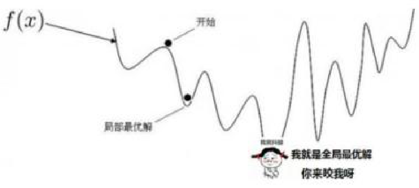

如果可以证明x 的邻域有个点z 是比x 的值还小的，f(z)<f(x)，那么x 肯定不是最优解了

$$
z=\theta y+(1-\theta)x,\qquad \theta=\frac{\delta}{2\|x-y\|_2}
$$

δ是邻域半径x −y 2是L2 范数，表示x 和y 两点之间的距离，把θ带进来

证明z 是在x 邻域的，也就是小于等于δ的

$$
\begin{aligned}\|x-z\|_2&=\left\|x-\left(\frac{\delta}{2\|x-y\|_2}y+\left(1-\frac{\delta}{2\|x-y\|_2}\right)x\right)\right\|_2\\&=\frac{\delta}{2\|x-y\|_2}\|x-y\|_2=\frac{\delta}{2}<\delta,\\f(z)&=f(\theta y+(1-\theta)x)\\&\le\theta f(y)+(1-\theta)f(x)\\&=\theta(f(y)-f(x))+f(x)<f(x).\end{aligned}
$$

根据凸函数的性质，同时f(y)<f(x)，θ>0

所以这和前面的假设是矛盾的，所以说前面的性质是成立的

### 凸优化一般的表述形式

$$
\begin{aligned}\min_{x\in C}f(x),\quad&C\text{ 为凸集},\\\min f(x)\quad&\text{满足 }c_i(x)\le0,\ i=1,\ldots,m,\\&h_j(x)=0,\ j=1,\ldots,k.\end{aligned}
$$

C 是凸集

由不等式等式约束条件构成的可行域也是凸集

往往我们需要去证明的一些机器学习算法它们都是凸优化问题，比如逻辑回归，SVM，线性回归等，证明它的可行域是凸集，目标函数是凸函数就可以了，凸优化规避了局部最小值问题，而且也规避了鞍点问题，f(x)是凸函数，它的hessian 矩阵是半正定的，当是半正定的也就规避了鞍点问题

<!-- PDF 第 58 页 -->

### 拉格朗日对偶

凸优化，非线性规划问题，甚至是运筹学里面的线性规划问题都会涉及这个概念，它的意义是把原始问题转化为另外一个问题来求解，但是转化之后的问题要容易求解一点，拉格朗日乘数法的扩展，用来解决既带等式约束条件，又带不等式约束条件的一种方法通过把原问题转换为对偶问题来求解，很多时候对偶问题比原问题更容易求解

$$
\begin{aligned}\min\quad&f(x),\\g_i(x)&\le0,\quad i=1,\ldots,m,\\h_j(x)&=0,\quad j=1,\ldots,k.\end{aligned}
$$

构建一个广义的拉格朗日函数，所谓广义就是还包括不等式约束条件在下面式子中你会发现对x 的约束没有了，虽然有个对α的约束

$$
L(x,\alpha,\beta)=f(x)+\sum_{i=1}^{m}\alpha_i g_i(x)+\sum_{j=1}^{k}\beta_j h_j(x)
$$

原始问题

$$
p^*=\min_x\max_{\alpha,\beta,\,\alpha_i\ge0}L(x,\alpha,\beta)=\min_x\theta_p(x)
$$

原始问题等价于我们要求解的问题！

### KKT 条件

拉格朗日乘数法的扩展，用来解决既带等式约束条件，又带不等式约束条件的一种理论结果

$$
\begin{aligned}\nabla_x L(x^*,\lambda,\mu)&=0,\\\mu_i&\ge0,\\\mu_i g_i(x^*)&=0,\\h_j(x^*)&=0,\\g_i(x^*)&\le0.\end{aligned}
$$

$$
\begin{aligned}\min\quad&f(x),\\g_i(x)&\le0,\quad i=1,\ldots,q,\\h_j(x)&=0,\quad j=1,\ldots,p,\\L(x,\lambda,\mu)&=f(x)+\sum_{j=1}^{p}\lambda_jh_j(x)+\sum_{i=1}^{q}\mu_i g_i(x).\end{aligned}
$$

