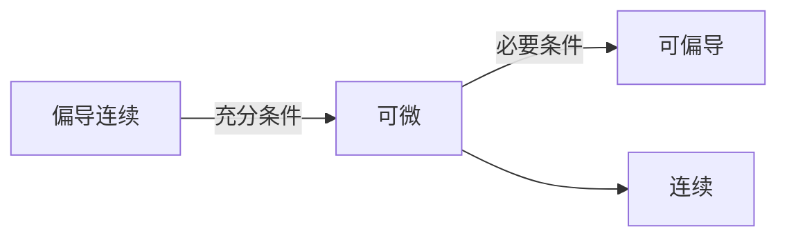

### 全微分的实质

全微分的实质，是寻找多元函数全增量的一种线性近似表达。

多元函数的表达式可能比较复杂，直接计算函数增量的精确值不方便，因此希望找到一个关于自变量增量的线性表达式，近似代替真实的函数增量。线性表达式形式简单，也更容易计算。

> **注意：** 全微分要解决的是“怎样近似计算函数的增量”。先记住“增量的线性近似”这句话，学完定义和公式后再回头理解。

### 一元函数微分的回顾

设 $y=f(x)$ 在所讨论的点 $x$ 的某个邻域内有定义。自变量取得增量 $\Delta x$ 后，要求 $x+\Delta x$ 仍在定义域内。

函数的真实增量为：$\Delta y=f(x+\Delta x)-f(x)$。

如果存在一个不依赖于 $\Delta x$ 的常数 $A$，使得当 $\Delta x\to0$ 时：$\Delta y=A\Delta x+o(\Delta x)$，则称函数在该点可微。

左边是精确的函数增量，右边将其分成两部分：

- $A\Delta x$：关于自变量增量的线性部分；
- $o(\Delta x)$：相对于 $\Delta x$ 的高阶无穷小，即误差项。

把线性部分称为函数在该点的微分，记作：$dy=A\Delta x$。

因此：$\Delta y=dy+o(\Delta x)$。

> **注意：** “可微”描述的是函数增量能够写成“线性部分＋高阶误差”的性质；“微分”则是给其中的线性部分起的名称。微分本身不包含后面的误差项。

在一元函数中，可微与可导互为充要条件：$\text{可微}\iff\text{可导}$。

而且，微分中的系数就是函数在所讨论位置的导数：$A=f'(x)$。

所以一元函数的微分公式是：$dy=f'(x)\Delta x$。

对于自变量，记 $dx=\Delta x$，于是：$dy=f'(x)dx$。

如果将所讨论的位置固定记作 $x_0$，同一个公式写成 $dy=f'(x_0)dx$。在固定点处，$f'(x_0)$ 是一个确定的数；换一个位置，这个系数可能改变。

> **注意：** 在哪一点计算微分，系数 $A$ 就是哪一点的导数值。

### 二元函数的全增量与偏增量

设 $z=f(x,y)$，其中 $(x,y)$ 属于函数的定义域 $D_f$。改变自变量后，也要求 $(x+\Delta x,y+\Delta y)$ 在定义域内。

**全增量：** 允许两个自变量分别取得增量 $\Delta x$、$\Delta y$，新函数值减去原函数值：

$\Delta z=f(x+\Delta x,y+\Delta y)-f(x,y)$。

**关于 $x$ 的偏增量：** 固定 $y$，只改变 $x$：$\Delta_x z=f(x+\Delta x,y)-f(x,y)$。

**关于 $y$ 的偏增量：** 固定 $x$，只改变 $y$：$\Delta_y z=f(x,y+\Delta y)-f(x,y)$。

偏增量就是全增量的特殊情况：令 $\Delta y=0$，得到关于 $x$ 的偏增量；令 $\Delta x=0$，得到关于 $y$ 的偏增量。“全增量”允许两个变量都变化，但不要求两个增量都必须非零。

> **注意：** 全增量要同时考虑所有自变量的增量；偏增量只让其中一个变量变化，其他变量保持原来的值。

### 偏增量与偏微分

固定 $y$ 后，$f(x,y)$ 可以看成关于 $x$ 的一元函数。若该点关于 $x$ 的偏导数存在，应用一元函数的增量公式，有：

$f(x+\Delta x,y)-f(x,y)=f_x(x,y)\Delta x+o(\Delta x)$。

其中的线性部分：$f_x(x,y)\Delta x$   称为函数关于 $x$ 的偏微分。

同理，若该点关于 $y$ 的偏导数存在，则：

$f(x,y+\Delta y)-f(x,y)=f_y(x,y)\Delta y+o(\Delta y)$。

其中的线性部分：$f_y(x,y)\Delta y$    称为函数关于 $y$ 的偏微分。

这里统一用 $f_x$、$f_y$ 表示一阶偏导函数，即 $f_x=\dfrac{\partial z}{\partial x}$、$f_y=\dfrac{\partial z}{\partial y}$；也可记作 $f_x'$、$f_y'$。

> **注意：** 固定另一个变量后，偏增量的处理就是一元函数的处理。在固定的 $(x,y)$ 处，$f_x(x,y)$、$f_y(x,y)$ 都是确定的系数。偏微分是“偏导数乘对应变量的增量”这一项，不包括高阶误差。

> **理解：“固定 $y$ 后，$f(x,y)$ 可以看成关于 $x$ 的一元函数”**
>
> 在 $(x_0,y_0)$ 处求函数关于 $x$ 的偏微分时，“固定 y”就是取 $y=y_0$，用平面 $y=y_0$ 截曲面，得到经过对应曲面点的截线：
>
> $\begin{cases}z=f(x,y_0),\\y=y_0.\end{cases}$
>
> 在这个平面内，截线可以用一元函数 $g(x)=f(x,y_0)$ 描述，这个截线说白了就是关于x的一元函数。因此，现在求二元函数在某一点的偏微分就回到了一元函数的微分：先求截线在 $x_0$ 处的导数 $g'(x_0)=f_x(x_0,y_0)$，再乘上自变量的增量，得到 $g'(x_0)\Delta x=f_x(x_0,y_0)\Delta x$。
>
> 这就是原函数在 $(x_0,y_0)$ 处关于 $x$ 的偏微分，它近似的是只改变 $x$、保持 $y=y_0$ 时产生的偏增量。
>
> 同理，求关于 $y$ 的偏微分时，取平面 $x=x_0$ 截曲面，再对得到的一元函数 $f(x_0,y)$ 求微分，得到 $f_y(x_0,y_0)\Delta y$。
>

### 引例：函数的全增量能否找到一个线性近似？

取函数 $z=x^2+y^2$，考察它在 $(1,1)$ 处的全增量。

因为 $f(1,1)=2$，所以：

$\Delta z=f(1+\Delta x,1+\Delta y)-f(1,1)$

$\phantom{\Delta z}=(1+\Delta x)^2+(1+\Delta y)^2-2$

$\phantom{\Delta z}=2\Delta x+2\Delta y+(\Delta x)^2+(\Delta y)^2$。

这里，$2\Delta x+2\Delta y$ 已经是关于两个自变量增量的线性表达式。接下来需要判断：剩余项 $(\Delta x)^2+(\Delta y)^2$ 能否作为高阶误差，从而允许我们用前面的线性部分近似全增量。

**判断高阶误差，需要先确定比较的尺度。**

在一元函数微分中，我们把误差与自变量增量 $\Delta x$ 比较；从距离角度看，比较的尺度就是 $|\Delta x|$。

现在两个自变量都可能变化，就需要用一个量来衡量它们合起来的变化大小。这个量就是自变量平面内两点之间的距离：

$\rho=\sqrt{(\Delta x)^2+(\Delta y)^2}$。

在本例中，它表示 $(1,1)$ 与 $(1+\Delta x,1+\Delta y)$ 之间的距离。一般地，它表示 $(x,y)$ 与 $(x+\Delta x,y+\Delta y)$ 之间的距离。

> **注意：** $\rho$ 对应一元情形中的 $|\Delta x|$。$\Delta x$ 可以带正负号，其绝对值表示距离；$\rho$ 本身就是非负的距离。它衡量的是自变量的整体变化大小，不是函数值的变化量，也不是曲面上两点的空间距离。

因此，$\rho\to0$ 就等价于 $(\Delta x,\Delta y)\to(0,0)$。

**有了这个尺度，就可以判断剩余项是否为高阶无穷小。**

将剩余项除以 $\rho$：

$\displaystyle \frac{(\Delta x)^2+(\Delta y)^2}{\rho}
=\frac{\rho^2}{\rho}
=\rho$。

当 $\rho\to0$ 时，这个比值趋于零，所以：

$\displaystyle \lim_{(\Delta x,\Delta y)\to(0,0)}
\frac{(\Delta x)^2+(\Delta y)^2}{\rho}=0$。

这说明剩余项比自变量的整体变化距离更高阶，即：$(\Delta x)^2+(\Delta y)^2=o(\rho)$。

**于是，最初的全增量就能写成：**

$\boxed{\Delta z=2\Delta x+2\Delta y+o(\rho)}$。

因此，当自变量的整体变化距离 $\rho$ 很小时，可以使用线性部分近似全增量：

$\boxed{\Delta z\approx2\Delta x+2\Delta y}$。

这个引例说明：多元函数的全增量确实可能写成“关于自变量增量的线性部分＋相对于整体变化距离的高阶误差”。后面的全微分定义，就是将这种形式推广到一般函数。

> **理解时注意：** 严格比较的对象是误差与 $\rho$

### 全微分的定义

设 $z=f(x,y)$ 在点 $(x,y)$ 的某个邻域内有定义。若存在两个常数 $A$、$B$，使得当 $(\Delta x,\Delta y)\to(0,0)$ 时，全增量可以表示为：

$\Delta z=f(x+\Delta x,y+\Delta y)-f(x,y)$

$\phantom{\Delta z}=A\Delta x+B\Delta y+o(\rho)$，

其中 $\rho=\sqrt{(\Delta x)^2+(\Delta y)^2}$，则称函数在 $(x,y)$ 处可微。

将其中的线性部分 $A\Delta x+B\Delta y$ 称为函数在该点的全微分，记作：

$\boxed{dz=A\Delta x+B\Delta y}$。

因此：

$\boxed{\Delta z=dz+o(\rho)}$。

当 $\rho$ 很小时，可以用全微分近似全增量：

$\Delta z\approx dz$。

> **注意：** “可微”是函数满足上述分解的性质；“全微分”是分解中的线性部分。二元函数有两个自变量，所以有两个系数；一元函数只有一个自变量，所以只有一个系数。

> **注意：** 改变后的点必须仍在定义域内。定义中的“任意增量”是指在趋近于零的过程中，所有允许的增量组合都要满足上述要求；不是只选某个方向（$\Delta x$、$\Delta y$ 都趋于零，但趋零的速度和比例可以不同eg:$\Delta y=\Delta x$：沿直线趋近；$\Delta y=2\Delta x$：沿另一条直线趋近；$\Delta y=(\Delta x)^2$：沿曲线趋近，两个增量趋于零的速度不同。可微要求：无论沿什么方向或路径趋近，都有 $\Delta z=A\Delta x+B\Delta y+o(\rho)$，且使用同一组系数 $A$、$B$）； 并且线性近似通常只在增量足够小时才准确 。

**几点小细节**

固定所讨论的点 $(x,y)$ 后，$A$、$B$ 是常数，与增量 $\Delta x$、$\Delta y$ 无关。

换一个点，$A$、$B$ 可能改变；只改变增量而不改变所讨论的点，$A$、$B$ 不变。

> **注意：** 点不变，系数就不变；系数只与所讨论的位置有关，不能为了配合不同的增量方向而临时更换系数。

如果函数在区域 $D$ 内的每一点都可微，就称函数在 $D$ 内可微，也称其为 $D$ 内的可微函数。

### 可微一定推出连续

若函数在某点可微，则：$\Delta z=A\Delta x+B\Delta y+o(\rho)$。

当 $(\Delta x,\Delta y)\to(0,0)$ 时：

- $A\Delta x\to0$；
- $B\Delta y\to0$；
- $\rho\to0$，因此 $o(\rho)\to0$。

所以：

$\displaystyle \lim_{(\Delta x,\Delta y)\to(0,0)}\Delta z=0$。

这等价于：

$\displaystyle \lim_{(\Delta x,\Delta y)\to(0,0)}f(x+\Delta x,y+\Delta y)=f(x,y)$。

因此函数在该点连续，即：

$\boxed{\text{可微}\Longrightarrow\text{连续}}$。

> **注意：** 这是在同一个点处的结论。“连续”的另一种说法就是：自变量的增量趋于零时，函数增量也趋于零。

### 例1：由极限条件判断可微并求全微分

已知 $f(x,y)$ 在 $(0,0)$ 处连续，且：$\displaystyle \lim_{(x,y)\to(0,0)}\frac{f(x,y)-3x+4y}{\sqrt{x^2+y^2}}=0$。

判断函数在 $(0,0)$ 处是否可微；若可微，求 $\left.df\right|_{(0,0)}$。

**第一步：确定 $f(0,0)$。**

因为分式趋于零，分母 $\sqrt{x^2+y^2}$ 也趋于零，所以分子趋于零：

$\displaystyle \lim_{(x,y)\to(0,0)}[f(x,y)-3x+4y]=0$。

又因为 $3x\to0$、$4y\to0$，得到：

$\displaystyle \lim_{(x,y)\to(0,0)}f(x,y)=0$。

结合题目给出的连续性：$\boxed{f(0,0)=0}$。

> **注意：** 先求 $f(0,0)$，是因为可微定义需要的是全增量 $f(x,y)-f(0,0)$。不能直接把 $f(x,y)$ 当作全增量；这里用到连续性，才能确定原点的函数值。

**第二步：把极限条件改写为高阶无穷小。**

令 $\rho=\sqrt{x^2+y^2}$。由已知极限：

$f(x,y)-3x+4y=o(\rho)$。

因为 $f(0,0)=0$，移项后：

$f(x,y)-f(0,0)=3x-4y+o(\rho)$。

**第三步：改写成原点处的增量形式。**

在 $(0,0)$ 处，$x=0+\Delta x=\Delta x$、$y=0+\Delta y=\Delta y$。因此：

$f(\Delta x,\Delta y)-f(0,0)=3\Delta x-4\Delta y+o(\rho)$，

其中 $\rho=\sqrt{(\Delta x)^2+(\Delta y)^2}$。

左边就是 $\Delta z$，右边符合可微定义，且 $A=3$、$B=-4$。因此函数在 $(0,0)$ 处可微，并且：

$\boxed{\left.df\right|_{(0,0)}=3\Delta x-4\Delta y}$。

采用 $dx=\Delta x$、$dy=\Delta y$ 的记法，也就是：

$\boxed{\left.df\right|_{(0,0)}=3dx-4dy}$。

> **注意：** “分子除以分母的极限为零”，可以改写成“分子是分母的高阶无穷小”。本题依靠的是可微定义，不需要知道 $f$ 的具体表达式。注意移项后的系数是 $3$ 和 $-4$。

### 可微的必要条件：可微推出可偏导

一元函数在某点可微与可导等价。对于多元函数，要分别考察两个方向：可微能否推出可偏导？可偏导能否推出可微？

**定理1（可微的必要条件）：** 若 $z=f(x,y)$ 在点 $(x,y)$ 处可微，则该点的两个一阶偏导数都存在，且：$\boxed{A=f_x(x,y), B=f_y(x,y)}$。这里“可偏导”指该点关于各个自变量的一阶偏导数都存在。

**证明：** 由可微定义：

$f(x+\Delta x,y+\Delta y)-f(x,y)=A\Delta x+B\Delta y+o(\rho)$，

其中 $\rho=\sqrt{(\Delta x)^2+(\Delta y)^2}$。

特别地，令 $\Delta y=0$。此时 $\rho=|\Delta x|$，所以：

$f(x+\Delta x,y)-f(x,y)=A\Delta x+o(|\Delta x|)$。

两边除以 $\Delta x\ne0$：

$\displaystyle \frac{f(x+\Delta x,y)-f(x,y)}{\Delta x}=A+\frac{o(|\Delta x|)}{\Delta x}$。

误差项可以写成：

$\displaystyle \frac{o(|\Delta x|)}{\Delta x}=\frac{o(|\Delta x|)}{|\Delta x|}\cdot\frac{|\Delta x|}{\Delta x}$。

其中第一项因子趋于零，第二项因子在 $\Delta x\ne0$ 时只取 $1$ 或 $-1$，是有界的。因此乘积趋于零，得到：

$\displaystyle \lim_{\Delta x\to0}\frac{f(x+\Delta x,y)-f(x,y)}{\Delta x}=A$。

左边就是关于 $x$ 的偏导数定义，所以 $f_x(x,y)$ 存在，且 $f_x(x,y)=A$。

同理，令 $\Delta x=0$，得到：

$f(x,y+\Delta y)-f(x,y)=B\Delta y+o(|\Delta y|)$。

两边除以 $\Delta y$ 并令其趋于零，得到 $f_y(x,y)=B$。因此：

$\boxed{\text{可微}\Longrightarrow\text{可偏导}}$。

> **注意：** 能令 $\Delta y=0$，是因为可微定义对所有允许的增量组合都成立。这样就把全增量变成了关于 $x$ 的偏增量，恰好构造出偏导数定义。证明关于 $y$ 的偏导数时，改为令 $\Delta x=0$ 即可。

> **注意：** $\sqrt{(\Delta x)^2}=|\Delta x|$，不能直接漏掉绝对值。除以 $\Delta x$ 后，通过有界的正负号因子处理即可；不需要这个正负号因子本身有极限。

> **注意：** 这个证明不仅说明偏导存在，还确定了全微分中的两个系数：$A$ 就是关于 $x$ 的偏导数，$B$ 就是关于 $y$ 的偏导数。

### 利用定义判断某点是否可微

判断 $z=f(x,y)$ 在 $(x_0,y_0)$ 处是否可微，可以分两步。

**第一步：求该点的两个一阶偏导数。**

先求 $f_x(x_0,y_0)$、$f_y(x_0,y_0)$。只要其中任何一个不存在，就可以断定函数在该点不可微。

这是“可微必然可偏导”的逆否结论。

**第二步：验证剩余项是否为 $o(\rho)$。**

若两个偏导数都存在，记真实的全增量为：

$\Delta z=f(x_0+\Delta x,y_0+\Delta y)-f(x_0,y_0)$。

要验证该等式是否成立：$\Delta z=f_x(x_0,y_0)\Delta x+f_y(x_0,y_0)\Delta y+o(\rho)$，其中 $\rho=\sqrt{(\Delta x)^2+(\Delta y)^2}$。

也就是验证全增量减去两个偏导数给出的线性部分后，剩余项是否相对于 $\rho$ 为高阶无穷小。

将它转化为便于计算的极限：

$\displaystyle \lim_{(\Delta x,\Delta y)\to(0,0)}\frac{\Delta z-f_x(x_0,y_0)\Delta x-f_y(x_0,y_0)\Delta y}{\sqrt{(\Delta x)^2+(\Delta y)^2}}=0$。

若该极限等于零，则可微；若极限不存在，或存在但不等于零，则不可微。

> **注意：** 两个偏导数只负责确定线性部分的系数；求出它们后，还要验证误差条件。判断的关键不是随意写出一个 $o(\rho)$，而是验证剩余项除以 $\rho$ 的极限确实为零。

### 可偏导为什么不能反过来推出可微？

偏导数只检查两种特殊变化：固定 $y$、只改变 $x$；固定 $x$、只改变 $y$。

可微却要求同一个线性表达式 $A\Delta x+B\Delta y$，对于所有趋于零的增量组合都能满足误差要求。它不只检查平行坐标轴的变化，也要覆盖两个变量同时变化的各种情况。

因此，可微的要求比可偏导更强，不能仅凭两个偏导数存在就断定可微。

> **注意：** 可偏导只考察两个坐标方向，可微要求对任意增量组合成立。严格地说，这里还包括沿曲线路径趋近的情况，不能只检查几条直线就证明可微。

### 反例：偏导存在，但函数不可微

设：

$f(x,y)=\begin{cases}\dfrac{xy}{\sqrt{x^2+y^2}},&(x,y)\ne(0,0),\\0,&(x,y)=(0,0).\end{cases}$

考察它在 $(0,0)$ 处的偏导数和可微性。

**第一步：用定义求原点处的偏导数。**

因为 $f(\Delta x,0)=0$、$f(0,0)=0$，所以：

$\displaystyle f_x(0,0)=\lim_{\Delta x\to0}\frac{f(\Delta x,0)-f(0,0)}{\Delta x}=0$。

同理：

$\displaystyle f_y(0,0)=\lim_{\Delta y\to0}\frac{f(0,\Delta y)-f(0,0)}{\Delta y}=0$。

因此两个偏导数都存在。

**第二步：验证可微定义中的误差极限。**

若函数可微，线性部分只能是 $0\cdot\Delta x+0\cdot\Delta y=0$。需要检查：

$\displaystyle \frac{f(\Delta x,\Delta y)-f(0,0)-f_x(0,0)\Delta x-f_y(0,0)\Delta y}{\sqrt{(\Delta x)^2+(\Delta y)^2}}$

$\displaystyle =\frac{f(\Delta x,\Delta y)}{\sqrt{(\Delta x)^2+(\Delta y)^2}}$

$\displaystyle =\frac{\Delta x\Delta y}{(\Delta x)^2+(\Delta y)^2}$。

沿路径 $\Delta y=\Delta x$ 趋于原点时，该比值为：

$\displaystyle \frac{(\Delta x)^2}{2(\Delta x)^2}=\frac12$。

沿这条路径的极限不等于零，因此整个二元极限不可能等于零，函数在 $(0,0)$ 处不可微。

所以：

$\boxed{\text{可偏导}\nRightarrow\text{可微}}$。

> **注意：** 要否定误差极限等于零，只需找到一条趋近路径，使沿该路径的比值不趋于零；不必算完所有路径。但只找到一条路径极限为零，不能反过来证明二元极限为零。

本例中，沿 $\Delta y=0$ 时比值为零，沿 $\Delta y=\Delta x$ 时为 $\tfrac12$，所以这个误差比值的二元极限实际上不存在。这里讨论的是“误差除以距离”的极限，不应与原函数的极限混淆。

### 可微的充分条件：偏导连续推出可微

**定理2（可微的充分条件）：** 若 $f_x$、$f_y$ 在点 $(x_0,y_0)$ 的某个邻域内存在，并且这两个偏导函数在 $(x_0,y_0)$ 处连续，则 $f$ 在该点可微。

简记为：

$\boxed{\text{偏导连续}\Longrightarrow\text{可微}}$。

> **注意：** 连续的是两个偏导函数 $f_x$、$f_y$，不是仅仅要求原函数 $f$ 连续。不能把这个条件误记成“原函数连续＋偏导存在，就可微”。这一定理本节不作证明，直接掌握结论。

“关于 $x$ 的偏导函数在该点连续”是指：

$\displaystyle \lim_{(x,y)\to(x_0,y_0)}f_x(x,y)=f_x(x_0,y_0)$。

“关于 $y$ 的偏导函数在该点连续”是指：

$\displaystyle \lim_{(x,y)\to(x_0,y_0)}f_y(x,y)=f_y(x_0,y_0)$。

它们本身也是二元函数，要用二元函数连续的定义判断，不能只固定一个变量检查。

> **注意：** 必要条件回答“可微一定能推出什么”；充分条件回答“有什么条件就足够保证可微”。偏导连续是充分条件，不是可微的必要条件。

### 二元函数的全微分公式

由必要条件已经确定 $A=f_x(x,y)$、$B=f_y(x,y)$。所以，当 $z=f(x,y)$ 在该点可微时：

$dz=f_x(x,y)\Delta x+f_y(x,y)\Delta y$。

对这里作为自变量的 $x$、$y$，记：

$dx=\Delta x,\qquad dy=\Delta y$。

于是得到二元函数的全微分公式：$\boxed{dz=f_x(x,y)dx+f_y(x,y)dy}$。

也可以写成：$\boxed{dz=\frac{\partial z}{\partial x}dx+\frac{\partial z}{\partial y}dy}$。

两种写法完全相同。它们把全微分写成两个偏微分之和：

- $f_x(x,y)dx$：关于 $x$ 的偏微分；
- $f_y(x,y)dy$：关于 $y$ 的偏微分。

这个性质称为全微分的叠加原理。

> **注意：** 计算全微分，最终就是求各个偏导数，再分别乘对应变量的微分并相加。“对哪个变量的偏微分”，就是“对哪个变量求偏导，再乘哪个变量的微分”。这是本节必须掌握的重点。

> **理解时注意：** 全微分等于偏微分之和，不表示真实的全增量一定等于在同一个原位置计算的两个偏增量之和。前者是可微时的线性部分叠加，后者一般还会含有额外误差。

**求二元函数在某一点处的微分的小细节：**

函数在具体点 $(x_0,y_0)$ 处的全微分记作：

$\boxed{\left.dz\right|_{(x_0,y_0)}=f_x(x_0,y_0)dx+f_y(x_0,y_0)dy}$。

这里只将两个偏导函数中的变量替换为坐标 $x_0$、$y_0$，使它们成为具体的系数。

$dx$、$dy$ 表示自变量的增量，仍然保留为 $dx$、$dy$。它们不是坐标值，不能替换成 $x_0$、$y_0$，也不要把代入操作误写成 $d(x_0)$、$d(y_0)$。

> **注意：** $dx$、$dy$ 要作为整体理解，它们分别就是 $\Delta x$、$\Delta y$。指定了在哪一点计算，不等于指定了增量大小。只给出具体点，没有给出增量时，全微分的结果仍然含有 $dx$、$dy$。

### 三元函数的全微分公式

若 $u=f(x,y,z)$ 在所讨论的点可微，则：

$\boxed{du=\frac{\partial u}{\partial x}dx+\frac{\partial u}{\partial y}dy+\frac{\partial u}{\partial z}dz}$。

二元函数有两个自变量，全微分有两项；三元函数有三个自变量，全微分有三项。每一项都是“对应的偏导数乘对应自变量的微分”。更多自变量时也按同样方式推广。

> **例2：求二元函数的全微分**

求 $z=x^2y+y^2$ 的全微分。

先求两个偏导数：

$\displaystyle \frac{\partial z}{\partial x}=2xy,\qquad \frac{\partial z}{\partial y}=x^2+2y$。

代入公式：

$\displaystyle dz=\frac{\partial z}{\partial x}dx+\frac{\partial z}{\partial y}dy$。

得到：

$\boxed{dz=2xy\,dx+(x^2+2y)\,dy}$。

> **例3：求指定点处的全微分**

求 $z=e^{xy}$ 在 $(2,1)$ 处的全微分。

先求偏导数：

$\displaystyle \frac{\partial z}{\partial x}=ye^{xy},\qquad \frac{\partial z}{\partial y}=xe^{xy}$。

代入 $(2,1)$：

$\displaystyle \left.\frac{\partial z}{\partial x}\right|_{(2,1)}=e^2,\qquad \left.\frac{\partial z}{\partial y}\right|_{(2,1)}=2e^2$。

所以：

$\boxed{\left.dz\right|_{(2,1)}=e^2dx+2e^2dy=e^2(dx+2dy)}$。

>  **例4：求三元函数的全微分**

求 $u=x+\sin\frac{y}{2}+e^{yz}$ 的全微分。

这是三元函数，应当有三个偏微分相加。

对 $x$ 求偏导时，把 $y$、$z$ 当常数：

$\displaystyle \frac{\partial u}{\partial x}=1$。

对 $y$ 求偏导时，把 $x$、$z$ 当常数：

$\displaystyle \frac{\partial u}{\partial y}=\frac12\cos\frac{y}{2}+ze^{yz}$。

对 $z$ 求偏导时，把 $x$、$y$ 当常数：

$\displaystyle \frac{\partial u}{\partial z}=ye^{yz}$。

代入三元函数的全微分公式：

$\boxed{du=dx+\left(\frac12\cos\frac{y}{2}+ze^{yz}\right)dy+ye^{yz}dz}$。

> **注意：** 先确认有三个自变量，再逐个求偏导；每次只对当前变量求导，其余两个变量都当常数。求出的三个系数分别乘 $dx$、$dy$、$dz$。

### 可微、可偏导、连续与偏导连续的关系

以下关系均针对同一个点讨论；“偏导连续”包含前面所述的邻域内存在、在该点连续的条件。

> 没画箭头的地方就说明没有任何关系

