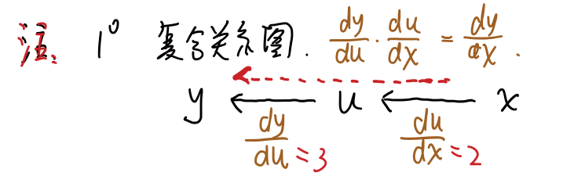
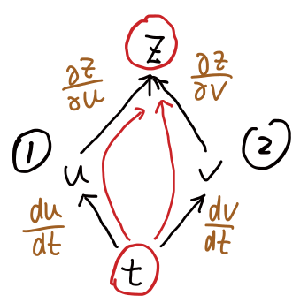
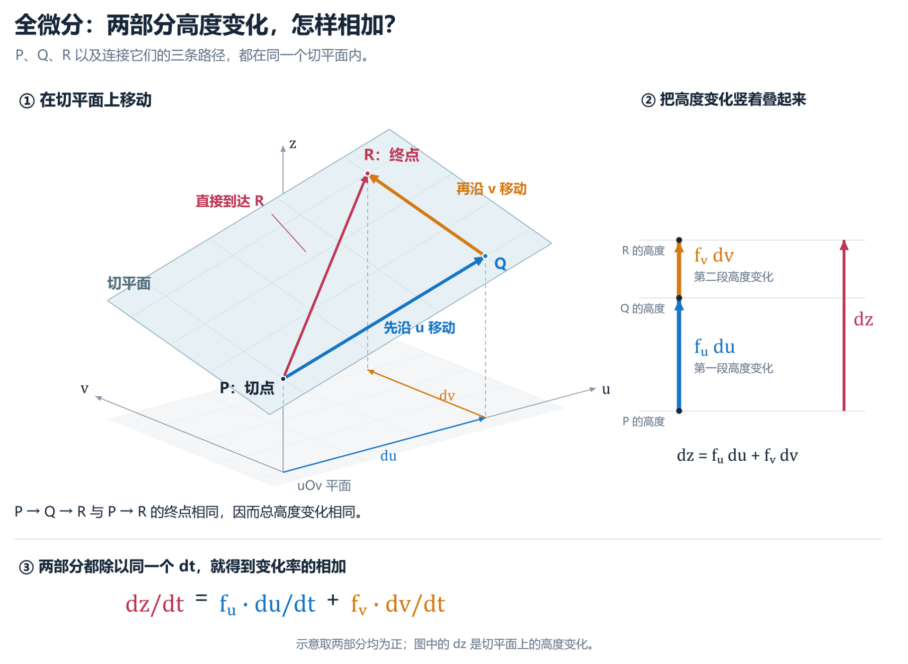
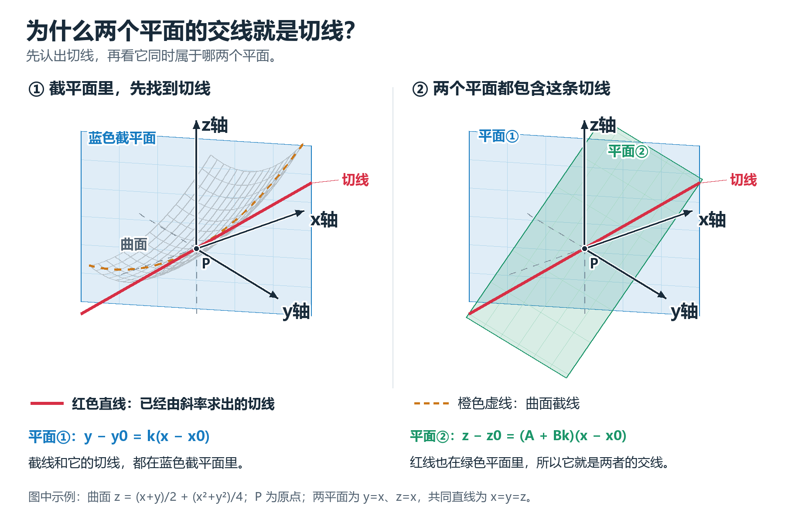
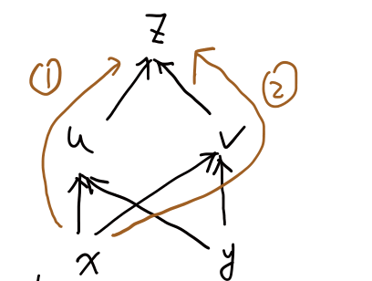
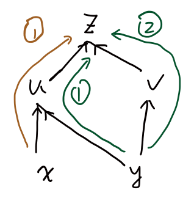

### 第四节　多元复合函数求导法则

**复习：一元复合函数求导法则**
$$
y=f(u),\quad u=\varphi(x)
\quad\Rightarrow\quad
y=f[\varphi(x)].
$$

$$
\frac{dy}{dx}
=\frac{dy}{du}\cdot\frac{du}{dx}
=f'(u)\cdot\varphi'(x)
=f'[\varphi(x)]\cdot\varphi'(x).
$$

<!-- annotation:start:review_personal -->

------

**我的理解｜原笔记**

**如何理解 $f'(u)=f'[\varphi(x)]$？**

$f'$ 是由 $f$ 求导得到的计算规则。例如，$f(x)=x^2$，则 $f'(x)=2x$，$f'$的规则就是：输入乘以 2”。

计算 $f'[\varphi(x)]$，就是先求出 $f'$ 的规则，再把 $\varphi(x)$ 代进去。因为 $u=\varphi(x)$，所以 $f'(u)=f'[\varphi(x)]$。

平时从 $f(x)=x^2$ 直接写出 $f'(x)=2x$，我们关注的是“平方求导得到 2x”，没有刻意区分：$f'$ 已经是一条新的计算规则，而括号里的 $x$ 是这条规则接收的输入。因为前后一直使用同一个字母 $x$，“求出导函数的规则”和“把什么代入这个规则”看起来像是一步完成的。当括号里换成 $\varphi(x)$ 时，就需要把这两个层次分开看：先由 $f$ 求出 $f'$ 的规则，再将 $\varphi(x)$ 作为整体代入。因此，$f'[\varphi(x)]=2\varphi(x)$。

------

<!-- annotation:end:review_personal -->

**注：**$1^\circ$　复合关系图。



$$
\frac{dy}{du}\cdot\frac{du}{dx}=\frac{dy}{dx}.
$$

$2^\circ$

$$
\frac{d(\text{函数})}{d(\text{自})}
=\frac{d(\text{函数})}{d(\text{中})}
\cdot\frac{d(\text{中})}{d(\text{自})}.
$$

<!-- annotation:start:review_teacher -->

------

链式法则里面，前一项是没有复合之前的 $f(u)$ 对 $u$ 求导，后一项是中间变量 $u$ 对 $x$ 求导。最后再把 $u=\varphi(x)$ 代回去。

复合关系图的箭头表示：给定一个 $x$ 就能对应一个 $u$，再由 $u$ 对应一个 $y$。$x$ 的变化引起 $u$ 的变化，$u$ 的变化又引起 $y$ 的变化，所以沿这一条路径，两个变化率是相乘的。例如 $du/dx=2$、$dy/du=3$，总变化率就是 $2\times3=6$。


导数可以理解为：在该点的切线上，$x$ 每变化单位长度 $1$，$y$ 就变化 $\dfrac{dy}{dx}$。

因此，求 $y$ 关于 $x$ 的导数，就是在问：**$x$ 变化单位长度 $1$，会引起 $y$ 变化多少？**

对于复合函数 $y=f(u)$、$u=\varphi(x)$：

- $x$ 变化单位长度 $1$，$u$ 就变化 $\dfrac{du}{dx}$；
- $u$ 每变化单位长度 $1$，$y$ 就变化 $\dfrac{dy}{du}$。

所以，$x$ 变化单位长度 $1$，先引起 $u$ 变化 $\dfrac{du}{dx}$，再通过 $u$ 引起 $y$ 变化 $\dfrac{dy}{du}\cdot\dfrac{du}{dx}$。因此：

$$
\boxed{
\frac{dy}{dx}
=
\frac{dy}{du}\cdot\frac{du}{dx}
}
$$

这里的“变化单位长度 $1$”指的是该点切线上的线性变化，不代表原函数实际变化这么多后的精确增量。

------

------

<!-- annotation:end:review_teacher -->

**一、中间变量为一元的情形**

$$
z=f(u,v),\quad u=\varphi(t),\quad v=\psi(t)
$$

$$
\Rightarrow\quad z=f[\varphi(t),\psi(t)]\triangleq z(t).
$$

$u,v$：中间变量；$t$：自变量。

**Th.1：**设 $z=f(u,v)$，$u=\varphi(t)$，$v=\psi(t)$，其中 $\varphi(t),\psi(t)$ 在 $t$ 处可导，$f(u,v)$ 在对应点 $(u,v)$ 处有连续偏导数，则复合函数 $z=f[\varphi(t),\psi(t)]$ 在 $t$ 处可导，且
$$
\frac{dz}{dt}
=\frac{\partial f}{\partial u}\cdot\frac{du}{dt}
+\frac{\partial f}{\partial v}\cdot\frac{dv}{dt}.
$$

**注：复合关系图**



$$
\begin{aligned}
\frac{dz}{dt}
&=\text{①}+\text{②}\\
&=\frac{\partial z}{\partial u}\cdot\frac{du}{dt}
+\frac{\partial z}{\partial v}\cdot\frac{dv}{dt}.
\end{aligned}
$$

<!-- annotation:start:paths1_teacher -->

------

把 $z$ 看成最上层领导，$u,v$ 看成两个中层领导，$t$ 是共同联系到它们的底层员工。给定 $t$，先决定 $u,v$，再决定 $z$

$t$ 的变化通过两条路径影响 $z$：$t\to u\to z$ 和 $t\to v\to z$。每条路径内的变化率相乘，再把两条路径的贡献相加。

- **第一条：$t\to u\to z$。**$t$ 变化单位长度 $1$，$u$ 就变化 $\dfrac{du}{dt}$；而 $u$ 每变化单位长度 $1$，对 $z$ 的线性贡献是 $\dfrac{\partial z}{\partial u}$。所以，这条路径对 $z$ 的贡献是 $\dfrac{\partial z}{\partial u}\cdot\dfrac{du}{dt}$。
- **第二条：$t\to v\to z$。**$t$ 变化单位长度 $1$，$v$ 就变化 $\dfrac{dv}{dt}$；而 $v$ 每变化单位长度 $1$，对 $z$ 的线性贡献是 $\dfrac{\partial z}{\partial v}$。所以，这条路径对 $z$ 的贡献是 $\dfrac{\partial z}{\partial v}\cdot\dfrac{dv}{dt}$。

因为 $f$ 可微，这两部分贡献可以在同一个切平面上计算，并直接相加：【注意，为什么“这两部分贡献可以在同一个切平面上计算”，具体解释就紧挨着在下面】

$$
dz=\frac{\partial z}{\partial u}\,du+\frac{\partial z}{\partial v}\,dv.
$$

因此，$t$ 变化单位长度 $1$，通过两条路径共同引起的 $z$ 的线性变化就是：

$$
\boxed{
\frac{dz}{dt}
=
\frac{\partial z}{\partial u}\cdot\frac{du}{dt}
+
\frac{\partial z}{\partial v}\cdot\frac{dv}{dt}
}
$$

------

<!-- annotation:end:paths1_teacher -->
<!-- annotation:start:differential_personal -->

------

**我的理解｜原笔记①  **

**多元复合函数链式法则与全微分**

设 $z=f(u,v)$，其中 $u=u(t)$、$v=v(t)$。当 $f$ 可微时：

$dz=f_u\,du+f_v\,dv$。

因为 $du=u'(t)\,dt$、$dv=v'(t)\,dt$，代入得到：

$dz=[f_u\,u'(t)+f_v\,v'(t)]dt$。

导数简称微商，说白了就是微分的商，因此：

$\boxed{\dfrac{dz}{dt}=f_u\dfrac{du}{dt}+f_v\dfrac{dv}{dt}}$。

中间的加号来自全微分：两个中间变量同时变化时，它们的一阶贡献相加。链式法则再将各自的变化追溯到共同的自变量 $t$。

------

<!-- annotation:end:differential_personal -->

**自变量为一元函数时的公式的具体证明证明：**求z关于t的导数本质是求： $\displaystyle\lim_{\Delta t\to0}\frac{\Delta z}{\Delta t}$。

由于 $z=f(u,v)$ 在 $(u,v)$ 处可微，故

$$
\Delta z
=\frac{\partial f}{\partial u}\cdot\Delta u
+\frac{\partial f}{\partial v}\cdot\Delta v+o(\rho),
\qquad
\rho=\sqrt{(\Delta u)^2+(\Delta v)^2}.
$$

同除 $\Delta t$：

$$
\begin{aligned}
\frac{\Delta z}{\Delta t}
&=\frac{\partial f}{\partial u}\cdot\frac{\Delta u}{\Delta t}
+\frac{\partial f}{\partial v}\cdot\frac{\Delta v}{\Delta t}
+\frac{o(\rho)}{\Delta t}\\
&=\frac{\partial f}{\partial u}\cdot\frac{\Delta u}{\Delta t}
+\frac{\partial f}{\partial v}\cdot\frac{\Delta v}{\Delta t}
+\frac{o(\rho)}{\rho}\cdot
\frac{\sqrt{(\Delta u)^2+(\Delta v)^2}}{\Delta t}\\
&=\frac{\partial f}{\partial u}\cdot\frac{\Delta u}{\Delta t}
+\frac{\partial f}{\partial v}\cdot\frac{\Delta v}{\Delta t}
+\frac{o(\rho)}{\rho}\cdot
\sqrt{\left(\frac{\Delta u}{\Delta t}\right)^2+
\left(\frac{\Delta v}{\Delta t}\right)^2}.
\end{aligned}
$$

其中 $\dfrac{o(\rho)}{\rho}\to0$，根号部分趋于常值（这是因为$\dfrac{\Delta u}{\Delta t}$  $\dfrac{\Delta v}{\Delta t}$为u/v 在$t_0$处的导数值，本质上就是常数）


由于 $u,v$ 可导，故连续，从而当 $\Delta t\to0$ 时，$\Delta u\to0$，$\Delta v\to0$，从而也有 $\rho\to0$。

令 $\Delta t\to0$ 得

$$
\frac{dz}{dt}
=\frac{\partial f}{\partial u}\cdot\frac{du}{dt}
+\frac{\partial f}{\partial v}\cdot\frac{dv}{dt}.
\qquad\Box
$$

<!-- annotation:start:proof_teacher -->

------

证明的目标是求 $\lim_{\Delta t\to0}\Delta z/\Delta t$。先利用外层函数可微，把全增量写成两个线性项加上 $o(\rho)$，再同除 $\Delta t$。

老师在把 $\Delta t$ 放进根号时特别说：为了简便，先假设 $\Delta t>0$；小于 $0$ 时同理。上面的根号等式按这个约定书写。

最后一项的关键是：$\Delta t\to0$ 时，$\rho$ 是否也趋于 $0$？因为 $u,v$ 可导，所以连续；因此 $\Delta u,\Delta v\to0$，进而 $\rho\to0$，于是 $o(\rho)/\rho\to0$。

根号内的两个增量比分别趋于 $du/dt,dv/dt$，根号整体趋于一个有限值。它与前面趋于 $0$ 的因子相乘，余项的极限就是 $0$。前面的两个偏导在证明所固定的对应点处取值，取增量极限时按常数处理。

------

<!-- annotation:end:proof_teacher -->
<!-- annotation:start:addition_personal -->

------

**我的理解｜原笔记②**

**我最初的疑惑**

想象曲面上的一点 $(x_0,y_0)$：固定 $x=x_0$，让 $y$ 增加一个很小的 $h$，函数值的变化可以用 $f_y(x_0,y_0)h$ 近似；固定 $y=y_0$、只改变 $x$ 时同理。

但两个偏导数描述的，都是“另一个变量保持原值”时的变化。现在两个变量同时改变，原先的条件已经变了，沿两个方向的斜率也可能变化。因此，不能直接认定真实的函数增量就等于两个原有偏导数的贡献之和。

**中间变量为一元的情形这块知识点里，为什么u对z造成的影响和v对z造成的影响可以直接相加，并且最终得到的直接就是u和v变化 一起对z的影响？**

在函数可微时，全增量可以写成：$\Delta z=f_x(x_0,y_0)\Delta x+f_y(x_0,y_0)\Delta y+o(\rho)$。

我担心的那些同时变化带来的额外影响，其实这里的担心本质上是多余了，这里对z的影响本质上是想去求$dz$的，也就是沿着某一个方向的切线上z的变化量，同时本质上就是全微分。

我们之前学过，一元函数的导数 $\dfrac{dy}{dx}$ 可以理解为：沿该点的切线，$x$ 每变化一个单位，$y$ 就变化 $\dfrac{dy}{dx}$ 个单位。这里说的是切线上的线性变化，并不意味着原曲线上的真实增量也完全如此。

多元函数也是类似的。随着 $t$ 改变，在 $uOv$ 平面内确定一条移动路径，说白了就是一个方向，对应到曲面上，也得到一条曲线。这条曲线在当前点的切线，位于曲面在该点的切平面内。

在这个切平面上，沿当前方向移动所造成的高度变化，可以分成两部分：先沿 $u$ 方向移动 $du$，高度变化为 $f_u\,du$；再沿 $v$ 方向移动 $dv$，高度变化为 $f_v\,dv$。因为是在同一个平面上计算，斜率不随位置改变，所以两部分可以直接相加：$dz=f_u\,du+f_v\,dv$。



==**注一**==
设 $z_0=f(x_0,y_0)$。当函数在 $(x_0,y_0)$ 处可微时，曲面在该点可以用切平面近似：
$z-z_0=f_x(x_0,y_0)(x-x_0)+f_y(x_0,y_0)(y-y_0)$。
因此，在切平面上移动 $\Delta x$、$\Delta y$ 后，高度变化为：
$\boxed{dz=f_x(x_0,y_0)\Delta x+f_y(x_0,y_0)\Delta y}$。
这里，$dz$就 是切平面给出的线性近似，$o(\rho)$ 是曲面弯曲带来的高阶误差。函数可微说明：当移动距离 $\rho\to0$ 时，这个误差相对于 $\rho$ 可以忽略。
所以，全微分中的两项可以理解为：先用基点处的两个偏导数确定一个切平面，再在这个切平面上计算 $\Delta x$、$\Delta y$ 共同造成的高度变化。
==**注二**==
这个切平面方程我们是如何得到的？
我们想找一个平面，让它经过曲面上的点，并且沿 $x$、$y$ 两个方向的斜率与曲面一致。先设：
$$
z=C+A(x-x_0)+B(y-y_0)
$$
这里 $A$、$B$、$C$ 都是待确定的常数。
**先要求它经过同一个点。**
代入 $x=x_0$、$y=y_0$，右边只剩 $C$，所以：
$$
C=f(x_0,y_0)
$$
**再要求沿 $x$ 方向的斜率相同。**
固定 $y=y_0$，平面上的截线是：
$$
z=C+A(x-x_0)
$$
这是一条直线，斜率就是 $A$。曲面在该点沿 $x$ 方向的切线斜率是 $f_x(x_0,y_0)$，因此：
$$
A=f_x(x_0,y_0)
$$
同理，沿 $y$ 方向的斜率是 $B$，所以：
$$
B=f_y(x_0,y_0)
$$

**把三个系数代回去**，就得到：
$$
\boxed{
z-f(x_0,y_0)
=f_x(x_0,y_0)(x-x_0)
+f_y(x_0,y_0)(y-y_0)
}
$$
==**注三**==
为什么这些不同方向的切线，就全部落在同一个平面内，而且平面就是切平面。
证明：
设切点为 $(x_0,y_0,z_0)$，其中 $z_0=f(x_0,y_0)$。把该点的两个偏导数简记为 $A=f_x(x_0,y_0)$、$B=f_y(x_0,y_0)$，则：
$\Delta z=A\Delta x+B\Delta y+o(\rho)$，
其中 $\rho=\sqrt{(\Delta x)^2+(\Delta y)^2}$。
现在任选一个方向，比如沿着 $\Delta y=k\Delta x$ 移动，也就是 $x$ 每改变一点，$y$ 就改变它的 $k$ 倍。代入得到：$\Delta z=(A+Bk)\Delta x+o(\rho)$。
沿这个固定方向移动的距离：$\rho=\sqrt{(\Delta x)^2+(\Delta y)^2}=\sqrt{1+k^2}\,|\Delta x|$。用 $s=\sqrt{1+k^2}\,\Delta x$ 表示带符号的水平位移，则 $\rho=|s|$。
一元函数中，切线斜率是 $\displaystyle\lim_{\Delta x\to0}\frac{\Delta z}{\Delta x}$，也就是“因变量增量除以自变量增量，再取极限”。
现在在三维空间中沿选定方向移动，说白了就是 $y-y_0=k(x-x_0)$ 这个平面去截曲面，会得到一个截线，我们现在找的就是截线中的某一个点对应的切线的斜率，也可以用我们之前一元函数中取极限的思路去做。

对应的带符号水平位移是 $s$，其长度是 $\rho=|s|$。因此，沿该方向前进时，应当用高度变化 $\Delta z$ 除以带符号水平位移 $s$，再取极限，得到切线斜率。
$\dfrac{\Delta z}{s}=\dfrac{(A+Bk)\Delta x+o(|s|)}{\sqrt{1+k^2}\,\Delta x}$
$\phantom{\dfrac{\Delta z}{s}}=\dfrac{A+Bk}{\sqrt{1+k^2}}+\dfrac{o(|s|)}{s}$。
由于 $\dfrac{o(|s|)}{s}\to0$，得到这个方向上的切线斜率：
$\boxed{m=\displaystyle\lim_{s\to0}\frac{\Delta z}{s}=\frac{A+Bk}{\sqrt{1+k^2}}}$。
用 $s$ 表示在 $xOy$ 平面内沿该方向的带符号位移（其长度是 $\rho=|s|$），那么：
$x-x_0=\Delta x =\dfrac{s}{\sqrt{1+k^2}}$，
$y-y_0= \Delta y  =\dfrac{ks}{\sqrt{1+k^2}}$。
切线是直线，所以高度变化精确等于“斜率乘以沿该方向的位移”：
$z-z_0=ms=\dfrac{A+Bk}{\sqrt{1+k^2}}\,s$。
由 $x-x_0=\dfrac{s}{\sqrt{1+k^2}}$，可得：
$s=\sqrt{1+k^2}(x-x_0)$。
代入后，$\sqrt{1+k^2}$ 抵消，得到：
$z-z_0=(A+Bk)(x-x_0)$。
因此，这个方向的切线由以下两个方程共同确定：
$$
\begin{cases}
y-y_0=k(x-x_0),\\
z-z_0=(A+Bk)(x-x_0).
\end{cases}
$$




将切线的第二个方程展开：$z-z_0=A(x-x_0)+Bk(x-x_0)$。
再利用第一个方程 $y-y_0=k(x-x_0)$，得到：$\boxed{z-z_0=A(x-x_0)+B(y-y_0)}$。
这个直线说白了就是这两个平面的交线，直线上的点肯定会同时满足方程组的这两个方程，所以我们在展开后：$z-z_0=A(x-x_0)+Bk(x-x_0)$，可以直接把$y-y_0=k(x-x_0)$带进去。
所以转换后该直线方程为：
$$
\begin{cases}
y-y_0=k(x-x_0),\\
z-z_0=A(x-x_0)+B(y-y_0).
\end{cases}
$$
我们发现其中的$z-z_0=A(x-x_0)+B(y-y_0)$就是切平面方程，所以切线上的每一个点肯定都满足这个平面方程，因此整条切线都在这个平面内。
$k$ 可以任意选；$k$不存在的时候也不用考虑，因为k不存在的时候的切线就是沿y轴方向的切线，而我们当初确定该切平面的时候就是用沿x轴方向的切线和沿y轴方向的切线来确定的。
这个小结论就是由可微推出来的，我们可以好好理解理解。

------

<!-- annotation:end:addition_personal -->

**注：**$1^\circ$

$$
\frac{d(\text{函数})}{dt}
=\frac{\partial(\text{函数})}{\partial\varphi_1}\cdot\frac{d\varphi_1}{dt}
+\frac{\partial(\text{函数})}{\partial\varphi_2}\cdot\frac{d\varphi_2}{dt}.
$$

$2^\circ$　推广到其它情形：

$$
z=f(u,v,w),\quad
u=\varphi(t),\quad v=\psi(t),\quad w=\omega(t).
$$

$$
\Rightarrow\quad
z=f[\varphi(t),\psi(t),\omega(t)]\triangleq z(t).
$$

$$
\frac{dz}{dt}
=\frac{\partial f}{\partial u}\cdot\frac{du}{dt}
+\frac{\partial f}{\partial v}\cdot\frac{dv}{dt}
+\frac{\partial f}{\partial w}\cdot\frac{dw}{dt}.
$$

<!-- annotation:start:general1_teacher -->

------


有几个中间变量，理论上就有几项之和：分别对每个中间变量求导，乘上它对 $t$ 的导数，再加起来。

复合完成后，如果最终是一个一元函数，那么这里求的 $dz/dt$ 也叫**全导数**。

------

<!-- annotation:end:general1_teacher -->

**例1．**$z=u^2e^v$，$u=\sin t$，$v=e^t$，求 $\dfrac{dz}{dt}$。

**解：**

$$
\begin{aligned}
\frac{dz}{dt}
&=\frac{\partial z}{\partial u}\cdot\frac{du}{dt}
+\frac{\partial z}{\partial v}\cdot\frac{dv}{dt}\\
&=2ue^v\cdot\cos t+u^2e^v\cdot e^t\\
&=2\sin t\cdot e^{e^t}\cos t
+\sin^2t\cdot e^{e^t}\cdot e^t.
\end{aligned}
$$

**方法二：**$z=\sin^2t\cdot e^{e^t}\Rightarrow\dfrac{dz}{dt}=\cdots$。

<!-- annotation:start:example1_teacher -->

------

**老师解释｜23:52–26:25**

$z_u,z_v$ 都是在对没有复合之前的 $u^2e^v$ 求偏导。对 $u$ 求导时固定 $v$；对 $v$ 求导时固定 $u$。求完以后，还要代入 $u=\sin t,v=e^t$。

这道题也允许先把 $u,v$ 代入，得到具体的一元函数 $z=\sin^2t\,e^{e^t}$，再按一元函数求导。对于能直接代入的具体函数，这样做完全可以。

------

<!-- annotation:end:example1_teacher -->

**例2．**$z=f(e^{t^2},\sin2t)$，$f$ 可微，求 $\dfrac{dz}{dt}$。

**注：**出现了抽象函数。

**解：**记 $u=e^{t^2}$，$v=\sin2t$，则 $z=f(u,v)$。
$$
\begin{aligned}
\frac{dz}{dt}
&=f_u'\cdot\frac{du}{dt}+f_v'\cdot\frac{dv}{dt}\\
&=f_u'\cdot2te^{t^2}+f_v'\cdot2\cos2t.
\end{aligned}
$$

<!-- annotation:start:example2_teacher -->

------

这里两个内层表达式已经给出来了，但没有告诉我们 $f$ 的具体规则，不能绕过外层直接算出一个具体的初等函数导数。先把两个整体认作 $u,v$，就能看出复合结构。

$f_u',f_v'$ 只能保留成抽象的偏导符号，不能继续具体化；但 $du/dt=2te^{t^2}$、$dv/dt=2\cos2t$ 可以具体求出。以后若给出 $f$ 的表达式，再把这两个偏导具体化。

------

<!-- annotation:end:example2_teacher -->

<!-- PDF印刷页20 -->

**二、中间变量为多元函数情形**
$$
z=f(u,v),\quad u=\varphi(x,y),\quad v=\psi(x,y)
$$

$$
\Rightarrow\quad z=f[\varphi(x,y),\psi(x,y)]\triangleq z(x,y).
$$

**Th.2：**设 $z=f(u,v)$，$u=\varphi(x,y)$，$v=\psi(x,y)$，其中 $\varphi,\psi$ 在 $(x,y)$ 处可偏导，$f(u,v)$ 在对应点 $(u,v)$ 处可微，则复合函数 $z=f[\varphi(x,y),\psi(x,y)]$ 在 $(x,y)$ 处可偏导，且
$$
\begin{cases}
\displaystyle
\frac{\partial z}{\partial x}
=\frac{\partial f}{\partial u}\cdot\frac{\partial u}{\partial x}
+\frac{\partial f}{\partial v}\cdot\frac{\partial v}{\partial x},\\[8pt]
\displaystyle
\frac{\partial z}{\partial y}
=\frac{\partial f}{\partial u}\cdot\frac{\partial u}{\partial y}
+\frac{\partial f}{\partial v}\cdot\frac{\partial v}{\partial y}.
\end{cases}
$$

**注：复合关系图**



$$
\begin{aligned}
\frac{\partial z}{\partial x}
&=\text{①}+\text{②}\\
&=\frac{\partial z}{\partial u}\cdot\frac{\partial u}{\partial x}
+\frac{\partial z}{\partial v}\cdot\frac{\partial v}{\partial x}.
\end{aligned}
$$

<!-- annotation:start:theorem2_teacher -->

------

求 $z$ 关于 $x$ 的偏导数，就是在 **$y$ 保持不变**的情况下，研究 $x$ 变化单位长度 $1$，会引起 $z$ 变化多少。图中，$x$ 通过两条路径影响 $z$：

① **第一条路径：$x\to u\to z$。**$x$ 变化单位长度 $1$，$u$ 就变化 $\dfrac{\partial u}{\partial x}$；而在 $v$ 保持不变时，$u$ 每变化单位长度 $1$，$z$ 就变化 $\dfrac{\partial z}{\partial u}$。所以，通过这条路径引起的 $z$ 的线性变化是：

$$
\frac{\partial z}{\partial u}\cdot\frac{\partial u}{\partial x}.
$$

② **第二条路径：$x\to v\to z$。**$x$ 变化单位长度 $1$，$v$ 就变化 $\dfrac{\partial v}{\partial x}$；而在 $u$ 保持不变时，$v$ 每变化单位长度 $1$，$z$ 就变化 $\dfrac{\partial z}{\partial v}$。所以，通过这条路径引起的 $z$ 的线性变化是：

$$
\frac{\partial z}{\partial v}\cdot\frac{\partial v}{\partial x}.
$$

由于 $f$ 可微，这两条路径的一阶贡献可以相加，因此：

$$
\boxed{
\frac{\partial z}{\partial x}
=
\frac{\partial z}{\partial u}\cdot\frac{\partial u}{\partial x}
+
\frac{\partial z}{\partial v}\cdot\frac{\partial v}{\partial x}
}
$$

同理，求 $z$ 关于 $y$ 的偏导数时，就让 **$x$ 保持不变**，分别沿 $y\to u\to z$ 和 $y\to v\to z$ 两条路径计算，再把贡献相加：

$$
\boxed{
\frac{\partial z}{\partial y}
=
\frac{\partial z}{\partial u}\cdot\frac{\partial u}{\partial y}
+
\frac{\partial z}{\partial v}\cdot\frac{\partial v}{\partial y}
}
$$

所以，仍然是：**同一条路径上的变化率相乘，不同路径的一阶贡献相加。**

------

<!-- annotation:end:theorem2_teacher -->

**注：**$1^\circ$

$$
\frac{\partial(\text{函数})}{\partial(\text{自})}
=\sum_i
\frac{\partial(\text{函数})}{\partial\varphi_i}
\cdot\frac{\partial\varphi_i}{\partial(\text{自})}.
$$

```
一些小理解：
针对这个通用的公式我们这样理解：偏导数其实和我们之前学习的导数都一样，本质上就是在求切线的斜率。而且自变量变化单位长度1，因变量就变化单位长度dy/dx 或者  偏 y /d 偏 x 。所以这个公式就是某一个字变量变化单位长度为1，然后最终造成z的变化。
自变量变化长度为1，会对所有的中间变量造成 偏 中 / 偏自 的影响，而每一个中间变量变化长度为1，会对z造成 偏 z / 偏中 的影响，所以每一小项是相乘的关系。并且我们之前在二元函数的时候也证明过，在求偏导数的时候，中间变量对z造成的影响是可以直接相加的，因为：两个变量变化本质是求其变化后共同让z变化了多少，之前也证明过该点关于该曲面的所有的切线构成一个切平面，而在三维空间的一个平面上，x方向轴变化了Δx，导致在平面上z值变化了Δz1，y轴方向变化了Δy，导致z值变化了Δz2，显而易见，x轴方向变化和y轴方向变化对z造成的影响没有任何关系，并且可以直接加起来。
所以这个相乘再累加的公式用复合关系图的思路是很好理解的。
```


$2^\circ$　推广：

①

$$
z=f(u,v,w),\qquad
\begin{cases}
u=\varphi(x,y),\\
v=\psi(x,y),\\
w=\omega(x,y).
\end{cases}
$$

$$
\frac{\partial z}{\partial x}
=\frac{\partial f}{\partial u}\cdot\frac{\partial u}{\partial x}
+\frac{\partial f}{\partial v}\cdot\frac{\partial v}{\partial x}
+\frac{\partial f}{\partial w}\cdot\frac{\partial w}{\partial x}.
$$

$$
\frac{\partial z}{\partial y}=\cdots+\cdots+\cdots.
$$

②

$$
W=f(u,v),\qquad
\begin{cases}
u=\varphi(x,y,z),\\
v=\psi(x,y,z).
\end{cases}
$$

$$
\Rightarrow\quad
W=f[\varphi(x,y,z),\psi(x,y,z)]\triangleq W(x,y,z).
$$

求 $\dfrac{\partial W}{\partial x}$，$\dfrac{\partial W}{\partial y}$，$\dfrac{\partial W}{\partial z}$。

$$
\frac{\partial W}{\partial z}
=\frac{\partial f}{\partial u}\cdot\frac{\partial u}{\partial z}
+\frac{\partial f}{\partial v}\cdot\frac{\partial v}{\partial z}.
$$

**例3．**$z=e^u\sin v$，$u=xy$，$v=x+y$，求 $\dfrac{\partial z}{\partial x}$，$\dfrac{\partial z}{\partial y}$。

**解：**
$$
\begin{aligned}
\frac{\partial z}{\partial x}
&=\frac{\partial z}{\partial u}\cdot\frac{\partial u}{\partial x}
+\frac{\partial z}{\partial v}\cdot\frac{\partial v}{\partial x}\\
&=e^u\sin v\cdot y+e^u\cos v\cdot1\\
&=e^{xy}\bigl[y\sin(x+y)+\cos(x+y)\bigr];
\end{aligned}
$$

$$
\begin{aligned}
\frac{\partial z}{\partial y}
&=\frac{\partial z}{\partial u}\cdot\frac{\partial u}{\partial y}
+\frac{\partial z}{\partial v}\cdot\frac{\partial v}{\partial y}\\
&=e^{xy}\bigl[x\sin(x+y)+\cos(x+y)\bigr].
\end{aligned}
$$

**法二：：**$z=e^{xy}\sin(x+y)$，求 $\dfrac{\partial z}{\partial x}$，$\dfrac{\partial z}{\partial y}$。

<!-- annotation:start:example3_teacher -->

------

每一项前面的外层偏导，都是对复合之前的 $e^u\sin v$ 求导：$z_u=e^u\sin v$，$z_v=e^u\cos v$。再分别乘 $u_x,v_x$，或者 $u_y,v_y$。

求完把 $u,v$ 代回。也可以先代入成 $z=e^{xy}\sin(x+y)$，直接求两个偏导。两种做法都可以；对具体函数，后者有时更方便，而链式法则尤其适合下一道那样的抽象函数。

------

<!-- annotation:end:example3_teacher -->

<!-- PDF印刷页21 -->

**例4．**$W=f(xyz,x+2y+3z)$，$f$ 可微，求 $\dfrac{\partial W}{\partial y}$。

**解：**记 $u=xyz$，$v=x+2y+3z$，则 $W=f(u,v)$。
$$
\begin{aligned}
\frac{\partial W}{\partial y}
&=f_u'\cdot\frac{\partial u}{\partial y}
+f_v'\cdot\frac{\partial v}{\partial y}\\
&=f_u'\cdot xz+f_v'\cdot2.
\end{aligned}
$$

<!-- annotation:start:example4_teacher -->

------

$f$ 的表达式未知，但输入的位置是清楚的。把 $xyz$ 看成第一中间变量，把 $x+2y+3z$ 看成第二中间变量，它们各自都是三元函数。

重点：例三和例四 第一步就是得到这两个式子，其实我们直接使用前面的复合关系图去理解然后得到这个式子：$\frac{\partial z}{\partial u}\cdot\frac{\partial u}{\partial x}
+\frac{\partial z}{\partial v}\cdot\frac{\partial v}{\partial x}$     $f_u'\cdot\frac{\partial u}{\partial y}
+f_v'\cdot\frac{\partial v}{\partial y}$    

求谁关于谁的导数，本质上就是看：**在该点的线性近似下，自变量变化单位长度 $1$，会引起因变量变化多少。**

例三求 $z$ 关于 $x$ 的偏导时，$x$ 通过 $x\to u\to z$ 和 $x\to v\to z$ 两条路径影响 $z$；对 $y$ 求偏导同理。

例四把 $xyz$、$x+2y+3z$ 分别看成中间变量 $u,v$，求 $W$ 关于 $y$ 的偏导时，也有 $y\to u\to W$ 和 $y\to v\to W$ 两条路径。

所以，**沿每条路径把变化率相乘，再把两条路径的贡献相加**，就能直接写出上面的式子。

------

<!-- annotation:end:example4_teacher -->

**三、混合情形**

$$
z=f(u,v),\quad u=\varphi(x,y),\quad v=\psi(y).
$$

**Th.3：**设 $z=f(u,v)$，$u=\varphi(x,y)$，$v=\psi(y)$，其中 $\varphi$ 可偏导，$\psi$ 可导，$f(u,v)$ 在对应点处可微，则复合函数 $z=f[\varphi(x,y),\psi(y)]$ 在 $(x,y)$ 处可偏导，且
$$
\begin{cases}
\displaystyle
\frac{\partial z}{\partial x}
=\frac{\partial f}{\partial u}\cdot\frac{\partial u}{\partial x},
\\[8pt]
\displaystyle
\frac{\partial z}{\partial y}
=\frac{\partial f}{\partial u}\cdot\frac{\partial u}{\partial y}
+\frac{\partial f}{\partial v}\cdot\frac{dv}{dy}.
\end{cases}
$$

对 $x$ 求偏导时，$\dfrac{\partial f}{\partial v}\cdot0$ 一项为 $0$。

**注：**$1^\circ$　复合关系图。



<!-- annotation:start:mixed_teacher -->

------

求 $z$ 关于 $x$ 的偏导时，固定 $y$，$v$ 也不变，所以只有 $x\to u\to z$ **一条路径**。

求 $z$ 关于 $y$ 的偏导时，固定 $x$，$y$ 可以同时影响 $u,v$，所以有 $y\to u\to z$ 和 $y\to v\to z$ **两条路径**。

因此，对 $x$ 求偏导只有一项，对 $y$ 求偏导有两项；仍然是**同一路径的变化率相乘，不同路径的贡献相加**。

------

<!-- annotation:end:mixed_teacher -->

$2^\circ$　其它情形，如：

$$
z=f(u,v,x),\quad u=\varphi(x,y),\quad v=\psi(y),\quad x=x.
$$

将 $u,v,x$ 当中间变量看待。

$$
\Rightarrow\quad
z=f[\varphi(x,y),\psi(y),x]\triangleq z(x,y).
$$

$$
\begin{aligned}
\frac{\partial z}{\partial x}
&=\frac{\partial f}{\partial u}\cdot\frac{\partial u}{\partial x}
+\frac{\partial f}{\partial v}\cdot0
+\frac{\partial f}{\partial x}\cdot1\\
&=\frac{\partial f}{\partial u}\cdot\frac{\partial u}{\partial x}
+\frac{\partial f}{\partial x}.
\end{aligned}
$$

其中 $\dfrac{\partial f}{\partial x}$ 将 $u,v$ 当常数处理。

$$
\frac{\partial z}{\partial y}
=\frac{\partial f}{\partial u}\cdot\frac{\partial u}{\partial y}
+\frac{\partial f}{\partial v}\cdot\frac{dv}{dy}.
$$

<!-- annotation:start:direct_teacher -->

------

这里 $f$ 的第三个输入直接就是 $x$，所以 **$x$ 既能通过中间变量影响 $z$，也能直接影响 $z$。**

求 $z$ 关于 $x$ 的偏导，看 $x$ 的单位变化对 $z$ 的线性影响。有两条路径：

- $x\to u\to z$：贡献为 $\dfrac{\partial f}{\partial u}\dfrac{\partial u}{\partial x}$；
- $x\to z$：第三个输入就是 $x$，变化率为 $1$，贡献为 $\dfrac{\partial f}{\partial x}\cdot1$。

两条路径的贡献相加，得到：

$$
\frac{\partial z}{\partial x}
=
\frac{\partial f}{\partial u}\frac{\partial u}{\partial x}
+
\frac{\partial f}{\partial x}.
$$

求 $z$ 关于 $y$ 的偏导时，只有 $y\to u\to z$ 和 $y\to v\to z$ 两条路径，因此：

$$
\frac{\partial z}{\partial y}
=
\frac{\partial f}{\partial u}\frac{\partial u}{\partial y}
+
\frac{\partial f}{\partial v}\frac{dv}{dy}.
$$

------

<!-- annotation:end:direct_teacher -->

**例5．**$u=f(x,y,z)=e^{x^2+y^2+z^2}$，$z=x^2\sin y$，求 $\dfrac{\partial u}{\partial x}$，$\dfrac{\partial u}{\partial y}$。

三个中间变量：$x,y,z$。复合后 $u=u(x,y)$，$x,y$ 为自变量。

**解：**

$$
\begin{aligned}
\frac{\partial u}{\partial x}
&=\frac{\partial f}{\partial x}\cdot1
+\frac{\partial f}{\partial y}\cdot0
+\frac{\partial f}{\partial z}\cdot\frac{\partial z}{\partial x}\\
&=e^{x^2+y^2+z^2}\cdot2x+0
+e^{x^2+y^2+z^2}\cdot2z\cdot2x\sin y\\
&=e^{x^2+y^2+z^2}\cdot2x\left(1+2x^2\sin^2y\right);
\end{aligned}
$$

$$
\begin{aligned}
\frac{\partial u}{\partial y}
&=\frac{\partial f}{\partial x}\cdot0
+\frac{\partial f}{\partial y}\cdot1
+\frac{\partial f}{\partial z}\cdot\frac{\partial z}{\partial y}\\
&=e^{x^2+y^2+z^2}\cdot2y
+e^{x^2+y^2+z^2}\cdot2z\cdot x^2\cos y\\
&=e^{x^2+y^2+z^2}\cdot2\left(y+x^4\sin y\cos y\right).
\end{aligned}
$$

<!-- annotation:start:example5_teacher -->

------

仍然是**同一路径的变化率相乘，不同路径的贡献相加**。

求 $u$ 关于 $x$ 的偏导时，固定 $y$，有 $x\to u$ 和 $x\to z\to u$ 两条路径：

$$
\begin{aligned}
\frac{\partial u}{\partial x}
&=\frac{\partial f}{\partial x}\cdot1
+\frac{\partial f}{\partial y}\cdot0
+\frac{\partial f}{\partial z}\frac{\partial z}{\partial x}\\
&=\frac{\partial f}{\partial x}
+\frac{\partial f}{\partial z}\cdot2x\sin y.
\end{aligned}
$$

求 $u$ 关于 $y$ 的偏导时，固定 $x$，有 $y\to u$ 和 $y\to z\to u$ 两条路径：

$$
\begin{aligned}
\frac{\partial u}{\partial y}
&=\frac{\partial f}{\partial x}\cdot0
+\frac{\partial f}{\partial y}\cdot1
+\frac{\partial f}{\partial z}\frac{\partial z}{\partial y}\\
&=\frac{\partial f}{\partial y}
+\frac{\partial f}{\partial z}\cdot x^2\cos y.
\end{aligned}
$$

------

<!-- annotation:end:example5_teacher -->

**例6．**$z=f(x^2y,xy^2,x)$，$f$ 可微，求 $\dfrac{\partial z}{\partial x}$，$\dfrac{\partial z}{\partial y}$。

**解：**记 $u=x^2y$，$v=xy^2$，则 $z=f(u,v,x)$。

$$
\frac{\partial z}{\partial x}
=f_u'\cdot2xy+f_v'\cdot y^2+f_x'\cdot1.
$$

$$
\frac{\partial z}{\partial y}
=f_u'\cdot x^2+f_v'\cdot2xy.
$$

<!-- annotation:start:example6_teacher -->

------

对 $x$ 求偏导时，固定 $y$，有 $x\to u\to z$、$x\to v\to z$、$x\to z$ **三条路径**：

$$
\frac{\partial z}{\partial x}
=
f_u'\cdot2xy+f_v'\cdot y^2+f_x'\cdot1.
$$

对 $y$ 求偏导时，固定 $x$，只有 $y\to u\to z$、$y\to v\to z$ **两条路径**：

$$
\frac{\partial z}{\partial y}
=
f_u'\cdot x^2+f_v'\cdot2xy.
$$

其中 $f_x'$ 是固定 $u,v$，对外层函数第三个输入 $x$ 求偏导。仍然是**沿路径相乘，各路径相加**。

------

<!-- annotation:end:example6_teacher -->

**四、抽象复合函数求偏导**

为了书写和计算上的方便，引入记号：

$$
f(u,v):\quad
\begin{cases}
f_u'\longrightarrow f_1',\quad f_v'\longrightarrow f_2',\\
f_{uu}''\longrightarrow f_{11}'',\quad
f_{uv}''\longrightarrow f_{12}'',\quad\cdots
\end{cases}
$$

$$
f_{1221}^{(4)}.
$$

$$
f(u,v,w):\quad
\begin{cases}
f_u'\longrightarrow f_1',\quad
f_v'\longrightarrow f_2',\quad
f_w'\longrightarrow f_3',\\
f_{uv}''\longrightarrow f_{12}'',\quad
f_{vw}''\longrightarrow f_{23}'',\quad\cdots
\end{cases}
$$

**注：**若 $f(u,v)$，则 $f_1',f_2'$ 仍是 关于$u,v$的函数，即
$$
f_1'(u,v),\qquad f_2'(u,v).
$$

具体来说，如：

$$
z=f\bigl(xy,\sin(x+y)\bigr),
$$

其中 $u=xy$，$v=\sin(x+y)$。则

$$
f_1'\bigl(xy,\sin(x+y)\bigr),\qquad
f_2'\bigl(xy,\sin(x+y)\bigr).
$$

<!-- annotation:start:abstract_teacher -->

$f$ 是一套计算规则，括号里的内容是交给它的输入。对 $f$ 求偏导，会得到一套新的计算规则 $f_1'$，这条新规则仍可以接收原来的两个输入。

例如，$f(u,v)=u^2v$：

- 原规则 $f$：把第一个输入平方，再乘第二个输入；
- 新规则 $f_1'$：把第一个输入乘以 $2$，再乘第二个输入。

所以：

$$
f_1'(u,v)=2uv.
$$

对于 $f(x+y+z,xyz)$，括号里的 $x+y+z$ 和 $xyz$ 就是两个整体输入。换成 $f_1'$，只是换了一套计算规则，仍然把这两个整体交给它：

$$
f_1'(x+y+z,xyz)=2(x+y+z)\,xyz.
$$

下面这个思路是GPT说的，也是一个很巧妙的思路：

**偏导数描述的是“每个点处沿某个方向的斜率”，而点的位置仍需要 $(u,v)$ 两个坐标确定。**所以，偏导函数通常仍与 $u,v$ 都有关。

------

<!-- annotation:end:abstract_teacher -->


<!-- PDF印刷页23 -->

**例7．**$W=f(x+y+z,xyz)$，$f$ 具有二阶连续偏导数，求 $\dfrac{\partial W}{\partial x}$，$\dfrac{\partial^2W}{\partial x\partial z}$。

**解：**

$$
\begin{aligned}
\frac{\partial W}{\partial x}
&=f_1'\cdot1+f_2'\cdot yz\\
&=f_1'+yzf_2'.
\end{aligned}
$$

$$
f_1'(x+y+z,xyz),\qquad f_2'(x+y+z,xyz)
$$

是 $x,y,z$ 的函数（复合）。

$$
\begin{aligned}
\frac{\partial^2W}{\partial x\partial z}
&=\frac{\partial f_1'}{\partial z}
+yf_2'+yz\cdot\frac{\partial f_2'}{\partial z}\\
&=\left(f_{11}''\cdot1+f_{12}''\cdot xy\right)
+yf_2'
+yz\left(f_{21}''\cdot1+f_{22}''\cdot xy\right)\\
&=f_{11}''+y(x+z)f_{12}''
+yf_2'+xy^2z f_{22}''.
\end{aligned}
$$

$$
f_{12}''=f_{uv}'',\qquad
f_{21}''=f_{vu}''
\quad\Rightarrow\quad f_{12}''=f_{21}''.
$$

<!-- annotation:start:example7_teacher -->

------

我们依旧是可以直接去利用复合关系图去列出第一步式子，然后去运算化简即可。

$f$ 是以 $x+y+z,xyz$ 为输入的复合函数，那么这里的 $f_1',f_2'$ 也仍是这种复合函数。求完第一阶后，对它们继续求导，还要用链式法则。

对 $z$ 求导时，$yzf_2'$ 是乘积，必须拆成 $yf_2'+yz\,\partial f_2'/\partial z$。这里的 $yf_2'$ 很容易漏掉。

**最后一定回看条件。**题目说 $f$ 有二阶连续偏导数，所以 $f_{12}''=f_{21}''$，可以把对应两项合并成 $y(x+z)f_{12}''$。

------

<!-- annotation:end:example7_teacher -->

**五、全微分形式不变性**
$$
z=f(u,v),\quad u=\varphi(x,y),\quad v=\psi(x,y)
$$

$$
\Rightarrow\quad z=f[\varphi(x,y),\psi(x,y)]\triangleq z(x,y).
$$

<!-- annotation:start:differential_view_personal -->

------

**我的理解｜原笔记**

这里做一点小复习：

虽然最初写成 $z=f(u,v)$，但由于 $u、v$ 都是 $x、y$ 的函数，代入后就得到复合函数 $z=Z(x,y)$。

求它的全微分 $dz$，几何上就是计算：在当前点的切平面上，$x、y$ 分别改变 $dx、dy$ 时，共同产生多大的高度变化。

切平面沿两个坐标方向的斜率分别是 $Z_x$、$Z_y$，因此两部分高度变化分别为 $Z_xdx$、$Z_ydy$。平面上的变化可以直接相加，所以：

$dz=Z_xdx+Z_ydy$。

这个 $dz$ 是切平面上的高度变化，用来近似真实曲面的高度变化 $\Delta z$，前提是复合函数在该点可微。

------

<!-- annotation:end:differential_view_personal -->

$$
\begin{aligned}
dz
&=\frac{\partial z}{\partial x}\,dx+\frac{\partial z}{\partial y}\,dy\\
&=\left(\frac{\partial f}{\partial u}\frac{\partial u}{\partial x}
+\frac{\partial f}{\partial v}\frac{\partial v}{\partial x}\right)dx
+\left(\frac{\partial f}{\partial u}\frac{\partial u}{\partial y}
+\frac{\partial f}{\partial v}\frac{\partial v}{\partial y}\right)dy\\
&=\frac{\partial f}{\partial u}
\left(\frac{\partial u}{\partial x}dx+\frac{\partial u}{\partial y}dy\right)
+\frac{\partial f}{\partial v}
\left(\frac{\partial v}{\partial x}dx+\frac{\partial v}{\partial y}dy\right)\\
&=\frac{\partial f}{\partial u}\,du+\frac{\partial f}{\partial v}\,dv.
\end{aligned}
$$

即

$$
dz=\frac{\partial z}{\partial x}\,dx+\frac{\partial z}{\partial y}\,dy;
$$

$$
dz=\frac{\partial f}{\partial u}\,du+\frac{\partial f}{\partial v}\,dv.
$$

微分形式不变性。

<!-- annotation:start:differential_teacher -->

------

**老师解释｜01:13:05–01:16:34**

复合后，$z$ 是 $x,y$ 的函数，所以先按这两个最终自变量写全微分：$dz=z_xdx+z_ydy$。

再用复合函数求导展开两个偏导（这一步很关键，依旧可以依照复合关系图那里的理解去展开）。然后打乱原来的分组，把含 $f_u$ 的两项放一起、含 $f_v$ 的两项放一起。

$u_xdx+u_ydy$ 正好是 $du$，$v_xdx+v_ydy$ 正好是 $dv$。于是又得到 $dz=f_u\,du+f_v\,dv$。

也就是说，同一个全微分，既能表示成最终自变量的微分之和，也能表示成中间变量的微分之和。

------

<!-- annotation:end:differential_teacher -->

**用法：**
$$
z=f(u,v),\quad u=\varphi(x,y),\quad v=\psi(x,y).
$$

$$
\begin{aligned}
dz
&=d[f(u,v)]\\
&=\frac{\partial f}{\partial u}\,du+\frac{\partial f}{\partial v}\,dv\\
&=\frac{\partial f}{\partial u}
\left(\frac{\partial u}{\partial x}dx+\frac{\partial u}{\partial y}dy\right)
+\frac{\partial f}{\partial v}
\left(\frac{\partial v}{\partial x}dx+\frac{\partial v}{\partial y}dy\right)\\
&=\cdots.
\end{aligned}

$$

实际使用时，往往把之前的推导的推导**反过来用**。

先不管 $u,v$ 是否是中间变量，直接按 $f(u,v)$ 写全微分：$dz=f_u\,du+f_v\,dv$。

接着再看 $du,dv$ 能不能继续展开。若它们是 $x,y$ 的函数，就再分别代入关于 $dx,dy$ 的全微分，最后合并。这样可以一层一层往下做。

**例：如3．**$z=e^u\sin v$，$u=xy$，$v=x+y$，求 $\dfrac{\partial z}{\partial x}$，$\dfrac{\partial z}{\partial y}$。

**分析：**

$$
dz=\left(\frac{\partial z}{\partial x}\right)dx
+\left(\frac{\partial z}{\partial y}\right)dy.
$$

**解：**

$$
\begin{aligned}
dz
&=d(e^u\sin v)=e^u\sin v\,du+e^u\cos v\,dv\\
&=e^u\sin v\cdot d(xy)+e^u\cos v\cdot d(x+y)\\
&=e^u\sin v\cdot(y\,dx+x\,dy)+e^u\cos v\cdot(dx+dy)\\
&=\left(ye^u\sin v+e^u\cos v\right)dx
+\left(xe^u\sin v+e^u\cos v\right)dy\\
&=\cdots.
\end{aligned}
$$

<!-- annotation:start:example3again_teacher -->

------

***

这是例3的另一种解法。因为 $dz=z_xdx+z_ydy$，如果先把全微分求出来，就能直接读出两个偏导：$dx$ 前面的系数是 $z_x$，$dy$ 前面的系数是 $z_y$。

先按 $u,v$ 求微分，再代入 $d(xy)$ 与 $d(x+y)$。其中 $d(xy)=y\,dx+x\,dy$，$d(x+y)=dx+dy$，后者也体现了微分运算的线性性质。

把 $dx,dy$ 分别合并后，再代入 $u,v$。结果可以和前面例3对照。

------

<!-- annotation:end:example3again_teacher -->

<!-- PDF印刷页24 -->

**例如：**$z=f(x^2-y^2,e^{xy})$，求 $dz$。

**解：**$u=x^2-y^2$，$v=e^{xy}\Rightarrow z=f(u,v)$。

$$
\begin{aligned}
dz
&=d[f(u,v)]\\
&=\frac{\partial f}{\partial u}\,du+\frac{\partial f}{\partial v}\,dv\\
&=f_1'\,d(x^2-y^2)+f_2'\,d(e^{xy})\\
&=f_1'(2x\,dx-2y\,dy)
+f_2'(ye^{xy}\,dx+xe^{xy}\,dy)\\
&=\left(2xf_1'+ye^{xy}f_2'\right)dx
+\left(xe^{xy}f_2'-2yf_1'\right)dy.
\end{aligned}
$$

<!-- annotation:start:differential_example_teacher -->

------

**老师解释｜01:21:12–01:23:41**

法一：这道抽象函数的题也能先求 $z_x,z_y$，再各乘 $dx,dy$ 相加。

法二：利用形式不变性，则先记 $u=x^2-y^2,v=e^{xy}$，写成 $dz=f_1'd(x^2-y^2)+f_2'd(e^{xy})$。两个内层都是二元函数，再各自展开成两项，最后合并 $dx,dy$ 的系数。这个思路就很巧妙。

------

<!-- annotation:end:differential_example_teacher -->