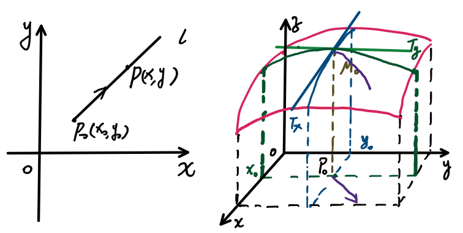
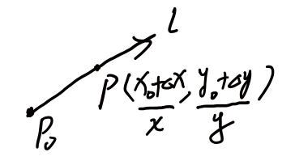
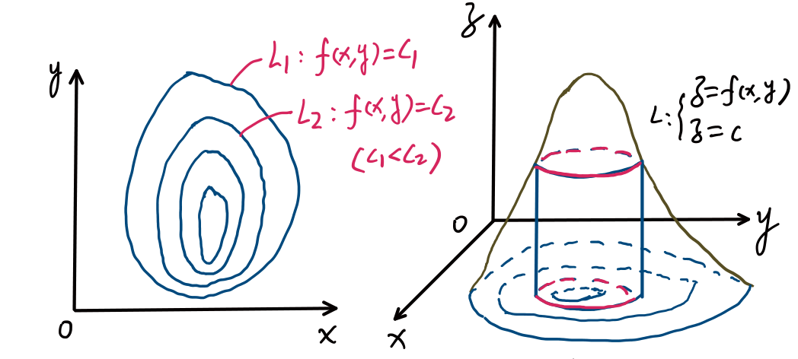
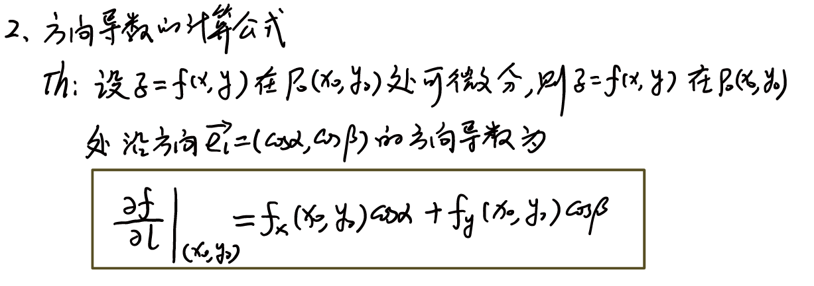
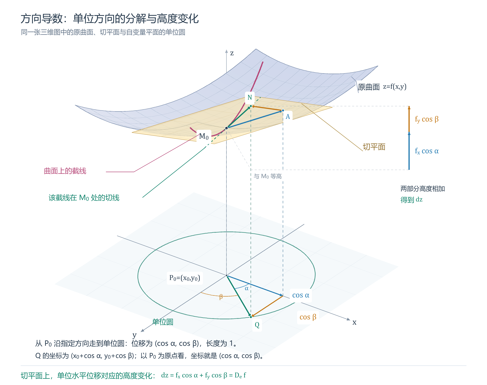

**第七节　方向导数与梯度**

### 一、方向导数

$$
\vec e_l=(\cos\alpha,\cos\beta).
$$

------

**老师讲解**

偏导数研究的是沿坐标轴方向的变化率，方向导数研究的是沿任意指定方向的变化率。

对曲面 $z=f(x,y)$，用平面 $y=y_0$ 截它，得到曲线 $z=f(x,y_0)$。该曲线在 $M_0=(x_0,y_0,f(x_0,y_0))$ 处的切线斜率，就是 $f_x(x_0,y_0)$；类似地，用平面 $x=x_0$ 截曲面，得到的交线在该点的切线斜率就是 $f_y(x_0,y_0)$。

**指定的方向位于自变量所在的 $xOy$ 平面内。** 这个方向可以用单位向量 $\vec e_l=(\cos\alpha,\cos\beta)$ 表示，其中 $\alpha,\beta$ 分别是与 $x$ 轴、$y$ 轴正方向的夹角。

------

**我的理解**

αβ分别是与x轴和y轴正方向的夹角。

单位圆上的点可以表示为 $P=(\cos\theta,\sin\theta)$，其中 $\theta$ 是从 $x$ 轴正方向逆时针量起的角。

另一个核心关系是：**单位向量在某条坐标轴上的分量，等于它与该轴正方向夹角的余弦。**

因此，若 $\alpha$、$\beta$ 分别表示向量 $\overrightarrow{OP}$ 与 $x$ 轴、$y$ 轴正方向的夹角，同一个点也可以写成 $P=(\cos\alpha,\cos\beta)$。

由于 $OP=1$，根据勾股定理，有 $\cos^2\alpha+\cos^2\beta=1$。

$P=(\cos\theta,\sin\theta)$是我们之前对单位圆上点的说法，$P=(\cos\alpha,\cos\beta)$这里其实也代表单位圆上的点，当然在这里也代表方向向量。

------

射线 $l$ 的参数方程：

$$
\begin{cases}
x=x_0+t\cos\alpha,\\
y=y_0+t\cos\beta,
\end{cases}
\qquad t\ge0.
$$

$$
P\to P_0\iff |PP_0|\to0,
$$

$$
\begin{aligned}
|PP_0|
&=\sqrt{(x-x_0)^2+(y-y_0)^2}\\
&=\sqrt{(t\cos\alpha)^2+(t\cos\beta)^2}\\
&=\sqrt{t^2}=|t|=t\to0^+.
\end{aligned}
$$

函数的增量：

$$
f(x,y)-f(x_0,y_0)
=f(x_0+t\cos\alpha,y_0+t\cos\beta)-f(x_0,y_0).
$$

**1. 定义**

若

$$
\lim_{t\to0^+}
\frac{f(x_0+t\cos\alpha,y_0+t\cos\beta)-f(x_0,y_0)}t
$$

存在，则称此极限为 $f(x,y)$ 在 $P_0(x_0,y_0)$ 处沿方向 $l$ 的方向导数，记作

$$
\left.\frac{\partial f}{\partial l}\right|_{(x_0,y_0)}.
$$

即

$$
\left.\frac{\partial f}{\partial l}\right|_{(x_0,y_0)}
=\lim_{t\to0^+}
\frac{f(x_0+t\cos\alpha,y_0+t\cos\beta)-f(x_0,y_0)}t.
$$

------

**老师讲解**

**方向导数最后仍然是一个极限：函数的改变量除以自变量的改变量，再让自变量的改变量趋近于零。** 这里的分母 $t$ 是沿指定方向移动的距离。

这个定义里是 $t\to0^+$，即沿指定射线从一侧靠近。这一点在下面比较方向导数和偏导数时尤其重要。

------

**注：方向导数与偏导数的关系。**

一方面：偏导数存在 $\Rightarrow$ 沿 $x$ 轴正向的方向导数存在。

若 $f_x(x_0,y_0)$ 存在，即

$$
\lim_{\Delta x\to0}
\frac{f(x_0+\Delta x,y_0)-f(x_0,y_0)}{\Delta x}
$$

存在。取

$$
\vec e_l=\vec i=(1,0)=(\cos\alpha,\cos\beta),
$$

则

$$
\left.\frac{\partial f}{\partial l}\right|_{(x_0,y_0)}
=\lim_{t\to0^+}\frac{f(x_0+t,y_0)-f(x_0,y_0)}t
=f_x(x_0,y_0).
$$

另一方面：沿 $x$ 轴正向的方向导数存在 $\nRightarrow$ 偏导数存在。

如：

$$
z=\sqrt{x^2+y^2},\qquad P_0(0,0).
$$

$$
\begin{aligned}
z_x(0,0)
&=\lim_{\Delta x\to0}\frac{z(0+\Delta x,0)-z(0,0)}{\Delta x}\\
&=\lim_{\Delta x\to0}\frac{\sqrt{(\Delta x)^2}}{\Delta x}\\
&=\lim_{\Delta x\to0}\frac{|\Delta x|}{\Delta x},
\end{aligned}
$$

不存在。而取

$$
\vec e_l=\vec i=(1,0)=(\cos\alpha,\cos\beta),
$$

则

$$
\left.\frac{\partial z}{\partial l}\right|_{(0,0)}
=\lim_{t\to0^+}\frac{z(0+t,0)-z(0,0)}t
=\lim_{t\to0^+}\frac{|t|}t=1.
$$

------

**老师讲解**

**关键是“双侧极限”和“单侧极限”的区别。** 偏导数定义中的 $\Delta x\to0$ 要求左右两侧趋近时结果相同；方向导数定义中的 $t\to0^+$ 只从指定方向一侧研究。

双侧极限存在，右侧极限当然存在；右侧极限存在，却不能反推出双侧极限存在。反例中 $|\Delta x|/\Delta x$ 从右侧趋近时为 $1$，从左侧趋近时为 $-1$，所以偏导数不存在；但 $t>0$ 时 $|t|/t=1$，所以正向的方向导数存在。

类似地，若对 $y$ 的偏导数存在，则沿 $y$ 轴正向、负向的方向导数都存在。

------

**2. 方向导数的计算公式**

**Th：** 设 $z=f(x,y)$ 在 $P_0(x_0,y_0)$ 处可微分，则 $z=f(x,y)$ 在 $P_0(x_0,y_0)$ 处沿方向 $\vec e_l=(\cos\alpha,\cos\beta)$ 的方向导数为

$$
\boxed{
\left.\frac{\partial f}{\partial l}\right|_{(x_0,y_0)}
=f_x(x_0,y_0)\cos\alpha+f_y(x_0,y_0)\cos\beta
}.
$$

------

**老师讲解**

**这个公式非常重要，容易出计算题，必须记住。** 它把函数在该点的偏导数与指定的方向联系起来：对 $x$ 的偏导数乘以 $x$ 方向分量，对 $y$ 的偏导数乘以 $y$ 方向分量。

证明的已知条件只有“可微分”，所以从可微分的定义入手。回顾全微分：函数增量若能表示为

$$
\Delta z=A\Delta x+B\Delta y+o(\rho),\qquad
\rho=\sqrt{(\Delta x)^2+(\Delta y)^2},
$$

其中 $A,B$ 与 $\Delta x,\Delta y$ 无关，就对应可微；前面已经证明 $A=f_x(x_0,y_0)$、$B=f_y(x_0,y_0)$。

------

**证：** 因为 $z=f(x,y)$ 在 $P_0(x_0,y_0)$ 处可微。

$
\Delta z=A\Delta x+B\Delta y+o(\rho),\qquad
\rho=\sqrt{(\Delta x)^2+(\Delta y)^2}.
$

故

$$
\begin{aligned}
&f(x_0+\Delta x,y_0+\Delta y)-f(x_0,y_0)\\
&\qquad=f_x(x_0,y_0)\Delta x+f_y(x_0,y_0)\Delta y+o(\rho),
\end{aligned}
$$

其中

$$
\rho=\sqrt{(\Delta x)^2+(\Delta y)^2}.
$$

$
\begin{cases}
x=x_0+t\cos\alpha,\\
y=y_0+t\cos\beta.
\end{cases}
$

对应

$$
\Delta x=t\cos\alpha,\qquad \Delta y=t\cos\beta,
$$

$$
\begin{aligned}
\rho
&=\sqrt{(\Delta x)^2+(\Delta y)^2}\\
&=\sqrt{(t\cos\alpha)^2+(t\cos\beta)^2}
=\sqrt{t^2}=t.
\end{aligned}
$$

$$
\begin{aligned}
\left.\frac{\partial f}{\partial l}\right|_{(x_0,y_0)}
&=\lim_{t\to0^+}
\frac{f(x_0+t\cos\alpha,y_0+t\cos\beta)-f(x_0,y_0)}t\\
&=\lim_{t\to0^+}
\frac{f_x(x_0,y_0)t\cos\alpha+f_y(x_0,y_0)t\cos\beta+o(t)}t\\
&=\lim_{t\to0^+}\left(
 f_x(x_0,y_0)\cos\alpha+f_y(x_0,y_0)\cos\beta+\frac{o(t)}t
\right)\\
&=f_x(x_0,y_0)\cos\alpha+f_y(x_0,y_0)\cos\beta.
\end{aligned}
$$

------

**老师讲解**

这里选取的点 $P=(x_0+\Delta x,y_0+\Delta y)$ 就在指定射线上，所以可以把射线的参数方程代入可微定义，得到 $\Delta x=t\cos\alpha$、$\Delta y=t\cos\beta$ 和 $\rho=t$。

除以 $t$ 后，前两项与 $t$ 无关，取极限仍是它们本身；**最后一项 $o(t)/t\to0$，正是高阶无穷小的定义。**

------

**例 1.** 求 $z=xe^{2y}$ 在 $P(1,0)$ 处沿从点 $P(1,0)$ 到点 $Q(2,-1)$ 的方向的方向导数。

**解：** 方向 $l$ 即为 $\overrightarrow{PQ}$ 的方向。
$$
\overrightarrow{PQ}=(1,-1),\qquad
\vec e_l=\left(\frac1{\sqrt2},-\frac1{\sqrt2}\right)
=(\cos\alpha,\cos\beta).
$$

$$
\frac{\partial z}{\partial x}=e^{2y},\qquad
\frac{\partial z}{\partial y}=2xe^{2y},
$$

$$
\left.\frac{\partial z}{\partial x}\right|_{(1,0)}=1,\qquad
\left.\frac{\partial z}{\partial y}\right|_{(1,0)}=2.
$$

$$
\therefore\quad
\left.\frac{\partial z}{\partial l}\right|_{(1,0)}
=1\cdot\frac1{\sqrt2}+2\cdot\left(-\frac1{\sqrt2}\right)
=-\frac1{\sqrt2}.
$$

------

**老师讲解**

**求方向导数，就围绕两个目标去做：求该点的偏导数，求指定方向的单位向量。**

从 $P$ 到 $Q$，方向向量用“终点减起点”：$\overrightarrow{PQ}=(2-1,-1-0)=(1,-1)$。然后每个分量都除以向量的模 $\sqrt2$，得到单位向量。它的两个分量就是公式中的 $\cos\alpha$、$\cos\beta$。熟练以后，不必再特意写这两个方向余弦符号。

再求偏导函数，把指定点的坐标代入，最后与相应的方向分量相乘并相加。**不能把未单位化的 $(1,-1)$ 直接当作公式中的单位方向。**

------

**推广：** $u=f(x,y,z)$，$\vec e_l=(\cos\alpha,\cos\beta,\cos\gamma)$。

$$
\left.\frac{\partial f}{\partial l}\right|_{(x_0,y_0,z_0)}
=\lim_{t\to0^+}
\frac{f(x_0+t\cos\alpha,y_0+t\cos\beta,z_0+t\cos\gamma)-f(x_0,y_0,z_0)}t.
$$

$$
\boxed{
\begin{aligned}
\left.\frac{\partial f}{\partial l}\right|_{(x_0,y_0,z_0)}
={}&f_x(x_0,y_0,z_0)\cos\alpha\\
&+f_y(x_0,y_0,z_0)\cos\beta
+f_z(x_0,y_0,z_0)\cos\gamma.
\end{aligned}
}
$$

------

**补充说明**

三元计算公式同样以函数在该点可微为前提，方向向量须为单位向量，因此

$$
\cos^2\alpha+\cos^2\beta+\cos^2\gamma=1.
$$

------

**例 2.** 求 $f(x,y,z)=xy+yz+zx$ 在 $(1,1,2)$ 处沿方向 $l$ 的方向导数，其中 $l$ 的方向角分别为 $60^\circ,45^\circ,60^\circ$。

**解：**
$$
\alpha=\frac\pi3,\qquad \beta=\frac\pi4,\qquad \gamma=\frac\pi3,
$$

$$
\vec e_l=(\cos\alpha,\cos\beta,\cos\gamma)
=\left(\frac12,\frac{\sqrt2}2,\frac12\right).
$$

$$
\begin{aligned}
f_x&=y+z,& f_x(1,1,2)&=3,\\
f_y&=x+z,& f_y(1,1,2)&=3,\\
f_z&=y+x,& f_z(1,1,2)&=2.
\end{aligned}
$$

$$
\therefore\quad
\left.\frac{\partial f}{\partial l}\right|_{(1,1,2)}
=3\cdot\frac12+3\cdot\frac{\sqrt2}2+2\cdot\frac12
=\frac12(5+3\sqrt2).
$$

### 二、梯度

**1. 定义**

设 $z=f(x,y)$ 在平面 $D$ 内具有一阶连续偏导数，引入向量

$$
f_x(x_0,y_0)\vec i+f_y(x_0,y_0)\vec j,
$$

此向量称为 $f(x,y)$ 在 $P_0(x_0,y_0)$ 处的梯度。

记作 $\operatorname{grad}f(x_0,y_0)$ 或 $\nabla f(x_0,y_0)$。

即

$$
\begin{aligned}
\operatorname{grad}f(x_0,y_0)
&=\nabla f(x_0,y_0)\\
&=f_x(x_0,y_0)\vec i+f_y(x_0,y_0)\vec j\\
&=\bigl(f_x(x_0,y_0),f_y(x_0,y_0)\bigr).
\end{aligned}
$$

注：

$$
\nabla f(x_0,y_0,z_0)
=\bigl(f_x(x_0,y_0,z_0),f_y(x_0,y_0,z_0),f_z(x_0,y_0,z_0)\bigr).
$$

------

**老师讲解**

**梯度是一个向量，既有大小，也有方向。** $f_x\vec i+f_y\vec j$ 是坐标分解式，$(f_x,f_y)$ 是坐标形式，二者表示的是同一个向量。

三元函数照着二元函数的形式写就可以，多出对 $z$ 的偏导分量。

梯度的定义看上去引入得比较突然；接下来通过它与方向导数的关系，就能看出引入这个向量的意义。

------

**2. 梯度与方向导数关系**

$$
\begin{aligned}
\left.\frac{\partial f}{\partial l}\right|_{(x_0,y_0)}
&=f_x(x_0,y_0)\cos\alpha+f_y(x_0,y_0)\cos\beta\\
&=\bigl(f_x(x_0,y_0),f_y(x_0,y_0)\bigr)\cdot(\cos\alpha,\cos\beta)\\
&=\operatorname{grad}f(x_0,y_0)\cdot\vec e_l\\
&=|\operatorname{grad}f(x_0,y_0)|\,|\vec e_l|\cos\theta\\
&=|\operatorname{grad}f(x_0,y_0)|\cos\theta,
\end{aligned}
$$

其中 $\theta$ 为 $\operatorname{grad}f(x_0,y_0)$ 与 $\vec e_l$ 的夹角。

① 当 $\theta=0$（方向 $\vec e_l$ 与梯度 $\operatorname{grad}f(x_0,y_0)$ 的方向一致），方向导数取到最大值，且

$$
\left.\frac{\partial f}{\partial l}\right|_{(x_0,y_0)}
=|\operatorname{grad}f(x_0,y_0)|.
$$

② 当 $\theta=\pi$（方向 $\vec e_l$ 与梯度 $\operatorname{grad}f(x_0,y_0)$ 的方向相反），方向导数取到最小值，且

$$
\left.\frac{\partial f}{\partial l}\right|_{(x_0,y_0)}
=-|\operatorname{grad}f(x_0,y_0)|.
$$

③ 当 $\theta=\pi/2$（方向 $\vec e_l$ 与梯度 $\operatorname{grad}f(x_0,y_0)$ 的方向正交），方向导数为 $0$，即

$$
\left.\frac{\partial f}{\partial l}\right|_{(x_0,y_0)}=0.
$$

------

**老师讲解**

方向导数的计算公式可以写成两个向量的**数量积**。前一个向量就是梯度，后一个向量就是指定方向的单位向量。

回顾数量积：$\vec a\cdot\vec b=|\vec a|\,|\vec b|\cos\theta$。因为 $|\vec e_l|=1$，所以方向导数等于“梯度的模乘以夹角的余弦”。

当方向与梯度一致，夹角为 $0$，$\cos\theta=1$ 取得最大值，方向导数就是梯度的模；当方向与梯度相反，夹角为 $\pi$，方向导数就是负的梯度模；当二者垂直，方向导数为 $0$，表示该点沿这个方向的变化率为零。

**沿梯度方向增加最快，沿梯度反方向减少最快。** “沿梯度的方向”就是指定方向与梯度向量同向。

方向导数为零，仅表示该点的瞬时一阶变化率为零，不能据此认为沿该直线走一段距离后函数始终不变。

------

**3. 梯度与等值线的关系**

$$
L:\begin{cases}z=f(x,y),\\z=c,\end{cases}
\qquad
L_1:f(x,y)=c_1,\quad L_2:f(x,y)=c_2,\quad c_1<c_2.
$$

$L^*:f(x,y)=c$ 称为 $z=f(x,y)$ 的等值线。

$$
P_0(x_0,y_0)\in L^*,\qquad
\text{法向量}\quad\vec n=\bigl(f_x(x_0,y_0),f_y(x_0,y_0)\bigr).
$$

$z=f(x,y)$ 在 $(x_0,y_0)$ 处梯度

$$
\nabla f(x_0,y_0)=\bigl(f_x(x_0,y_0),f_y(x_0,y_0)\bigr).
$$

由此说明 $f(x,y)$ 在 $(x_0,y_0)$ 处的梯度方向就是 $f(x,y)=c$ 在该点处的法线方向 $\vec n$，且

$$
|\nabla f(x_0,y_0)|=\frac{\partial f}{\partial n}.
$$

------

**我的理解**

缺少的一些证明：

$P_0(x_0,y_0)\in L^*,\qquad
\text{法向量}\quad\vec n=\bigl(f_x(x_0,y_0),f_y(x_0,y_0)\bigr).$这个法向量是怎么求出来的呢？

切平面对应的方程：

$z-z_0=f_x(x_0,y_0)(x-x_0)+f_y(x_0,y_0)(y-y_0)$。

**等值线就是高度保持为 $z_0$ 的那条曲线。** 用水平面 $z=z_0$ 去切曲面，得到等值线，该水平面与切平面的交线就是切线，所以在切平面方程中代入 $z-z_0=0$。（等值线的切线本质上也是该点在曲面上沿着某一个方向的切线，该切线一定在切平面上，那显而易见，直接用$z=z_0$这个平面直接去截取切平面就能得到切线了）。

就得到这条切线的方程：$f_x(x_0,y_0)(x-x_0)+f_y(x_0,y_0)(y-y_0)=0$。

这条切线方程的两个系数分别为 $A=f_x(x_0,y_0)$、$B=f_y(x_0,y_0)$。当 $B\ne0$ 时，切线斜率是 $-\dfrac{A}{B}$，因此可以取切线方向向量 $(1,-\dfrac{A}{B})$。

而 $(A,B)\cdot(1,-\dfrac{A}{B})=0$，说明 $(A,B)$ 与切线垂直，所以法向量可以取：$\vec n=(f_x(x_0,y_0),f_y(x_0,y_0))$此时我们发现正好就等于梯度向量$\nabla f(x_0,y_0)$

法向量只要求垂直，因此全部变号后的 $-\vec n$ 也仍然是法向量。我们这里直接将其与梯度联系起来，就取了$\vec n$这个方向。

------

**老师讲解**

**等值线有很具体的实际意义。** 研究水温、气温、地温时，它是等温线；研究地形地貌时，它是等高线；研究降水量时，它是等降水量线。

把图看成一座山的等高线图，稀疏的地方高度变化缓慢，稠密的地方高度变化快。老师用爬山作比喻：喜欢刺激、攀岩，可以选择稠密的一侧；游玩拍照，则可以选择稀疏、较平缓的一侧。

再把图看成一块中心温度较高的铁板的等温线图。如果铁板上有只蚂蚁，为了尽快逃离高温，它该往哪里跑？**沿当前位置梯度的反方向。** 因为梯度方向是温度增加最快的方向，负梯度方向才是温度减少最快的方向，不能把二者记反。

二元函数有等值线，三元函数还有等值面的概念，这里不再展开。

------

**例 3.** 求 $\displaystyle\operatorname{grad}\frac1{x^2+y^2}$。

**解：** 令 $\displaystyle f(x,y)=\frac1{x^2+y^2}$。

$$
f_x=-\frac{2x}{(x^2+y^2)^2},\qquad
f_y=-\frac{2y}{(x^2+y^2)^2}.
$$

$$
\therefore\quad
\operatorname{grad}\frac1{x^2+y^2}
=-\frac{2x}{(x^2+y^2)^2}\vec i
-\frac{2y}{(x^2+y^2)^2}\vec j.
$$

------

**例 4.** 设 $f(x,y,z)=x^3-xy^2-z$，$P_0(1,1,0)$，问 $f(x,y,z)$ 在 $P_0$ 处沿什么方向变化最快，在这个方向的变化率多少？

**解：**

$$
\begin{aligned}
\nabla f
&=f_x\vec i+f_y\vec j+f_z\vec k\\
&=(3x^2-y^2)\vec i-2xy\vec j-\vec k.
\end{aligned}
$$

$$
\nabla f(1,1,0)=2\vec i-2\vec j-\vec k.
$$

$f(x,y,z)$ 在 $P_0$ 处沿 $\nabla f(1,1,0)$ 方向增加最快，且变化率为

$$
|\nabla f(1,1,0)|=\sqrt{2^2+(-2)^2+(-1)^2}=3.
$$

$f(x,y,z)$ 在 $P_0$ 处沿 $-\nabla f(1,1,0)$ 方向减少最快，且变化率为

$$
-|\nabla f(1,1,0)|=-3.
$$

------

**例 5.** 设 $u=2xy+z^2$，求 $u$ 在 $(2,-1,1)$ 处的方向导数的最大值。

**解：**

$$
u_x=2y,\qquad u_y=2x,\qquad u_z=2z.
$$

$$
\therefore\quad
\left.u_x\right|_{(2,-1,1)}=-2,\qquad
\left.u_y\right|_{(2,-1,1)}=4,\qquad
\left.u_z\right|_{(2,-1,1)}=2.
$$

$$
\therefore\quad\nabla u(2,-1,1)=-2\vec i+4\vec j+2\vec k.
$$

方向导数的最大值为

$$
|\nabla u(2,-1,1)|=\sqrt{(-2)^2+4^2+2^2}=2\sqrt6.
$$

------

### 我的整体理解

------

**我的理解**

这里的几何意义要好好理解：

之前已经了解过导数和偏导数的意义： **在该点的切线或切平面这个线性模型上，** 自变量x变化单位 1 时，因变量对应变化 $\dfrac{dy}{dx}$ 或 $\dfrac{\partial y}{\partial x}$。同样，方向导数就是沿指定方向，自变量每变化单位长度 1 时，因变量对应变化多少。

设函数在 $(x_0,y_0)$ 处可微。以 $(x_0,y_0)$ 为圆心，在 $xOy$ 平面内画一个单位圆，从圆心沿指定方向指向圆周。这个单位方向与 $x$、$y$ 轴正方向的夹角分别为 $\alpha$、$\beta$，因此，它在两个坐标方向上的分量就是 $\cos\alpha$、$\cos\beta$。

以圆心为原点看，圆周上这个点的坐标就是 $(\cos\alpha,\cos\beta)$。也就是说，沿指定方向的单位位移，可以分解为沿 $x$ 方向移动 $\cos\alpha$，沿 $y$ 方向移动 $\cos\beta$。

在切平面上，分别用这两个分量乘以对应的偏导数，就得到两部分高度变化；利用全微分的线性关系，将它们相加，便得到方向导数：

$\dfrac{\partial f}{\partial l}=f_x(x_0,y_0)\cos\alpha+f_y(x_0,y_0)\cos\beta$。

